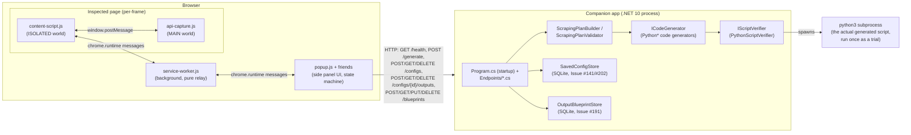
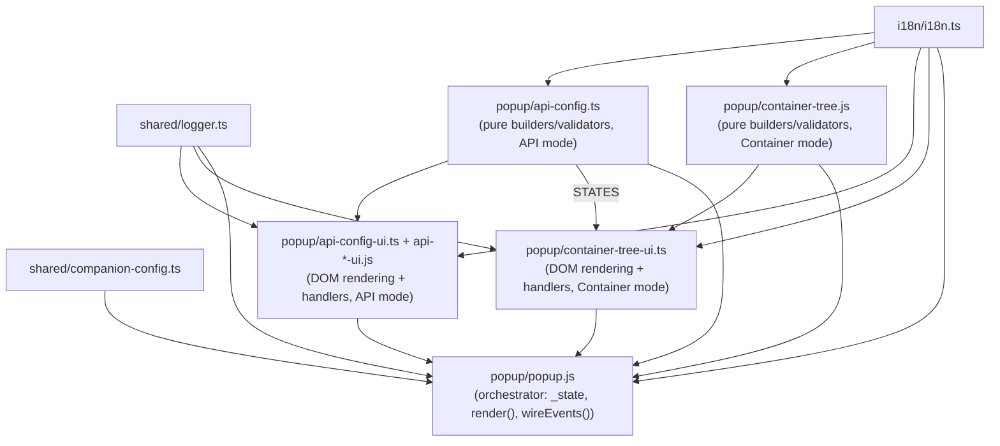
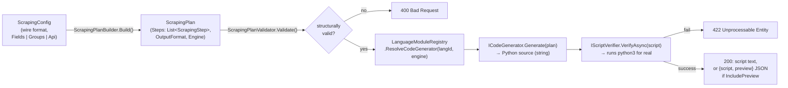
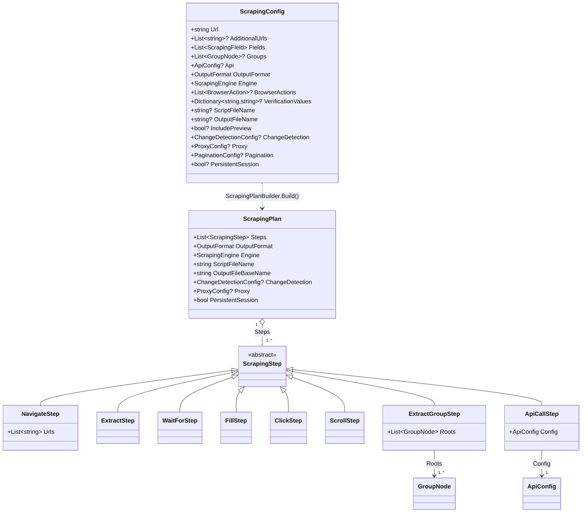
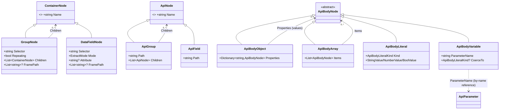
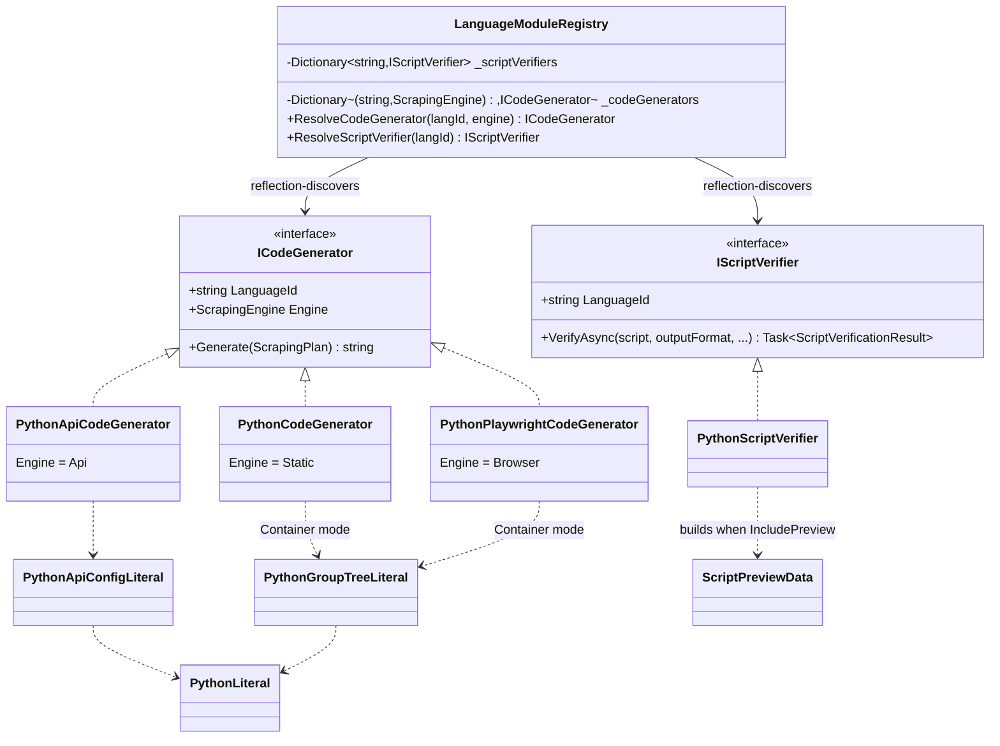
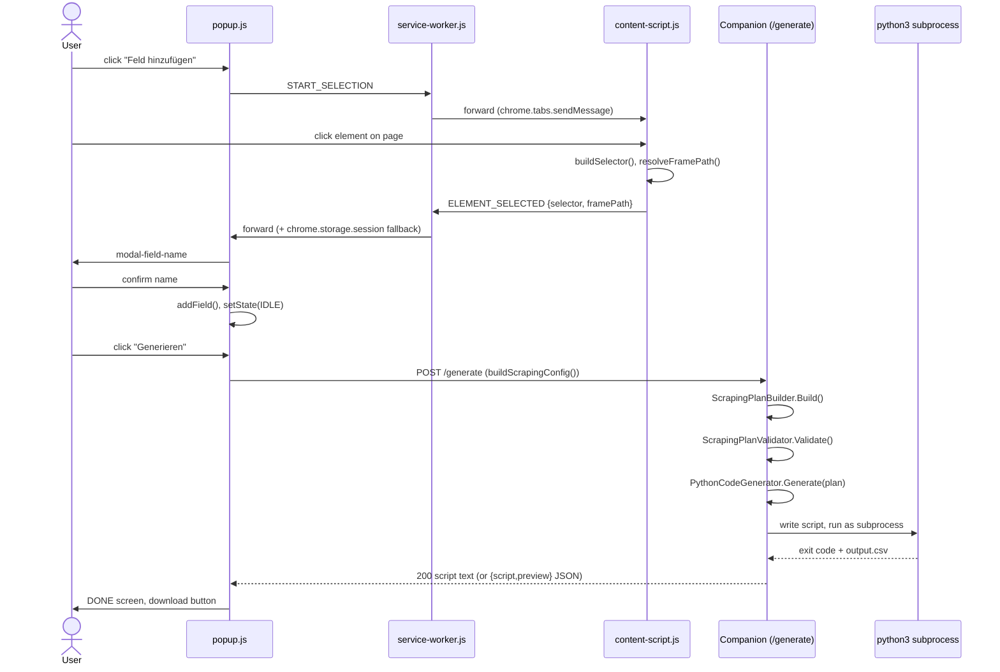

# Scraping Factory — Architecture & Developer Reference

This document is the map of the codebase: how the system is put together, which files
implement which feature, and how the pieces reference each other across the
extension/companion boundary. It's meant to answer three recurring questions:

1. **Reviewing a PR** — does this change fit the existing layering, and did it touch
   every place a change of this shape usually needs to touch?
2. **Planning a new feature** — which layer does it belong in, and what does it
   interact with?
3. **Briefing an implementation** — which exact files should a change start from?

It deliberately does not re-explain *why* individual decisions were made — the
cross-cutting rules and architecture decisions are in `CLAUDE.md`, and the behavior,
edge cases and reasoning of each feature are in `docs/design-notes/`. This document is
the structural map. When in doubt, this doc tells you *where*, the design notes tell
you *why it works the way it does*.

Contents:

1. [System Architecture](#1-system-architecture)
2. [Feature Catalog](#2-feature-catalog--implementing-files)
3. [Class & Module Relationship Model](#3-class--module-relationship-model)
4. [Change Recipes](#4-change-recipes--where-a-typical-request-lands)

---

## 1. System Architecture

Scraping Factory has two runtime halves that only ever talk over a local HTTP
connection — there is no shared process, shared memory, or native messaging:

The companion's HTTP surface is wired in `Program.cs` (services, middleware, `/health`, `/whoami`) and implemented in
`companion/ScrapingFactory.Companion/Endpoints/`: `ConfigEndpoints.cs` (`/configs`, outputs, `replay-hardening`),
`BlueprintEndpoints.cs`, `TransformPresetEndpoints.cs` and `GenerateEndpoint.cs` (+ `.Combined.cs`, `.Blocks.cs`: the
mode-exclusivity checks and the three `/generate` handlers). The trial-run skip rules live in
`Compiler/Backends/VerificationPolicy.cs`. `ScrapingPlanValidator` is one `partial` class in `Compiler/IR/`
(`ScrapingPlanValidator.cs` sequences the checks; `.Settings`, `.BrowserSteps`, `.Shapes`, `.Fields`, `.Output`,
`.Hardening`, `.Blocks` and `.Api*` hold the per-area checks). Below, "in `Program.cs`" for an endpoint or an
outer-request rejection means the matching `Endpoints/` file.

### 1.1 The extension has three separate JS execution contexts

| Context | File(s) | Runs where | Can reach |
|---|---|---|---|
| Content script (isolated world) | `extension/content/content-script.js` | Once per frame of the inspected page (`all_frames: true`) | The page's DOM (but not its JS globals); `chrome.runtime` |
| Network recorder (MAIN world) | `extension/content/api-capture.js` | Once per frame, injected at `document_start`, before the page's own scripts run | The page's real `window.fetch`/`XMLHttpRequest` (needed to patch them); **not** `chrome.runtime` |
| Background service worker | `extension/background/service-worker.js` | Once per browser session | `chrome.tabs`, relays messages; has no page/DOM access itself |
| Side panel UI | `extension/popup/popup.html` + its scripts | Once per open panel | `chrome.runtime`, `chrome.storage`, `fetch` to the companion |

The content script and the MAIN-world recorder are two different JS realms that
happen to share one `window` — they can only talk via `window.postMessage`, never
via a shared variable or direct function call. The service worker cannot talk to a
content script directly either; it must go through `chrome.tabs.sendMessage`, and a
content script/panel replies via `chrome.runtime.sendMessage`. The service worker
(`extension/background/service-worker.js`) is intentionally a pure relay — it holds
no feature logic, just a `FORWARD_TO_TAB` allow-list and a couple of pull-based
request/response bridges (`GET_LOGS`, `GET_API_CAPTURE_ENTRIES`, `CHECK_ROBOTS_TXT`).

### 1.2 The side panel is a single state machine, split across files for size

`extension/popup/popup.js` owns one module-level `_state` object and a `STATES`
enum (`CHECKING_COMPANION → IDLE ⇄ SELECTING`, `IDLE → API_CONFIG`, `IDLE →
GENERATING → DONE`). Every state transition goes through `setState`/`patchState`,
which re-renders the whole visible screen from scratch (`render()`) — there is no
partial/virtual-DOM diffing. `setState` also persists selected state fields to
`chrome.storage.session` (see `persistState()`) so the panel survives being closed
mid-configuration; `chrome.storage.local` is used instead for the two settings that
should survive a full browser restart (UI language, a custom companion URL — see
`extension/i18n/i18n.ts` and `extension/shared/companion-config.ts`).

Because `popup.js` had grown past ~3800 lines, mode-specific logic was split out
into sibling files loaded *before* it (see `popup.html`'s script order):

Every file is a plain CommonJS module (`const { ... } = require('./x')`,
`module.exports = { ... }`). Since Issue #389 `extension/build.js` (esbuild) bundles
the popup — `popup/popup.js` is the entry point and `popup.html` has a single
`<script src="popup.js">` — together with the other three contexts (content
script, MAIN-world recorder, service worker) into `extension/dist/`, which is what
"Load unpacked" points at; Jest runs the same sources directly. Module-level names
never collide, so there is no load order to maintain.

`api-config-ui.ts` and `container-tree-ui.ts`'s handler functions take a `bridge`
object (`{ getState, setState, patchState, stopPreviewIfActive, requestDomTree,
showToast }`) as their first parameter instead of closing over `popup.js`'s
`_state` — necessary because `_state` is private to `popup.js` (importing it back
would make a dependency cycle), and because each file is a separate, isolated Jest
module with no shared closure. `api-config.ts` and
`container-tree.ts` need no such bridge: they're pure, DOM-free functions
(build/resolve/insert/remove/serialize tree drafts, no state or DOM access).

**API mode's UI is several modules** (Issue #390: `api-config-ui.ts` had grown to
1,967 lines). `api-config-ui.ts` stays the orchestrator — the API_CONFIG screen's
own render/confirm/cancel, the modals' render and `wireApiConfigEvents`, which calls
each module's `wire…Events(bridge)` in turn — and re-exports every name it used to
export (`api-config-ui-exports.test.js` pins that surface), so `popup.js` and
`idle-screen-ui.ts` import unchanged. The focused modules, none importing
`api-config-ui.ts` (no cycles; `api-config-shared-ui.ts` holds the helpers two of
them share):

| Module | Owns |
| --- | --- |
| `api-capture-ui.ts` | recording toggle, the click-based searches (network, embedded JSON), candidate and recorded-request lists, confirming a candidate |
| `api-response-tree-ui.ts` | response-tree rows, the group and leaf-transforms modals, the JSON-scoped tree search |
| `api-parameters-ui.ts` | URL parts and parameter-source cards (value list, discovery endpoint, range) |
| `api-browser-discovery-ui.ts` | the BrowserDiscoverySource action editor (its listener branches are called by `api-parameters-ui.ts`) |
| `api-request-ui.ts` | captured-header table, POST body tree and its "new parameter" modal |
| `api-config-shared-ui.ts` | `patchApiConfigDraft`/`patchApiConfigSource`, the parameter-placeholder picker |

These DOM-free `<feature>.js` modules are also exactly the ones opted into
JSDoc type checking (Issue #238; the design notes in `docs/design-notes/extension.md` cover it) — a
leading `// @ts-check` pragma plus `extension/tsconfig.json`
(`npm run typecheck`, wired into CI) against two type modules under
`extension/types/`, imported as namespaces: `SFWire` (`wire.ts`, a hand-kept mirror of the
companion's wire-format IR) and `SFDraft` (`drafts.ts`, this popup's
own internal pre-serialization shapes, e.g. `container-tree.ts`'s tree
nodes). `checkJs` stays off project-wide — the DOM-rendering `<feature>-ui.js`
files and `popup.js` itself aren't annotated (yet).
Two more type modules describe the side panel itself: `types/popup.ts` (`State`, the
shape of `popup.js`'s `_state`; `Screen`; `PopupBridge`, what every `<feature>-ui`
module receives as `bridge`) and `types/messages.ts` (`PopupInboundMessage`, the
messages the content script and service worker send to `message-router.ts`).

### 1.3 The companion pipeline: wire format → canonical IR → codegen → real execution

Everything the extension sends is `ScrapingFactory.Compiler.IR.ScrapingConfig` —
described in full in `CLAUDE.md`'s Architecture Decisions §1. `Endpoints/GenerateEndpoint.cs`'s
`/generate` endpoint runs it through a fixed pipeline, and **every** stage after
`ScrapingPlanBuilder` only ever sees the canonical `ScrapingPlan`, never the wire
format directly:

Three things are always true about this pipeline and are worth keeping in mind for
any change:

- **The wire format never gains a new top-level extraction concept without a
  matching new `ScrapingStep` subtype.** `Fields` → `ExtractStep` (many),
  `Groups` → `ExtractGroupStep` (one, wrapping a whole tree), `Api` →
  `ApiCallStep` (one, wrapping `ApiConfig`). All three are mutually exclusive,
  enforced in `Endpoints/GenerateEndpoint.cs` before `ScrapingPlanBuilder` ever runs.
- **`ScrapingPlanValidator` runs before any subprocess is spawned.** It only
  catches structural issues that are wrong regardless of runtime behavior
  (bad URL, empty/duplicate names, `FramePath` without `Engine=Browser`, a
  `RangeSource` value that doesn't match its own format). It deliberately never
  validates CSS-selector or JSON-path *syntax/compatibility* — that's an accepted
  limitation (`CLAUDE.md`'s Architecture Decision §3) proven only by real
  execution.
- **Verification is real execution, not a simulation.** `PythonScriptVerifier`
  writes the generated script to a temp directory and runs it via `python3`/
  `python`, then reads back `output.csv`/`output.xml`/`output.json`. This is why a separate
  Playwright-/AngleSharp-based verification path was rejected (`CLAUDE.md`'s
  "Consistency Rule") — only real execution can catch encoding issues, selector
  incompatibilities, and network errors the way the eventual downloaded script
  would hit them too.

### 1.4 The "mode × engine" matrix

Two largely-orthogonal axes run through the whole system:

- **Mode** (what shape the extracted data has): `Fields` (flat) | `Groups`
  (nested tree, forces `OutputFormat.Xml`) | `Api` (forces `Engine.Api`;
  `OutputFormat` then depends on the *response* shape — flat `ItemsPath`/`Fields`
  → `Csv`, tree `Groups` → `Xml`). Any forced default yields to an explicit
  `OutputFormat.Json` request (Issue #86) — Json fits a flat record list just
  as well as `Csv` and a tree just as well as `Xml`.
- **Engine** (how the page is fetched/rendered): `Static` (requests +
  BeautifulSoup) | `Browser` (Playwright + Chromium) | `Api` (plain `requests`,
  forced by API mode regardless of what the wire payload sent). Browser-only
  `BrowserAction`s (`WaitFor`/`Fill`/`Click`/`Scroll`) run before extraction
  **regardless of mode** — a login flow works the same whether the eventual
  extraction is flat, container, or (in principle) API.

Each `(LanguageId, Engine)` pair resolves to exactly one `ICodeGenerator` via
`LanguageModuleRegistry`'s reflection scan; mode is a further branch *inside* each
generator (flat template vs. `_grouped` template), not a separate registry
dimension — see §3.1 for the full class picture.

---

## 2. Feature Catalog — implementing files

For each feature: a plain-language explanation of what it does (for anyone
orienting themselves, not just implementers), followed by the exact file set that
implements it. For behavioral detail (edge cases, validation rules, why a design
choice was made), see the matching section of `docs/design-notes/` — the file lists below
are deliberately terse.

### 2.1 Flat field scraping (original v1 mode)

Click an element on the page → get a CSS selector → name it → repeat → generate a
CSV-producing script.

- Extension: `popup/popup.js` (`_state.fields`, `addField`/`removeField`,
  `renderFields`, `confirmField`), `content/content-script.js` (`buildSelector`,
  `startSelection`/`onClick`)
- Companion: `IR/ScrapingConfig.cs` (`ScrapingField`), `IR/ScrapingStep.cs`
  (`ExtractStep`), `IR/ScrapingPlanBuilder.cs`, `Backends/Python/PythonCodeGenerator.cs`,
  `Backends/Python/PythonPlaywrightCodeGenerator.cs`
- Templates: `language-modules/python/templates/scraper.py.j2`,
  `playwright_scraper.py.j2`

### 2.2 Container mode (nested, repeating groups → XML)

Lets the user model repeating, nested structures on a page — e.g. a list of
product cards, each with its own sub-fields, possibly containing further nested
lists — as a tree of named "container" (group) and "field" nodes, instead of one
flat list of fields. The generated script walks the same tree at runtime and
writes the result as XML instead of CSV, since a tree doesn't fit CSV's flat
column model.

- Extension: `popup/container-tree.js` (pure tree helpers), `popup/container-tree-ui.ts`
  (tree editor UI, modals), `popup/popup.js` (`_state.groups`, `_state.mode ===
  'container'`), `content/content-script.js` (`scopeSelector`/`scopeRoot` support
  in `startSelection`/`buildSelector`, `matchGroupTree` for the DOM preview)
- Companion: `IR/ContainerNode.cs` (`GroupNode`/`DataFieldNode`),
  `IR/ContainerNodeJsonConverter.cs`, `IR/ScrapingStep.cs` (`ExtractGroupStep`),
  `IR/ScrapingPlanBuilder.cs`/`ScrapingPlanValidator.cs`,
  `Backends/Python/PythonGroupTreeLiteral.cs`, `PythonCodeGenerator.cs`/
  `PythonPlaywrightCodeGenerator.cs` (their `ExtractGroupStep` branch)
- Templates: `scraper_grouped.py.j2`, `playwright_scraper_grouped.py.j2`

### 2.3 API mode — base (Issue #53: URL params, value sources, headers)

Instead of scraping rendered HTML, records the page's own background JSON API
calls while the user browses, lets them click a value they want and matches it
against the recorded responses to find which request/JSON-path produced it, then
turns the varying parts of that request's URL (query parameters, path segments)
into configurable parameters — each backed by a fixed value, a manually entered
list, a second "discovery" request, or a computed range (e.g. the last N ISO
weeks) — so the generated script can call the API directly, once per parameter
combination, without ever touching the HTML.

- Extension: `popup/api-config.ts` (URL decomposition, value-source builders,
  `buildApiConfig`), `popup/api-config-ui.ts` (API_CONFIG screen rendering +
  handlers, recording UI), `content/api-capture.js` (MAIN-world fetch/XHR patch),
  `content/content-script.js` (`findApiCandidates`, `deriveItemsAndValuePath`,
  robots.txt-adjacent JSON-path helpers)
- Companion: `IR/ApiConfig.cs` (`ApiConfig`, `ApiParameter`, `ApiParameterSource`
  variants, `ApiHeader`), `IR/ScrapingStep.cs` (`ApiCallStep`),
  `IR/ScrapingPlanBuilder.cs`/`ScrapingPlanValidator.cs`,
  `Backends/Python/PythonApiCodeGenerator.cs`, `PythonApiConfigLiteral.cs`,
  `RangeFormat.cs`, `PythonLiteral.cs`
- Templates: `scraper_api.py.j2`

### 2.4 API mode — nested JSON responses (Issue #54)

Extends API mode (§2.3) to API responses that nest more than one repeating level
— e.g. `categories[*].subcategories[*].products[*]` — by letting the response be
modeled as a tree of groups/fields (each group scoped to a JSON path resolved
relative to its parent) instead of a single flat record list, mirroring Container
mode's own tree editor. Output becomes XML instead of CSV once a tree is used, for
the same reason Container mode's tree output is XML.

- Extension: `popup/api-config.ts` (`ApiGroup`/`ApiField` draft
  build/insert/remove/serialize), `popup/api-response-tree-ui.ts` (`renderApiTree`,
  `buildApiTreeNodeEl`, sub-group/sub-field search flows), `content/content-script.js`
  (`deriveApiTreeSkeleton`, `resolveApiGroupScopePath`-adjacent `pathStartsWithScope`)
- Companion: `IR/ApiConfig.cs` (`ApiConfig.Groups`, `ApiNode`/`ApiGroup`/`ApiField`),
  `IR/ApiNodeJsonConverter.cs`, `ScrapingPlanValidator.cs` (`ValidateApiNodes`),
  `Backends/Python/PythonApiConfigLiteral.cs` (`RenderGroups`),
  `PythonApiCodeGenerator.cs` (its `api.Groups` branch)
- Templates: `scraper_api_grouped.py.j2`

### 2.5 API mode — POST/GraphQL request bodies (Issue #55)

Extends API mode (§2.3) to POST requests, including GraphQL, by additionally
capturing the outgoing request body and showing it as an editable tree: any value
in that body can be marked "fixed" (kept as recorded) or "variable" (bound to a
new or already-declared parameter, the same parameter mechanism a URL placeholder
already uses). GraphQL needs no special handling of its own — its `query`/
`variables` body is just an ordinary nested object this generic mechanism already
covers.

- Extension: `popup/api-config.ts` (`jsonValueToBodyDraft`, body-tree
  update/reference/serialize helpers), `popup/api-request-ui.ts`
  (`buildBodyTreeNodeEl`/`renderBodyTree`, body-parameter modal wiring),
  `content/api-capture.js` (`requestBody`/`requestBodySkipped` capture)
- Companion: `IR/ApiBodyNode.cs` (`ApiBodyObject`/`Array`/`Literal`/`Variable`),
  `IR/ApiBodyNodeJsonConverter.cs`, `IR/ApiConfig.cs` (`Method`, `Body`),
  `ScrapingPlanValidator.cs` (`ValidateApiBodyNode`),
  `Backends/Python/PythonApiConfigLiteral.cs` (`RenderBody`)
- Templates: `scraper_api.py.j2` and `scraper_api_grouped.py.j2` (`METHOD`/`BODY`
  constants, `_render_body`/`_coerce_body_value`)

### 2.5a API mode — embedded JSON source (Issue #136)

Extends API mode (§2.3) to sites that render their complete data into the
initial page HTML (Next.js `__NEXT_DATA__`, Nuxt `__NUXT__`, a generic
`<script type="application/json">` state blob) and hydrate the DOM from it
client-side, with no separate, capturable network request ever happening —
`content/api-capture.js`'s recorder has nothing to correlate against in this
case. A second, recording-free candidate source (`findEmbeddedJsonCandidates`)
scans `document.scripts` directly at click time and reuses §2.3's own
`findValueInJson`/`siblingFields`/`deriveApiTreeSkeleton` unchanged — they're
pure functions over already-parsed JSON, agnostic to where it came from. The
companion fetches the page via `requests` and extracts the identified
`<script>` tag via BeautifulSoup instead of parsing a live JSON response body;
`ItemsPath`/`Fields`/`Groups` extraction is otherwise identical to an ordinary
API-mode request (fetch-mechanism-agnostic by design).

- Extension: `content/content-script.js` (`findEmbeddedJsonCandidates`,
  `scriptTagSelector`), `popup/api-capture-ui.ts`
  (`startEmbeddedJsonFieldSearch`, `confirmEmbeddedJsonFieldCandidate`,
  `renderApiCandidates`'s `candidate.scriptSelector` branch), `popup/api-config.ts`
  (`buildApiConfig`'s `embeddedJsonSource` param)
- Companion: `IR/ApiConfig.cs` (`ApiConfig.EmbeddedJsonSource`,
  `EmbeddedJsonSource`), `ScrapingPlanValidator.cs` (`ValidateApiConfig`'s
  `EmbeddedJsonSource` block), `Backends/Python/PythonApiConfigLiteral.cs`
  (`RenderEmbeddedJsonSource`), `PythonApiCodeGenerator.cs`
  (`embedded_json_source`/`embedded_json_source_literal`)
- Templates: `scraper_api.py.j2` and `scraper_api_grouped.py.j2`
  (`EMBEDDED_JSON_SOURCE` constant, `_extract_embedded_json`)

### 2.5b API mode — token/auth bootstrap value (Issue #220)

For JSON APIs that only answer with a short-lived credential (bearer token,
signed URL parameter, nonce) obtained from a separate login/token request. The
generated script sends that one bootstrap request at the start of every run —
before any parameter is resolved — extracts a single value via a JSON path,
and splices it into the main request's headers (an `ApiHeader.Template` such as
`"Bearer {token}"`), its URL (`{token}` in `UrlTemplate`), a discovery request's
template, or a body variable. Deliberately *not* an `ApiParameter`: parameter
values become output columns and appear in "Skipped (404)" lines, and a live
credential must reach neither (the script also masks it in every URL it
prints). Credentials in the bootstrap request's own body/headers are env-var
names only; `/generate`'s trial run takes one-time test values for them via
`verificationValues` (§2.6's Issue #43 mechanism). The API_CONFIG screen's
"Take from recording" button adopts a recorded login request wholesale and
auto-detects the token's JSON path by finding the response value the main
request actually sends.

- Extension: `popup/api-bootstrap.js` (pure draft/wire logic:
  `bootstrapDraftFromCaptureEntry`, `detectTokenInResponse`,
  `wireTokenIntoMainRequest`, `buildApiBootstrap`, `resolveBootstrapUrlParts`,
  `buildBootstrapVerificationValues`), `popup/api-bootstrap-ui.ts` (the
  section's render/wiring, recording picker), `popup/api-config.ts`
  (`buildApiConfig`'s `bootstrap` param, `buildApiHeaders`'s `'bootstrap'`
  mode, the Apply gate), `popup/api-request-ui.ts` (header "From token" mode),
  `popup/api-parameters-ui.ts` (the "Token value" URL-part source),
  `popup/api-config-ui.ts` (`confirmApiConfig`),
  `popup/companion-client.ts` (bootstrap test values → `verificationValues`),
  `popup/screens/api-config.html` (`#api-bootstrap-section`)
- Companion: `IR/ApiConfig.cs` (`ApiConfig.Bootstrap`, `ApiBootstrap`,
  `ApiBootstrapBodyField`, `ApiBootstrapBodyEncoding`, `ApiHeader.Template`),
  `ScrapingPlanValidator.cs` (`ValidateApiBootstrap`, `ValidateApiHeaders`'s
  template check, bootstrap name accepted as a placeholder),
  `IR/FillVerificationValues.cs` (bootstrap env vars accepted),
  `Backends/Python/PythonApiConfigLiteral.cs` (`RenderBootstrap`, template
  headers), `PythonApiCodeGenerator.cs` (`has_bootstrap`/`bootstrap_literal`)
- Templates: `scraper_api.py.j2` and `scraper_api_grouped.py.j2` (`BOOTSTRAP`,
  `_run_bootstrap`, `_redact_bootstrap`, `EXIT_BOOTSTRAP_FAILED = 6`)
- Tests: `ApiBootstrapValidatorTests.cs`, `ApiBootstrapEndToEndTests.cs`,
  `api-bootstrap.test.js`, `api-bootstrap-ui.test.js`; real-browser check
  `e2e/examples/issue-220-api-token-bootstrap-check.js` against the
  `test-pages/api-token-bootstrap` fixture

### 2.5c API mode — cursor/token-based pagination (Issue #224)

For JSON APIs whose next page's identifier only appears in the *current*
page's response (Relay's `pageInfo.endCursor`, a `next_page_token`). A
sequential fetch loop inside each parameter combination — deliberately not an
`ApiParameter`, whose values are enumerated up front and become output
columns. Page 1 is sent exactly as configured; from page 2 on the previous
page's cursor goes to a fixed target: a query parameter, or a dot path inside
the POST body (`variables.after` for GraphQL). The chain ends when no cursor
is returned, an optional has-more flag is falsy, a cursor repeats, or
`MaxPages` is reached. Works for the flat and the tree response shape. The
"Detect from recording" button reads the recorded response/request for
cursor-looking keys. The `Link`-header sibling is §2.5d.

- Extension: `popup/api-cursor-pagination.js` (pure draft/wire logic:
  `cursorDraftIsComplete`, `buildApiCursorPagination`,
  `detectCursorSuggestion`), `popup/api-cursor-pagination-ui.ts` (the
  section's render/wiring), `popup/api-config.ts` (`buildApiConfig`'s
  `cursorPagination` param, the Apply gate), `popup/api-config-ui.ts`
  (`confirmApiConfig`, `sourceEntryId` on the draft),
  `popup/screens/api-config.html` (`#api-cursor-section`)
- Companion: `IR/ApiConfig.cs` (`ApiConfig.CursorPagination`,
  `ApiCursorPagination`, `ApiCursorTarget`), `ScrapingPlanValidator.cs`
  (`ValidateApiCursorPagination`), `Backends/Python/PythonApiConfigLiteral.cs`
  (`RenderCursorPagination`), `PythonApiCodeGenerator.cs`
  (`cursor_pagination_enabled`/`cursor_pagination_literal`)
- Templates: `scraper_api.py.j2` and `scraper_api_grouped.py.j2`
  (`_fetch_page_data`, `_fetch_pages`, `CURSOR_PAGINATION`, `_apply_cursor`,
  `_next_cursor`)
- Tests: `ApiCursorPaginationValidatorTests.cs`,
  `ApiCursorPaginationEndToEndTests.cs`, `api-cursor-pagination.test.js`,
  `api-cursor-pagination-ui.test.js`; real-browser check
  `e2e/examples/issue-224-api-cursor-pagination-check.js` against the
  `test-pages/api-cursor-pagination` fixture (REST `?cursor=` and GraphQL
  `variables.after`, 7 items over 4 pages, port 9000)

### 2.5d API mode — Link-header pagination (Issue #321)

For REST APIs that announce the next page in the HTTP
`Link: <url>; rel="next"` response header (GitHub, GitLab, WordPress) instead
of the body. A sibling of §2.5c, not a kind of it, and mutually exclusive with
it. Page 1 is sent as configured; every further page is the URL the previous
response's `Link` header names, requested with the same headers. The chain
ends when no next link is left, a link repeats, a link points to another host
(never followed — the headers may carry credentials), or `MaxPages` is
reached. GET only; flat and tree shapes. The recorder keeps only a
`hasNextLink` boolean per entry, so the API_CONFIG screen can suggest the
option.

- Extension: `content/api-capture.js` (`hasNextLinkRel`), `content/content-script.js`
  (`hasNextLink` on candidates), `popup/api-link-pagination.js` (pure),
  `popup/api-link-pagination-ui.ts`, `popup/api-config.ts`,
  `popup/screens/api-config.html` (`#api-link-section`)
- Companion: `IR/ApiConfig.cs` (`ApiConfig.LinkHeaderPagination`,
  `ApiLinkHeaderPagination`), `ScrapingPlanValidator.cs`
  (`ValidateApiLinkHeaderPagination`), `PythonApiCodeGenerator.cs`
  (`link_pagination_enabled`/`link_pagination_max_pages`)
- Templates: `fragments/api_fetch.py.j2` (`_fetch_pages` variant,
  `_next_link_url`, `_origin_of`)
- Tests: `ApiLinkHeaderPaginationTests.cs`, `api-link-pagination*.test.js`,
  `e2e/examples/issue-321-api-link-pagination-check.js`

### 2.6 Browser engine, browser actions & login flows (Issues #41/#42/#43)

Adds an optional Playwright-based rendering engine (real Chromium, executes the
page's own JavaScript) as an alternative to the default `requests`-only static
engine, for pages whose content only appears after client-side rendering. On top
of that, a generic, ordered list of "browser actions" — wait for an element, fill
a form field, click, or scroll/click a "load more" button — lets the user
assemble things like a login flow (fill username/password → click submit → wait
for the result) or trigger lazy-loaded content, all executed once before
extraction runs, with no dedicated login-specific UI.

- Extension: `popup/popup.js` (`_state.engine`, `_state.browserActions`,
  `addBrowserAction`/`updateBrowserAction`/`serializeBrowserActions`,
  `renderBrowserActions`, `_state.fillTestValues`/`buildVerificationValues`),
  `content/content-script.js` (cross-frame path resolution: `resolveFramePath`,
  `handleFramePathMessage`, `findIframeSelectorForWindow`, `frameDepth`)
- Companion: `IR/BrowserAction.cs`, `IR/ScrapingStep.cs`
  (`WaitForStep`/`FillStep`/`ClickStep`/`ScrollStep`), `IR/FillVerificationValues.cs`,
  `ScrapingPlanBuilder.cs` (`ToStep`), `ScrapingPlanValidator.cs` (`FramePath`
  validation, browser-only-step gating), `Backends/Python/PythonPlaywrightCodeGenerator.cs`
- Templates: `playwright_navigate_step.py.j2`, `playwright_wait_step.py.j2`,
  `playwright_fill_step.py.j2`, `playwright_click_step.py.j2`,
  `playwright_scroll_step.py.j2`, `playwright_scraper.py.j2`

### 2.7 Trial-run verification (the "Consistency Rule")

Before handing a generated script to the user, the companion actually runs it
once for real — as a subprocess, against the live page/API, in a throwaway
directory — and only returns it if it exits cleanly and produces at least one row
(or XML element). This is what turns "a script that looks plausibly correct" into
"a script proven to work right now, exactly as downloaded" — any failure
(unreachable page, a selector matching nothing, a runtime error) surfaces as a
clear error message instead of a silently broken download.

- Companion: `Backends/Python/PythonScriptVerifier.cs`,
  `Backends/ScriptVerificationResult.cs`, `Backends/IScriptVerifier.cs`,
  `Endpoints/GenerateEndpoint.cs` (the `/generate` handler's verify-then-respond logic)

### 2.7a Generated-script snapshot tests (Issue #386)

Golden files pin the exact text of every generated script, so a change to a
template, a fragment or a code generator is visible as a diff instead of being
discovered by users. This is also the safety net for refactoring the templates
(Issue #395): sharing code between them must leave every snapshot untouched.

- `companion/ScrapingFactory.Tests/SnapshotCases.cs` (base shapes, `All`, `Add`),
  `SnapshotCases.Features.cs` (static/browser flat and container features),
  `SnapshotCases.Api.cs` (API, Blocks, Combined, interaction cases) — a case is
  named wire-format JSON, built from a base shape plus a patch; its id is the
  snapshot file name
- `ScriptSnapshotTests.cs` — renders each case via the real `POST /generate`
  (`skipVerification`, no Python run) and compares byte for byte; also checks for
  orphan snapshot files and that rendering is deterministic
- `SnapshotSupport.cs` — paths, line-ending normalization, update mode
  (`UPDATE_SNAPSHOTS=1`), the failure message
- `SnapshotCoverageTests.cs` — cases may only use properties the IR knows; every
  settable IR property appears in some case or in the documented `NotRendered`
  list; no machine-specific content
- `companion/ScrapingFactory.Tests/Snapshots/*.py` — the golden files;
  `.gitattributes` keeps them LF

Update with `UPDATE_SNAPSHOTS=1 dotnet test companion/ScrapingFactory.sln --filter Snapshot`
and review the diff. Template context keys are not checked separately; the IR
property check is the proxy for "every option reaches a template".

### 2.7b Wire-format mirrors and how each is checked (Issue #388)

Some behavior exists twice, on both sides of the extension/companion boundary. Each copy is pinned by a test that
reads the same data, so changing only one side fails. The shared data lives in `test-vectors/` (see its README).

| Mirror | Extension side | Companion / script side | Checked by |
| --- | --- | --- | --- |
| File-name cleanup | `sanitizeFileNameBase` (`scraping-config-builder.ts`) | `IR/FileNameSanitizer.cs` | `file-name-sanitizer.json` — `scraping-config-builder.test.js`, `FileNameSanitizerTests.cs` |
| Transform previews | `applyTransformsPreview` (`field-transforms.ts`) | `fragments/transforms.py.j2` `_apply_transforms` | `transforms.json` — `transform-vectors.test.js`, `TransformVectorTests.cs` (real helper, imported from a generated script) |
| robots.txt matching | `evaluateRobotsTxt` (`content-script.js`) | `fragments/robots_disallow.py.j2` | `robots.json` — `robots-vectors.test.js`, `RobotsVectorTests.cs` |
| Range formats | `compileRangeFormatPattern` (`api-config.ts`) | `Backends/Python/RangeFormat.cs`, `fragments/api_common.py.j2` | `range-format.json`, `range-expansion.json` — `range-format-vectors.test.js`, `RangeFormatVectorTests.cs` |
| URL-template matching | `findUrlTemplateMatches` (`api-config.ts`) | `_match_url_against_template` (`fragments/api_common.py.j2`) | `url-template.json` — `url-template-vectors.test.js`, `UrlTemplateVectorTests.cs` |
| `:contains("…")` split | `selector-text-filter.ts`, `content-script.js` | `IR/SelectorTextFilter.cs`, `fragments/text_selector_common.py.j2` | `text-selector.json` — both JS tests, `SelectorTextFilterTests.cs` |
| Environment-variable names | `env-var.ts` | `ScrapingPlanValidator` | `env-var-name.json` — `env-var.test.js`, `EnvVarNameVectorTests.cs` |
| The request body | `buildScrapingConfig` and the draft builders | `IR/ScrapingConfig.cs` and `/generate` | `test-vectors/wire/*.json` — `wire-fixtures.test.js` writes/verifies, `WireFixtureTests.cs` deserializes strictly and calls `/generate` |
| TypeScript wire types | `types/wire.ts` | `IR/*.cs` | `IrTypeDeclarationTests.cs` (reflection: property names, required-ness, enum unions) |

**Evaluated and rejected: generating `wire.ts`.** `System.Text.Json`'s `JsonSchemaExporter` handles the
plain properties and the `[JsonPolymorphic]` unions (`hardening`, `pagination`, `transforms`, parameter sources come out
as `anyOf` with a `const kind`), but not the custom converters: container nodes lose their `DataFieldNode` branch
(`children` becomes an untyped array), and API nodes, body nodes and blueprint trees are not described at all. It also
emits JSON Schema, so a second tool would be needed to get TypeScript, and C# `required` does not mean "the extension must
send it". So the file stays hand-written and `IrTypeDeclarationTests` guards it (its first run found a missing
`skipVerification` and an `OutputFormat` without `Sqlite`/`Xlsx`).

Adding a mirror: put the shared cases in `test-vectors/<name>.json`, run them from a Jest test and an xUnit test (the Python
side through `PythonContractHarness`), and add a row to this table. Known, accepted differences are cases with
`appliesTo` and a `note`; for example JavaScript's `\w` is ASCII-only while Python's is Unicode-aware, so a transform
preview can differ from the script for a pattern that depends on that.

### 2.8 Trial-run data preview (Issue #122)

An opt-in checkbox that lets the user see a capped sample (up to 50 rows/elements)
of what the trial run in §2.7 actually scraped — a table for flat/CSV output, a
read-only pretty-printed XML snippet for tree output — directly in the popup,
before ever downloading or running the script themselves.

- Extension: `popup/popup.js` (`_state.includeDataPreview`, `_state.dataPreview`,
  `renderDataPreview`, the `generate()` branch that parses JSON vs. plain text)
- Companion: `IR/ScrapingConfig.cs` (`IncludePreview`),
  `Backends/ScriptPreviewData.cs`, `Backends/Python/PythonScriptVerifier.cs`
  (`BuildCsvPreview`/`BuildXmlPreview`/`ParseCsvLine`), `Endpoints/GenerateEndpoint.cs` (the
  `IncludePreview == true` response branch)

### 2.8a Download the full trial-run output (Issue #161)

A second, independent opt-in checkbox — the complete, uncapped counterpart to
§2.8's capped preview — lets the user download the trial run's actual
`output.csv`/`.xml`/`.json` directly from the `DONE` screen, with no local
Python/Playwright install needed to run the generated script themselves.
`PythonScriptVerifier` reads the raw file text at each of its three success
paths rather than re-deriving it from the already-parsed/capped preview data,
so the download is byte-identical to what the script wrote.

- Extension: `popup/popup.js` (`_state.includeOutputFile`, `_state.outputFile`,
  `triggerOutputFileDownload`, the `btn-download-output` visibility toggle)
- Companion: `IR/ScrapingConfig.cs` (`IncludeOutputFile`),
  `Backends/ScriptVerificationResult.cs` (`OutputFileContent`/`OutputFileName`),
  `Backends/IScriptVerifier.cs`/`Backends/Python/PythonScriptVerifier.cs` (the
  `includeOutputFile` parameter), `Endpoints/GenerateEndpoint.cs` (the widened JSON-envelope
  condition, `outputFile` response key)

### 2.9 robots.txt check

A one-click check of whether the currently inspected page is allowed or
disallowed for generic crawlers according to the target site's own robots.txt —
shown directly in the popup so the user can make an informed decision before
scraping a site, without having to go look the file up themselves.

- Extension: `content/content-script.js` (`parseRobotsTxt`, `evaluateRobotsTxt`,
  `checkRobotsTxt`), `background/service-worker.js` (`CHECK_ROBOTS_TXT` relay),
  `popup/popup.js` (`checkRobotsTxt`, the idle-screen result rendering)
- No companion involvement — entirely client-side.

### 2.10 Companion URL configuration/discovery

Lets the extension find, and if needed be manually pointed at, the companion
app's local HTTP server address — needed when the default `localhost:5000` is
already taken on the user's machine, or when the companion runs on a different
port or even a different host than the browser.

- Extension: `shared/companion-config.ts` (`getCompanionUrl`,
  `setCompanionUrlOverride`), `popup/popup.js` (`checkCompanion`,
  `useCustomCompanionUrl`, `resetCustomCompanionUrl`, the `COMPANION_ERROR` screen)
- Companion: `ScrapingFactory.Companion/CompanionHostOptions.cs`,
  `CompanionBackendOverrides.cs`, `Program.cs` (`builder.WebHost.UseUrls(...)`)

### 2.10a Companion-unreachable guidance (Issue #406)

What the `COMPANION_ERROR` screen tells a user who has no working companion: a
plain-language explanation and the three situations (not installed / installed but
not running / another address or port) with the concrete next step for the user's
OS — in full until a companion has answered once on this browser
(`chrome.storage.local` `companionReached`), as a one-line hint afterwards — plus a
"Why can't it connect?" help popover. See docs/design-notes/extension.md for the behavior details.

- Extension: `popup/companion-guidance.ts` (OS detection, installer commands/paths,
  `likelySituations`, the persisted flag), `popup/companion-guidance-ui.ts`
  (`renderCompanionGuidance`, called from `popup.js`'s `render()`),
  `popup/companion-client.ts` (`checkCompanion` loads/sets the flag and keeps the last
  failure for `getCompanionFailure()`), `#screen-error` in `popup/popup.html`,
  `error.*`/`help.companionError.*` in `i18n/*.json`
- Tests: `popup/companion-guidance.test.js`, `popup/companion-guidance-ui.test.js`,
  real-browser check `e2e/examples/issue-406-companion-guidance-check.js`

### 2.10b Guidance for choosing mode, container type, field type and engine (Issue #398)

#396 help popovers (`help.mode.choice`, `help.engine.choice`, `help.containerType.type`,
`help.fieldType.container|flat`) next to the first decisions of a scrape, a match-count
check after a container pick against the type chosen beforehand, a clickable
"(single)"/"(repeating)" suffix in the container tree, and a "try the Browser engine"
suggestion when a Static trial run returns no data. See docs/design-notes/extension.md for details.

- Extension: `popup/choice-guidance.js` (pure: `containerCountAdvice`,
  `shouldSuggestBrowserEngine`), `popup/toast.ts` (`showMatchCountToast`),
  `popup/message-router.ts`/`popup/session-restore.ts` (pass the chosen type),
  `popup/container-tree-ui.ts` (`.group-tree-type` toggle), `popup/companion-client.ts`
  (`generate()` suggestion), help hosts in `popup/screens/idle.html`/`modals.html`,
  `help.*`/`toast.*`/`group.*` in `i18n/*.json`
- Tests: `popup/choice-guidance.test.js`, real-browser check
  `e2e/examples/issue-398-choice-guidance-check.js`

### 2.10c Plain-language error messages (Issue #401)

A failed Generate shows a translated title and hint (what happened, what to try)
instead of the companion's or script's raw text; the raw text stays behind a
"Details" disclosure (copyable) and is what "Report bug" sends. Recognised by pattern
in `popup/error-messages.js`; unknown errors keep the old wording. See docs/design-notes/extension.md.

- Extension: `popup/error-messages.js` (pure: `classifyError`, `describeError`),
  `popup/toast.ts` (`showErrorToast`, `hideToast`, `wireErrorToastEvents`; sticky toast
  with hint/details/close/copy), `popup/companion-client.ts` (`showGenerateFailure`),
  the toast markup in `popup/popup.html`, `errors.*` in `i18n/*.json`
- Tests: `popup/error-messages.test.js`, real-browser check
  `e2e/examples/issue-401-plain-errors-check.js`

### 2.10d Environment-variable name help and validation (Issue #397)

Every input that takes the *name* of an environment variable (change detection,
proxy, login Fill actions, custom request headers, API headers, the API auth
bootstrap, an API discovery Fill action) shares one explanation popover
(`help.envVar.what`), one inline name validation and one pre-flight check in
`generate()`. See docs/design-notes/extension.md for the conventions (`data-env-var`, `envVarNoteHtml()`).

- Extension: `popup/env-var.js` (pure: `validateEnvVarName`, `findInvalidEnvVarNames`),
  `popup/env-var-ui.ts` (`envVarNoteHtml`, `applyEnvVarValidation`,
  `refreshEnvVarValidation`, `wireEnvVarValidation`), `popup/popup.js` (`render()`),
  `popup/companion-client.ts` (`generate()` guard), the inputs in `popup/screens/idle.html`,
  `api-config.html`, `browser-actions-ui.ts`, `request-headers-ui.ts`, `api-config-ui.ts`,
  `api-bootstrap-ui.ts`, `envVar.*`/`help.envVar.*` in `i18n/*.json`
- Tests: `popup/env-var.test.js`, real-browser check
  `e2e/examples/issue-397-env-var-help-check.js`

### 2.10e Transform helpers: regex recipes and date-format guess (Issue #400)

The "Regex extract" transform gets a **Pattern helper** (recipes: first number, digits,
text after/before/between, text inside brackets — the user's text escaped, only
constructs .NET and Python read the same), and "Convert to date" pre-selects the format
guessed from the picked value. The recipe panel keeps its state in its own DOM; the
transform objects are unchanged. See docs/design-notes/extension.md for the details.

- Extension: `popup/transform-helpers.js` (pure: `buildRecipe`, `previewRecipe`,
  `inferDateFormat`), `popup/transform-helpers-ui.ts`, `popup/field-transforms-ui.ts`
  (`getRawValue` getter through `renderTransformList`/`wireTransformList`),
  `flat-mode-ui.ts`/`container-tree-ui.ts`/`api-config-ui.ts` (raw-value resolvers),
  `transforms.helper.*`/`help.transforms.*` in `i18n/*.json`
- Companion (tests only): `ScrapingFactory.Tests/RegexRecipeEndToEndTests.cs`
- Tests: `popup/transform-helpers.test.js` (incl. Python `re` parity),
  `popup/transform-helpers-ui.test.js`, real-browser check
  `e2e/examples/issue-400-transform-helpers-check.js` (fixture `test-pages/transform-helpers`)

### 2.10f Monitoring / Hardening in plain language (Issue #399)

Labels, help and a preset for the Monitoring section: a one-sentence intro, a
"Warn me" / "Stop the run" severity wording with its own popover (no wire change), one
popover per hardening check, thresholds written as sentences, the rare blocking options
under an "Advanced" disclosure, and a one-click "Recommended checks" preset. See
docs/design-notes/extension.md for the details.

- Extension: `popup/hardening-presets.js` (pure: `applyRecommendedHardening`),
  `popup/settings-panel-ui.js` (button wiring, null-rate row sentences),
  `popup/screens/idle.html` (intro, heading, hosts, sentences, disclosure),
  `idle.hardening*`/`help.hardening.*` in `i18n/*.json`
- Tests: `popup/hardening-presets.test.js`, `popup/hardening-presets-ui.test.js`,
  real-browser check `e2e/examples/issue-399-hardening-plain-language-check.js`

### 2.10n German documentation (Issue #436)

`docs/user/de/*.md` is the German version of the user documentation (same file names, same heading
structure), built next to the English pages; "Learn more" opens the German page when the panel is
German. No wire-format or companion change. See docs/design-notes/extension.md for the details.

- Build: `extension/docs-build.js` (both trees, `anchors.json`, source stamps, `translationStatus`),
  `extension/docs-template/docs.css` (language switch), `install/build-bundle.sh` (both Markdown trees)
- Extension: `popup/docs-links.js` (`resolveDocTarget(key, language, anchors)`), `popup/docs-links-ui.ts`
  (loads `docs/anchors.json` when the panel is German), `common.learnMore`
- Screenshots/checks: `e2e/screenshots/run.js --language de`, `lib.js` (`imagesDirFor`, `word()`),
  `check-docs.js` (both trees, translation status)
- Tests: `docs-build.test.js`, `popup/docs-links.test.js`, `popup/docs-links-ui.test.js`, real-browser check
  `e2e/examples/issue-436-german-docs-check.js`

### 2.10m Pick ids for the pending-selector fallback (Issue #429)

Each element pick carries a `pickId`; the service worker's fallback write stores it, the panel records the
pick it handled, and a restore ignores a stored selector of an already handled pick, so a late write can
no longer reopen a field dialog after a reload. No wire-format or companion change. See docs/design-notes/extension.md.

- Extension: `content/content-script.js` (`pickId`), `background/service-worker.js` (`pendingPickId`),
  `popup/message-router.ts` + `popup/session-restore.ts` (`markPickHandled`, `isLeftoverOfHandledPick`)
- Tests: `popup/session-restore.test.js`, `background/service-worker.test.js`, `content/content-script.test.js`,
  `popup/popup.test.js`, real-browser check `e2e/examples/issue-429-pending-selector-race-check.js`

### 2.10l Bundled documentation and "Learn more" (Issue #354 Part B)

`docs/user/*.md` is built into HTML pages inside the extension (`dist/docs/`), the panel's
long hints became one line each, and "Learn more" links open the bundled page offline. No
wire-format or companion change. See docs/design-notes/extension.md for the details.

- Build: `extension/docs-build.js` (markdown → HTML, link/anchor check, `slugify`),
  `extension/docs-template/docs.css`, `extension/build.js` (`copyDocs`), `install/build-bundle.sh`
  (docs as files in the bundle)
- Extension: `popup/docs-links.js` (key → page#anchor table), `popup/docs-links-ui.ts`
  (links, click, `learnMoreHtml`), `popup/help-popover-ui.ts` (`data-doc` on a help host),
  `popup/screens/*.html`/`popup.html` (the links), `common.learnMore` + shortened `*Hint` texts in `i18n/*.json`
- Tests: `docs-build.test.js`, `popup/docs-links.test.js`, `popup/docs-links-ui.test.js`,
  `i18n/hint-length.test.js`, real-browser check `e2e/examples/issue-354-bundled-docs-check.js`

### 2.10k Terminology pass, Advanced groups and glossary (Issue #407)

Plainer names for the jargon terms (output layout, safety checks, "Alerts & safety checks",
skip-if-unchanged, "Collect from the page", "Remove duplicates"), rarely used options under
remembered "Advanced" groups that open themselves when the option is in use, a 1-based
"Part" in Split field, and a glossary on the Settings screen. Labels and grouping only: no
wire-format, companion or generated-script change. See docs/design-notes/extension.md for the details.

- Extension: `i18n/{de,en,es}.json` (renamed values; keys unchanged), `popup/advanced-defaults.js`
  (pure: does a retry code list / dedup retention differ from its default?),
  `popup/advanced-disclosure-ui.ts` (`autoOpenAdvanced`), `popup/combine-split-fields.ts`
  (`partNumberToIndex`/`indexToPartNumber`), `popup/glossary.js` + `glossary-ui.ts`,
  `popup/screens/{idle,settings,modals}.html`, `help.outputLayout|safetyChecks|preflight|dedup.overview`
- Tests: `popup/advanced-defaults.test.js`, `advanced-groups-ui.test.js`, `glossary.test.js`,
  `combine-split-fields.test.js`, real-browser check `e2e/examples/issue-407-terminology-advanced-check.js`

### 2.10j API mode guidance and JSON-path pickers (Issue #404)

"Pick from the recording" for every JSON-path input (group path, cursor and "has more"
paths, the cursor's body field, the bootstrap token path), "?" popovers for URL parts,
value sources and the body, and the rarely needed options (auth bootstrap, cursor and
Link pagination, browser discovery, value type) under "Advanced". No wire-format or
companion change. See docs/design-notes/extension.md for the details.

- Extension: `popup/json-path-picker.js` (pure tree model + path derivation),
  `popup/json-path-picker-ui.ts` (state-driven panel, loading, wiring),
  `popup/api-cursor-pagination-ui.ts`/`api-bootstrap-ui.ts`/`api-response-tree-ui.ts`
  (buttons and panels), `popup/advanced-disclosure-ui.ts` (`autoOpenAdvanced`),
  `popup/screens/api-config.html`/`modals.html`, `jsonPathPicker.*`/`help.api*` in `i18n/*.json`;
  `content/content-script.js` (`readEmbeddedJson`) + `background/service-worker.js`
  (`GET_EMBEDDED_JSON`)
- Tests: `popup/json-path-picker.test.js`, `json-path-picker-ui.test.js`,
  `api-config-guidance.test.js`, real-browser checks `e2e/examples/issue-404-*.js`

### 2.10i Pagination helpers (Issue #405)

A page-number URL template proposed from a clicked "next"/"page 2" link or a start URL
that already says page 1, the typed "next" selector and the whole "Discover start URLs"
option under "Advanced", and "?" popovers for the pattern and the max-pages limit. The
companion's page-number template now needs only `{page}` for a single start page. See
docs/design-notes/extension.md for the details.

- Extension: `popup/pagination-template.js` (pure derivation), `popup/pagination-ui.ts`
  (banner, pickers, Advanced placement), `popup/message-router.ts`/`session-restore.ts`
  (the clicked link's address), `popup/screens/idle.html`, `idle.pagination*`/
  `help.pagination.*`/`help.discoveredUrls.*` in `i18n/*.json`
- Companion: `IR/ScrapingPlanValidator.cs` (`ValidatePageNumberUrlTemplate`),
  `IR/PaginationConfig.cs` (doc comment)
- Tests: `popup/pagination-template.test.js`, `popup/pagination-ui.test.js`,
  `ScrapingPlanValidatorTests`, `PaginationEndToEndTests`, fixture
  `test-pages/paginated-listing` + `e2e/examples/issue-405-pagination-helpers-check.js`

### 2.10h Login flow guidance for the browser actions (Issue #403)

A "Login form (4 steps)" starter, role-named cards, times in seconds, an overview and
"Max. rounds" popover, and the rarely used options under "Advanced". UI-only: the
wire format and generated scripts are unchanged (a starter action's `role` never
leaves the draft). See docs/design-notes/extension.md for the details.

- Extension: `popup/login-flow.js` (pure: `addLoginFlow`, `msToSecondsText`,
  `secondsTextToMs`), `popup/browser-actions-ui.ts` (cards, starter wiring),
  `popup/api-browser-discovery-ui.ts` (the discovery action editor shares the seconds inputs),
  `popup/advanced-disclosure-ui.ts` (open state applied synchronously),
  `popup/screens/idle.html`, `browserActions.*`/`help.browserActions.*` in `i18n/*.json`
- Tests: `popup/login-flow.test.js`, real-browser check
  `e2e/examples/issue-403-login-starter-check.js`

### 2.10g Request-header picker (Issue #402)

"Send custom request headers" starts from an "Add a header…" picker (Accept-Language,
Referer, User-Agent, Cookie, Authorization, X-Api-Key, Other) instead of an empty
free-text row. Secrets default to an environment variable, a recognised header shows a
plain-language description, and a credential-looking header kept as a fixed value gets a
warning with a one-click switch. No wire-format or companion change. See docs/design-notes/extension.md for
the details.

- Extension: `popup/request-header-presets.js` (pure: presets, `isSecretHeaderName`,
  `suggestHeaderEnvName`), `popup/request-headers.js` (`appendHeaderRow`),
  `popup/request-headers-ui.ts` (picker, notes, warning wiring),
  `popup/screens/idle.html` (`#select-add-request-header`), `popup/popup.css`
  (`.request-header-picker`/`-notes`), `requestHeaderPresets.*`/`help.requestHeaders.picker`
  in `i18n/*.json`
- Tests: `popup/request-header-presets.test.js`, `popup/request-headers.test.js`,
  real-browser check `e2e/examples/issue-402-request-headers-picker-check.js`

### 2.11 i18n (extension UI language)

Lets the user pick the popup's own display language (German/English/Spanish)
from a dropdown, independently of the browser's own UI language — via a small
custom dictionary system rather than the browser's built-in `chrome.i18n`, which
is tied to browser language and can't be switched from inside the extension.

- Extension: `i18n/i18n.ts`, `i18n/de.json`/`en.json`/`es.json`, every popup
  module's `t(...)` calls, `popup.js`'s `applyStaticTranslations`

### 2.11a Help popover and "Advanced" disclosure (Issue #396)

Reusable UI building blocks for explaining an option *at the option* (a short
"?" popover with an optional example, text under `help.<area>.<field>` in the
three dictionaries) and for tucking rarely needed options into a collapsed,
per-section-remembered `
`. See `docs/design-notes/extension.md`
for the conventions and the sync test that enforces them.

- Extension: `popup/help-popover.js` (pure) + `popup/help-popover-ui.ts`
  (`initHelpPopovers`, `wireHelpPopoverEvents`; hosts declared as
  `` in `screens/*.html`),
  `popup/advanced-disclosure.ts` + `popup/advanced-disclosure-ui.ts`
  (`
`, `chrome.storage.local` key `advancedSections`),
  `popup/popup.css` (`.help-btn`, `.help-popover`, `.advanced-disclosure`),
  `help.*`/`common.helpBtn`/`common.advanced` in `i18n/*.json`, wired from
  `popup.js` (`applyStaticTranslations`, `wireEvents`, `init`)
- Tests: `popup/help-popover.test.js`, `popup/help-popover-ui.test.js`,
  `popup/advanced-disclosure.test.js`, `i18n/help-i18n.test.js` (key sync across
  de/en/es and HTML), real-browser check
  `e2e/examples/issue-396-help-popover-check.js`

### 2.12 Bug reporting / structured logging

Collects the ring-buffered recent activity log kept by all three extension
contexts (content script, service worker, popup) into one downloadable and
shareable report, and can pre-fill a GitHub issue with it — so a bug can be
diagnosed from what actually happened, without having to ask the user to
reproduce it live or describe it from memory.

- Extension: `shared/logger.ts` (ring buffer, one instance per JS context),
  `popup/popup.js` (`collectLogs`, `buildBugReport`, `buildGithubIssueUrl`,
  `downloadBugReport`, `reportBug`), `background/service-worker.js`/
  `content/content-script.js` (`GET_LOGS` responders)

### 2.13 DOM tree view & selection-preview highlighting

Two related, optional aids for building a configuration: an expandable tree view
of the page's own DOM shown inside the popup (helps locate an element without
hunting through devtools), and a "preview" toggle that highlights, directly on the
live page, every element the *current* field/group configuration actually matches
right now — so a wrong or too-broad selector is visible immediately, without
running a full trial. Distinct from the *data* preview in §2.8, which shows
scraped values after a real `/generate` trial run, not live DOM matches.

- Extension: `popup/popup.js` (`requestDomTree`, `renderDomTree`,
  `highlightHover`/`highlightSelected`, `startPreview`/`stopPreview`/`togglePreview`),
  `content/content-script.js` (`serializeDomTree`, `computePreviewMatches`,
  `matchFlatFields`/`matchGroupTree`, the preview-overlay drawing functions)
- Single-row hover highlight (Issue #233): hovering one flat field row or
  container tree row highlights just that row's element(s) on the page, in
  green, with no toggle — `popup/hover-highlight.ts` (`buildFlatFieldHighlight`,
  `buildGroupNodeHighlight`, `wireHoverHighlight`, wired from
  `flat-mode-ui.ts`/`container-tree-ui.ts`), `HOVER_HIGHLIGHT`/
  `HOVER_HIGHLIGHT_CLEAR` in `background/service-worker.js`'s
  `FORWARD_TO_TAB`, `content/content-script.js` (`matchHoverHighlight`,
  `showHoverHighlight`/`clearHoverHighlight`, the shared `createHighlightBox`)

### 2.14 Configuration export ("Konfiguration exportieren")

Downloads the current Fields/Groups/Api configuration as a JSON file — byte-for-
byte the same request body `/generate` would receive, plus a timestamp and
extension version — so a user can attach their exact setup to a bug/selector
report instead of describing it by hand.

- Extension: `popup/popup.js` (`buildConfigExport`, `downloadConfigExport`) — reuses
  `buildScrapingConfig` verbatim, no companion involvement

### 2.14a Local saved-configuration history (Issue #141)

The opt-in counterpart to the export above, for a site scraped repeatedly:
"Speichern" persists the current Fields/Groups/Api configuration into a small
local SQLite database on the companion side (one row per save, scoped by the
saved URL's hostname), and the idle screen's "Gespeicherte Konfigurationen"
panel lists/loads/deletes past saves for whichever site the popup is currently
looking at. "Laden" restores everything `buildScrapingConfig` captures
(fields/groups/apiConfig/engine/browserActions/changeDetection/proxy/
pagination/hardening/persistentSession/output settings) except the `url`
itself — the live browser tab's URL always stays authoritative, so loading an
old config never navigates the popup away from the page it's actually
inspecting. Deleting a saved entry is the one destructive action in this popup
that needs an inline confirm (a second click), since it's the one action that's
persisted outside the current session. Purely local/additive — no data ever
leaves the user's machine, same trust boundary as `/generate` itself; an older
companion without `/configs` (or a network hiccup) just leaves the panel
empty, no error shown.

- Extension: `popup/popup.js` (`fetchSavedConfigs`, `saveCurrentConfig`,
  `loadSavedConfig`, `deleteSavedConfig`, `renderSavedConfigsList`,
  `requestDeleteSavedConfig`/`cancelDeleteSavedConfig`), `popup/
  config-import.ts` (`applyConfigToState` — the reverse of
  `buildScrapingConfig`/`buildConfigExport`)
- Companion: `SavedConfigStore.cs` (SQLite-backed, `Host`-scoped lookup —
  the config JSON itself is stored and returned opaquely, never deserialized
  into `ScrapingConfig`), `Endpoints/ConfigEndpoints.cs` (`POST /configs`, `GET
  /configs?url=...`, `GET /configs/{id}`, `DELETE /configs/{id}`)

### 2.14b Persist and browse run outputs (Issue #202)

Links Issue #161's own "download the full trial-run output" to Issue #141's
saved-configuration history above: "Output speichern" on the `DONE` screen
saves the current trial run's actual, complete output (the same content
"Download data" already downloads) into a second SQLite table, linked by
foreign key to an already-saved configuration — so a site scraped repeatedly
can accumulate more than one past result to look back at, instead of only
ever having its most recent download. Each row in the "Saved
configurations" panel gains its own expandable "Outputs" sub-panel listing
that config's own saved outputs (download/delete, same inline-confirm-delete
pattern the config row itself uses). Deleting a saved configuration cascades
to its own saved outputs on the database side (`ON DELETE CASCADE`) rather
than needing the extension/companion application layer to clean them up
first. Storage/browse/download only — evaluating hardening checks against a
saved output is a separate, not-yet-implemented issue (#207).

- Extension: `popup/popup.js` (`saveCurrentOutput`, `fetchSavedOutputs`,
  `toggleSavedConfigOutputs`, `downloadSavedOutput`,
  `requestDeleteSavedOutput`/`cancelDeleteSavedOutput`/`deleteSavedOutput`,
  `renderSaveOutputModal`, `openSaveConfigModal`, `downloadFile` — the
  latter two extracted out of Issue #141/#161's own `btn-save-config` click
  handler and `triggerOutputFileDownload` respectively, for reuse from this
  feature's own modal/download action)
- Companion: `SavedConfigStore.cs` (`SavedOutputs` table, `SavedConfigId`
  foreign key with `ON DELETE CASCADE`, `OpenConnection()` enabling `PRAGMA
  foreign_keys` for every query so that cascade actually fires), `Endpoints/ConfigEndpoints.cs`
  (`POST/GET /configs/{configId}/outputs`, `GET/DELETE
  /configs/{configId}/outputs/{id}`)

### 2.15 Configurable script/output filenames

Lets the user choose the downloaded script's filename and the name of the data
file the generated script writes (instead of always `scraper.py`/`output.csv`),
with invalid characters stripped the same way on both the extension (for the
actual download) and the companion (baked into the script's own "Run: python
X.py" comment) — so the two names shown to the user always agree.

- Extension: `popup/popup.js` (`sanitizeFileNameBase`, the output-settings inputs,
  `triggerDownload`)
- Companion: `IR/FileNameSanitizer.cs`, `IR/ScrapingConfig.cs`
  (`ScriptFileName`/`OutputFileName`), `IR/ScrapingPlan.cs`
  (`ScriptFileName`/`OutputFileBaseName`), every code generator template's
  `# Run: python X.py` comment and `open(...)`/`tree.write(...)` call

### 2.16 Cross-frame (iframe) selector support (`FramePath`, Issue #42)

Lets a selector target an element that lives inside a (possibly cross-origin)
iframe — e.g. a cookie-consent button or an SSO login widget embedded via an
iframe — by recording the chain of iframe selectors from the top document down to
the frame the click happened in, so the generated Playwright script can reach the
same element later via chained frame locators. Static-engine scripts have no
concept of frames at all, so this only applies to the Browser engine (§2.6).

- Extension: `content/content-script.js` (the whole "Cross-frame path resolution"
  section — `resolveFramePath`, `handleFramePathMessage`, `findIframeSelectorForWindow`),
  `popup/popup.js` (`frameBadgeHtml`, `pendingFramePath` threading through every
  confirm handler)
- Companion: `FramePath` properties on `ScrapingField`/`ExtractStep`/`WaitForStep`/
  `FillStep`/`ClickStep`/`ScrollStep`/`GroupNode`/`DataFieldNode`/every
  `BrowserAction` variant, `ScrapingPlanValidator.ValidateFramePath`, every
  Playwright template's frame-locator chaining

### 2.17 Live selector match-count preview (Issue #85)

Existence/quantity feedback ("N elements found") the instant a selector is
picked, instead of only surfacing much later via a full `/generate` round-trip
and trial run (§2.7). Purely client-side — the content script already has the
live DOM in front of it, so it can just ask it directly.

- Extension: `content/content-script.js` (`countSelectorMatches`, called from
  `onClick` alongside `buildSelector`; result travels as `matchCount` on the
  `ELEMENT_SELECTED` message), `background/service-worker.js`
  (`pendingMatchCount` in the same session-storage fallback as
  `pendingSelector`/`pendingFramePath`), `popup/popup.js`
  (`_state.pendingMatchCount`, `renderMatchCountHint` for the flat/container
  field modals, `showMatchCountToast` for container-group creation, which has
  no confirmation modal of its own to show a hint in)
- No companion involvement — entirely client-side.

### 2.18 Per-field data transformations (Issue #84)

An optional, ordered post-processing chain (trim/regex-extract/find-replace/
to-number) applied to a field's raw extracted value before it's written to the
output row — e.g. turning `"Preis: 12,99 €"` into `"12.99"` without the user
hand-editing the generated script. Added independently to all three field
shapes (flat/container/API) since none of them share a common leaf type.

- Extension: `popup/field-transforms.js` (pure data helpers — create/add/
  remove/update/changeKind/move/validate), `popup/field-transforms-ui.ts`
  (DOM rendering + delegated event wiring, shared between `modal-field-name`
  and `modal-field-extended`), `popup/popup.js` (`_state.pendingTransforms`,
  `lastFieldModalSelector` — tells a genuine modal reopen apart from a
  re-render triggered by editing a transform row)
- Companion: `IR/FieldTransform.cs` (`TrimTransform`/`RegexExtractTransform`/
  `ReplaceTransform`/`ToNumberTransform`, polymorphic via an explicit `"kind"`
  tag), `Transforms` on `ScrapingField`/`ExtractStep`/`DataFieldNode`/
  `ApiField`, `Backends/Python/FieldTransformValidator` (regex syntax
  pre-check, mirrors `RangeFormat.ValidateFormat`'s pattern),
  `Backends/Python/PythonFieldTransformLiteral` (the one canonical
  Python-literal serialization, reused by `PythonGroupTreeLiteral`,
  `PythonApiConfigLiteral`, and flat mode's own `TRANSFORMS` dict)
- All six leaf templates (§2.6/§2.3/§2.4's own template list) carry the same
  hand-duplicated `_apply_transforms`/`_to_number` runtime helper pair — see
  the `docs/design-notes/templates.md` for the `_to_number` heuristic's
  documented ambiguity.
- **Live preview** (Issue #143): a hint below the transform list in
  `modal-field-name`/`modal-field-extended` shows what the chain actually
  produces against the picked element's real raw value, updating live as
  steps are added/edited/reordered/removed — entirely client-side, no
  `/generate` round trip. `content-script.js`'s `onClick` collects the
  clicked element's trimmed text and full attribute map
  (`collectElementAttributes`), sent as `rawText`/`attributes` on the same
  `ELEMENT_SELECTED` message the selector/matchCount already travel on;
  `service-worker.js`'s session-storage fallback persists them as
  `pendingRawText`/`pendingElementAttributes` alongside `pendingMatchCount`.
  `field-transforms.ts`'s `applyTransformsPreview`/`toNumberPreview` are a
  hand-kept JS mirror of the Python runtime's own
  `_apply_transforms`/`_to_number` — an invalid-for-JS regex pattern makes
  the preview return `null` (rendered as "preview unavailable") instead of
  throwing.
- **API mode follow-up:** the same editor is also reachable from the
  `API_CONFIG` tree screen (§2.16), via a "Transformieren" button rendered
  next to every leaf `ApiField` row in `popup/api-response-tree-ui.ts`'s
  `buildApiTreeNodeEl` (never for a group node — only a leaf actually
  extracts a value, matching `ApiGroup` having no `Transforms` property on
  the companion side). Opens `modal-api-field-transforms`, reusing the exact
  same `field-transforms.ts`/`field-transforms-ui.ts` editor and
  `_state.pendingTransforms` slot the flat/container modals already use
  (mutually exclusive screens, no conflict); confirming writes the chain
  onto the `ApiField` draft node via `updateApiTreeNode`, and
  `serializeApiTree` omits the key on the wire when the chain is empty
  (mirroring `serializeGroupTree`'s own convention).
- **API mode live preview** (Issue #147): unlike a DOM pick, a tree field
  node has no raw value to preview against once inserted — the only value
  ever available is the one matched at candidate-confirm time.
  `buildApiFieldDraft` (`api-config.ts`) gained an optional `sampleValue`
  (the raw JSON scalar the field/sibling resolved to — `candidate.value` for
  the primary field, or the matching entry's own `.value` in
  `candidate.siblings` for a picked sibling, see `content-script.js`'s
  `siblingFields`) — popup-internal only, never sent to the companion.
  `openApiFieldTransformsModal` converts it into `pendingRawText` the same
  way the Python runtime resolves a value before applying transforms (`""`
  for a real JSON `null`, `undefined`/no-sample maps to `null` so the
  preview stays hidden) and reuses the exact same `renderTransformPreview`
  call flat mode's own modal already makes.

### 2.18a Safe type-conversion transforms (Issue #205)

Three more `FieldTransform` kinds — `ToIntegerTransform`/`ToBooleanTransform`/
`ToDateTransform` — alongside §2.18's original four, added for the same
"guarantee a mapped value is actually a well-formed type" need Output
Blueprints' design surfaced but deliberately left for the transform pipeline
to solve rather than inventing a second, Blueprint-local type system. Unlike
`ToNumberTransform`'s best-effort heuristic coercion, all three are strict —
a value that isn't already well-formed for the target type is a conversion
failure, not an approximation — and share one `OnError`/`DefaultValue`
contract (`TransformErrorMode.KeepOriginal`/`UseDefault`) instead of the
"fail the row" option floated in the issue itself (judged not worth the
row/element-dropping machinery `RequiredFieldsCheck` only built at real cost
for a hardening check that runs once at the very end, not per-transform).

- IR: `IR/FieldTransform.cs` (`ToIntegerTransform`/`ToBooleanTransform`/
  `ToDateTransform`, `enum TransformErrorMode`). `ToDateTransform.SourceFormat`
  reuses `RangeSource.Format`'s own `"{yyyy}"`/`"{mm}"`/`"{dd}"` mini-template
  (`Backends/Python/RangeFormat`) rather than inventing a second syntax —
  `FieldTransformValidator` delegates straight to
  `RangeFormat.ValidateFormat(RangeType.Date, ...)`, and
  `PythonFieldTransformLiteral` resolves an unset format via
  `RangeFormat.Resolve(RangeType.Date, ...)`.
- `Backends/Python/FieldTransformValidator` (same single call site every
  field shape — including the "blocks" feature's own extraction blocks —
  already shares): rejects `OnError == UseDefault` with no `DefaultValue`
  set, and an invalid `SourceFormat`.
- `Backends/Python/PythonFieldTransformLiteral`: `OnError` renders via
  `.ToString()` (`"KeepOriginal"`/`"UseDefault"`), the same PascalCase
  convention `HardeningCheck.Severity` already uses in
  `PythonHardeningLiteral`, so both sides compare the same vocabulary.
- Every template that already carries `_apply_transforms`/`_to_number` (the
  six from §2.6/§2.3/§2.4 plus two more added since by an unrelated feature)
  gains `_to_integer`/`_to_boolean`/`_to_date` runtime helpers and their own
  `_apply_transforms` branches, following the same hand-duplicated-per-
  template convention `_to_number` already established.
  `_to_date` compiles `SourceFormat` the same escape-then-substitute way
  `RangeFormat.CompilePattern` does in C#, and rejects a structurally-
  matching but non-existent calendar date (e.g. `"2026-02-30"`) via
  `datetime.date`'s own `ValueError`.
- Extension: the shared `field-transforms.ts`/`field-transforms-ui.ts`
  editor (§2.18) gains the three kinds directly — no new module, since every
  mode's transform modal already routes through this one editor.
  `toIntegerPreview`/`toBooleanPreview`/`toDatePreview` are hand-kept JS
  mirrors of the three new Python helpers, feeding the existing live preview
  (Issue #143) the same way `toNumberPreview` already does.
- Tests: `FieldTransformJsonTests` (polymorphic (de)serialization),
  `ScrapingPlanValidatorTests` (`OnError`/`SourceFormat` validation),
  `TypeConversionTransformEndToEndTests` (real generated-script runs proving
  each kind's success/failure/onError behavior — the same "black-box
  `PythonScriptVerifier` can't see per-cell values" reasoning
  `HardeningNullRateEndToEndTests` already documents).

### 2.18b Price/currency-to-number transform (Issue #234)

A fourth strict conversion next to §2.18a's three: "Convert price/currency to
number" (`toCurrency`) turns a scraped amount like "Preis: 1.234,56 €",
"£51.77" or "CHF 1'234.50" into a plain decimal string ("1234.56"). Unlike
`toNumber`'s heuristic (which reads a lone "1.234" as 1.234), the user picks
one of four format presets — each written as its own example amount
(`1.234,56`, `1,234.56`, `1 234,56`, `1'234.56`) — so the decimal vs.
thousands separator is never guessed. The first number in the value must
match the preset strictly; fraction digits are kept exactly as scraped (no
float rounding); a mismatch goes through the shared `onError` contract.

- IR: `IR/FieldTransform.cs` (`ToCurrencyTransform`, `"kind": "toCurrency"`,
  `Format`/`OnError`/`DefaultValue`, `SupportedFormats`)
- `Backends/Python/FieldTransformValidator` (preset whitelist, shared
  `UseDefault`-needs-a-value rule), `PythonFieldTransformLiteral`
- Every template carrying `_apply_transforms` (all eight): `_CURRENCY_FORMATS`
  table + `_to_currency`
- Extension: `field-transforms.ts` (`toCurrencyPreview` — hand-kept JS mirror
  of `_to_currency` — plus `CURRENCY_FORMAT_IDS`), `field-transforms-ui.ts`
  (format `<select>`), i18n `transforms.toCurrencyOption`/`transforms.currencyFormat.*`
- Tests: `CurrencyTransformTests.cs` (wire format, validation, real
  generated-script runs for every preset across flat/container/API),
  `extension/popup/to-currency.test.js` (the same cases against the JS
  mirror, plus the editor row), real-browser check
  `e2e/examples/issue-234-to-currency-check.js`

### 2.18c Reusable transform-chain presets (Issue #279)

A transform chain built once can be saved under a name and applied to any
field of any scrape, instead of re-adding each step. Two read-only built-in
presets ("Clean up price", trim + §2.18b's conversion, in two formats) ship
with the extension; the user's own presets live in a small cross-site
companion store, the same way Output Blueprints do (§2.23). Applying appends
a copy of the steps (an existing chain is never replaced).

- Extension: `popup/transform-presets.js` (`BUILTIN_TRANSFORM_PRESETS`,
  `allTransformPresets`, `applyTransformPreset`, `transformChainIsSaveable`),
  `popup/transform-presets-ui.ts` (fetch wrappers, the "Apply preset … / Save
  as preset" controls under all three transform editors, the Settings
  section), `.transform-preset-controls` in `screens/modals.html`,
  `#settings-transform-presets-section` in `screens/settings.html`,
  `bridge.fetchTransformPresets` called from `companion-client.ts`'s health
  check
- Companion: `TransformPresetStore.cs` (`transform-presets.db`), `/transform-presets`
  POST/GET/PUT(rename)/DELETE and `ValidateChain` in `Endpoints/TransformPresetEndpoints.cs`
- Tests: `TransformPresetsEndpointTests.cs`, `extension/popup/transform-presets.test.js`,
  real-browser check `e2e/examples/issue-279-transform-presets-check.js`

### 2.19 Multiple start URLs (Issue #83)

Lets the same Fields/Groups extraction config run against a static,
user-supplied list of start URLs in one script run, instead of exactly one —
results from every URL are combined into a single output file. Applies to
flat and container mode only; API mode already builds its own request URL
from `urlTemplate`/`Parameters` and rejects the combination outright.

- Extension: `popup/popup.js` (`_state.additionalStartUrls`,
  `parseAdditionalUrls` — splits the textarea on newlines and drops blank
  lines, threaded through `buildScrapingConfig`/`buildConfigExport` as
  `additionalUrls`), `popup/popup.html` (`#input-additional-urls`, hidden for
  API mode via the same `_state.mode === 'api'` toggle `#preview-section`
  already uses)
- Companion: `IR/ScrapingConfig.cs` (`AdditionalUrls`, additive/wire-
  compatible), `IR/ScrapingPlanBuilder.cs` (combines `Url` + trimmed,
  non-blank `AdditionalUrls` entries into `NavigateStep.Urls`),
  `IR/ScrapingStep.cs` (`NavigateStep.Urls`, `List<string>` instead of a
  single `Url` — the one breaking change to the canonical `ScrapingPlan`,
  confined to the two code generators below), `IR/ScrapingPlanValidator.cs`
  (validates every entry, identifying a failure by index), `Endpoints/GenerateEndpoint.cs` (the
  `Api`+`AdditionalUrls` `400` guard, same style as the existing Fields/
  Groups/Api mutual-exclusivity checks)
- `Backends/Python/PythonCodeGenerator.cs`/`PythonPlaywrightCodeGenerator.cs`
  read `NavigateStep.Urls` (a list) instead of `.Url`, rendered into each
  template as `URLS` instead of `URL`. `scraper.py.j2`/
  `playwright_scraper.py.j2` loop `main()` over `URLS`, combining every
  URL's rows into one `data` list; `scraper_grouped.py.j2`/
  `playwright_scraper_grouped.py.j2` combine every URL's own `scrape(url)`
  children into one `<Ergebnis>` root, reusing the same sibling-merging
  pattern already used for multiple root groups from a single URL.
  `scraper_api.py.j2`/`scraper_api_grouped.py.j2` (§2.3/§2.4) are untouched.
- Fixes a latent bug surfaced by this change: `playwright_navigate_step.py.j2`
  used to bake the target URL in as a literal, ignoring `scrape(url)`'s own
  parameter — it now emits `page.goto(url, ...)`, which is what makes
  per-URL looping possible for the Browser engine at all.

### 2.19a Pagination (Issue #174)

Classic multi-page pagination (page 1, 2, 3, … via a "next" link or a
page-number URL template) — distinct from infinite-scroll/"load more" on a
single page, already covered by the Scroll browser action (§2.6). Applies to
flat and container mode, both engines; not applicable to API mode, which
already has its own page-parameter mechanism via a Number `RangeSource`
(§2.3). Composes with §2.19's own Multiple start URLs: each start URL
paginates onward independently, entirely inside the generated script's own
`scrape()` function, so `main()`'s existing multi-URL loop needs no changes.

- Extension: `popup/popup.js` (`_state.pagination`, `buildPaginationConfig`
  — mirrors `buildProxyConfig`'s own "incomplete draft = toggle-off"
  convention — threaded through `buildScrapingConfig`/`buildConfigExport`),
  `popup/popup.html` (`#pagination-config` inside the collapsible Settings
  section, hidden for API mode via `#pagination-toggle-row`)
- Companion: `IR/PaginationConfig.cs` (`NextLinkPagination`/
  `PageNumberPagination`, `[JsonPolymorphic]` "kind" tag, both with a
  `MaxPages` safety cap), `IR/ScrapingConfig.cs`/`IR/ScrapingPlan.cs`
  (`Pagination`, mode-independent, carried through unchanged by
  `IR/ScrapingPlanBuilder.cs` for the Fields/Groups branches only),
  `IR/ScrapingPlanValidator.cs` (`MaxPages > 0`, a non-blank
  `NextLinkSelector`, or — reusing the same `UrlTemplatePlaceholderPattern`
  API mode's own `UrlTemplate` validation already uses — that
  `PageNumberPagination.UrlTemplate` references both `{url}` and `{page}`),
  `Endpoints/GenerateEndpoint.cs` (the `Api`+`Pagination` `400` guard, same style as
  `Api`+`AdditionalUrls`)
- `Backends/Python/PythonPaginationLiteral.cs` (`BuildContext`, mirrors
  `PythonProxyLiteral`/`PythonChangeDetectionLiteral` exactly — always emits
  every field regardless of kind), wired into all four non-API codegen call
  sites in `PythonCodeGenerator.cs`/`PythonPlaywrightCodeGenerator.cs`
- Templates: `scraper.py.j2`, `playwright_scraper.py.j2`,
  `scraper_grouped.py.j2`, `playwright_scraper_grouped.py.j2` — `scrape(url)`
  restructured into a loop (page 1 unchanged; further pages via
  `NEXT_LINK_SELECTOR`'s `href` or `PAGINATION_URL_TEMPLATE.format(url=url,
  page=page_number)`, stopping on an empty page, `PAGINATION_MAX_PAGES`, or a
  vanished next-link selector). The two Playwright templates reuse the same
  browser/page session across paginated pages (`page.goto` for page 2+)
  rather than relaunching; the full action sequence (login flow etc.) still
  runs only once, for page 1.

### 2.20 Change detection + notification (Issue #87)

Lets the generated script compare each run's output against the previous
run's and notify (email or webhook) only when something actually changed —
mode-independent (Fields/Groups/Api alike). No companion-side diffing logic
at all; the companion only validates the config and renders the right
literals, the actual diff/notify happens entirely at runtime inside the
generated script.

- Extension: `popup/popup.js` (`_state.changeDetection`,
  `buildChangeDetectionConfig` — converts the editable draft into the wire
  shape, returning `null` when disabled or a *required* env-var-name field
  is still blank, threaded through `buildScrapingConfig`/`buildConfigExport`
  as `changeDetection`), `popup/popup.html` (`#toggle-change-detection`,
  Email/Webhook method buttons, one text input per env-var name — every
  field is a name the user types, mirroring `FillAction`'s own
  `environmentVariableName` input, never a fixed/conventional name)
- Companion: `IR/ChangeDetectionConfig.cs` (`ChangeDetectionConfig`/
  `EmailNotificationConfig`/`WebhookNotificationConfig`, additive/wire-
  compatible), `IR/ScrapingPlan.cs` (`ChangeDetection`, carried through
  unchanged by `IR/ScrapingPlanBuilder.cs` in all three shape branches — no
  forcing/translation needed), `IR/ScrapingPlanValidator.cs` (notify method,
  matching sub-config present, every env-var name valid),
  `Backends/Python/PythonChangeDetectionLiteral.cs` (`BuildContext` — the
  one `change_detection.*` Scriban context object every one of the six
  templates renders from, always emitting all seven possible fields
  regardless of which method is active)
- All six templates gain an `OUTPUT_PATH` constant and, when enabled, a
  `_read_previous_output`/`_notify_email`/`_notify_webhook`/`_notify_change`
  helper set wrapped around the existing write logic: read the previous
  output before writing the new one, write as always, then diff the two via
  `difflib.unified_diff` — a notification fires only on an actual
  difference, never on the first run (no previous file yet = baseline
  only), which also means this path never executes during `/generate`'s
  trial-run verification (always a fresh temp directory). Email uses
  `smtplib` with opportunistic STARTTLS (`server.has_extn("starttls")`);
  webhook uses `urllib.request` — both stdlib-only. A notification failure
  is caught and printed as a warning, never re-raised, since the current
  run's own output was already written successfully by that point.
- Tests: `ChangeDetectionEndToEndTests.cs` runs the real generated script as
  a raw subprocess twice in one shared, test-controlled directory (unlike
  `PythonScriptVerifierTests`, which always uses a fresh temp directory per
  call — the reason this couldn't just be a `PythonScriptVerifier` test),
  proving a genuine cross-run diff actually triggers delivery for both
  methods (webhook via the existing `LocalTestServer`, email via a new
  `LocalSmtpTestServer` — a minimal fake SMTP server that never advertises
  STARTTLS, exercising the generated script's own "upgrade only if offered"
  logic for real).

### 2.21 Proxy support (Issue #88)

Lets the generated script route its outbound requests through proxies the
user already has access to, instead of connecting directly — mode-
independent (Fields/Groups/Api alike). The extension/companion never see a
literal proxy address, only the name of an environment variable holding a
comma-separated list; the generated script resolves and rotates through it
entirely at runtime, mirroring how `ChangeDetectionConfig` (Issue #87)
already keeps credentials env-var-name-only.

- Extension: `popup/popup.js` (`_state.proxy`, `buildProxyConfig` —
  converts the editable draft into the wire shape, returning `null` when
  disabled or the env-var-name field is still blank, threaded through
  `buildScrapingConfig`/`buildConfigExport` as `proxy`), `popup/popup.html`
  (`#toggle-proxy`, one text input for the env-var name, right below the
  change-detection block, same `environmentVariableName`-only pattern as
  `FillAction`)
- Companion: `IR/ProxyConfig.cs` (`ProxyConfig`, a single required
  `EnvironmentVariableName`, additive/wire-compatible), `IR/ScrapingPlan.cs`
  (`Proxy`, carried through unchanged by `IR/ScrapingPlanBuilder.cs` in all
  three shape branches), `IR/ScrapingPlanValidator.cs` (env-var name valid),
  `Backends/Python/PythonProxyLiteral.cs` (`BuildContext` — the one
  `proxy.*` Scriban context object every one of the six templates renders
  from, mirroring `PythonChangeDetectionLiteral`). All three code
  generators extend their `needs_os_import`/`NeedsOsImport` checks with a
  configured `Proxy`, since the generated script reads the proxy list via
  `os.environ.get(...)` too. `Backends/Python/PythonScriptVerifier.cs`
  treats a generated script's dedicated `EXIT_MISSING_ENV_VAR` (78) exit
  code as compatible with success (falls through to the normal "did it
  produce data" check instead of failing immediately like any other
  nonzero code); only combined with no output file at all (the `FillStep`
  case, see below) does it short-circuit with the script's own clean
  stderr message.
- All six templates gain, when enabled, a `PROXY_ENV_VAR` constant plus a
  duplicated `_next_proxy()` helper (the env var's comma-separated value
  parsed into a list, cycled round-robin via `itertools.cycle`). The
  static/API engines (`requests`) wire a `_proxies_for_requests()` helper
  (`{"http": p, "https": p}`) into every `requests.get`/`requests.post`
  call site, including the API templates' discovery-source request; the
  browser engine (Playwright) instead parses the picked URL via
  `urllib.parse.urlsplit` into Playwright's `{"server", "username",
  "password"}` proxy shape (`_next_playwright_proxy()`) and passes it to
  `p.chromium.launch(proxy=...)`. A missing env var no longer raises a raw
  `KeyError` — it's read via `os.environ.get(...)`, prints a German warning
  to stderr, and is treated the same as an empty/blank value ("no proxies
  configured", direct connection); the run is still flagged via a shared
  `EXIT_MISSING_ENV_VAR = 78` sentinel once `main()` otherwise completes
  successfully (also used by `FillStep`'s `_require_env` helper in the two
  Playwright templates, replacing its own former raw `os.environ[...]`
  read — a missing credential there is still a hard stop, just with a
  clean message instead of an unhandled traceback).
- Tests: `ProxyEndToEndTests.cs` runs the real generated static-engine
  script as a subprocess against a new `LocalHttpProxyTestServer` — a
  minimal raw-socket fake forward proxy (mirroring `LocalSmtpTestServer`'s
  style) that records every request line it receives and answers with its
  own canned body, proving both that a request actually routes through the
  configured proxy (the real target's content never reaches the output) and
  that round-robin rotation picks a different proxy per request across
  multiple start URLs.

### 2.21a Pause between requests (Issue #222)

An opt-in, mode- and engine-independent pause before every outbound request
of the generated script (fixed, or random within a range), as protection
against rate limits and blocks. Measured as a minimum gap between request
starts; the first request isn't delayed. Each pause is announced on stdout,
which the trial-run verifier uses to extend its deadline by exactly that
pause — so many requests never make `/generate` time out (capped at 10
minutes of pauses).

- IR: `IR/RequestDelayConfig.cs` (`ScrapingConfig.RequestDelay`/
  `ScrapingPlan.RequestDelay`), validation in `ScrapingPlanValidator`,
  Combined-mode outer-config rejection in `Endpoints/GenerateEndpoint.Combined.cs`
- `Backends/Python/PythonRequestDelayLiteral` (`request_delay.*`), wired in
  `PythonScrapingContextBuilder` and `PythonApiCodeGenerator`
- Templates: all eight request-making templates — `_pace_request()` before
  every request / page navigation
- `Backends/Python/PythonScriptVerifier.RunScriptAsync`
  (`PauseAnnouncementPattern`, `MaxRequestDelayExtension`, moving deadline)
- Extension: `scraping-config-builder.ts` (`buildRequestDelayConfig`),
  `config-import.ts` (`applyRequestDelayConfig`), `settings-panel-ui.js`,
  `#toggle-request-delay`/`#request-delay-config` in `screens/idle.html`
- Tests: `RequestDelayTests.cs`, `extension/popup/request-delay.test.js`,
  real-browser check `e2e/examples/issue-222-request-delay-check.js`

### 2.21aa Respect robots.txt Crawl-delay (Issue #228)

An opt-in, independent setting making the generated script read the target's
robots.txt once and use its `Crawl-delay` / `Request-rate` as a minimum gap
between requests — one more source for the pacing mechanism of 2.21a (the
larger of this and a configured pause wins). A site without such a directive
is unaffected. Disallow re-checking is the separate option of 2.21ab2 below.

- IR: `ScrapingConfig.RespectRobotsDelay`/`ScrapingPlan.RespectRobotsDelay`,
  Combined-mode outer-config rejection in `Endpoints/GenerateEndpoint.Combined.cs`
- `Backends/Python/PythonRequestDelayLiteral` (now takes the plan:
  `respect_robots`, `robots_urls_literal`)
- Fragment `request_delay.py.j2` (`_robots_delay`, `_fetch_robots_delay`,
  `urllib.robotparser`); the fetch itself is `fragments/robots_fetch.py.j2`,
  shared with 2.21ab2
- Extension: `scraping-config-builder.ts` (`respectRobotsDelay` option), `config-import.ts`, `session-restore.ts`,
  `settings-panel-ui.js`, `#toggle-respect-robots-delay` in `screens/idle.html`
- Tests: `RobotsCrawlDelayTests.cs`, `extension/popup/robots-crawl-delay.test.js`,
  fixture `test-pages/crawl-delay` +
  `e2e/examples/issue-228-robots-crawl-delay-check.js`

### 2.21ab2 Check robots.txt Disallow at run time (Issue #333)

An opt-in setting making the generated script evaluate every request it is
about to make against the target's robots.txt at run time — the extension's
"Check robots.txt" is advisory and runs once. A disallowed request is
skipped (default), warned about, or stops the run (exit code 9). RFC 9309
matching (own evaluator: group of the `ScrapingFactory` agent else `*`,
longest pattern wins, ties Allow, `*`/`$`), robots.txt fetched once per origin
and shared with 2.21aa. Covers start URLs, further pages, discovered URLs,
downloads, the preflight HEAD and API/discovery requests; not browser
subresources, the auth bootstrap or browser-discovery sessions.

- IR: `IR/RobotsDisallowConfig.cs` (`ScrapingConfig.RobotsDisallow`/
  `ScrapingPlan.RobotsDisallow`), Combined-mode outer-config rejection in
  `Endpoints/GenerateEndpoint.Combined.cs`
- `Backends/Python/PythonRobotsDisallowLiteral` (`robots_check.*`), wired in
  `PythonScrapingContextBuilder` and `PythonApiCodeGenerator`
- Fragments: `robots_fetch.py.j2`, `robots_disallow.py.j2` (included from
  `request_delay.py.j2`); `_robots_gate` guards in the `main_*` fragments, the
  static page loops, the Browser pagination, preflight/discovery/download
  fragments and `api_fetch.py.j2`/`api_common.py.j2`
- Extension: `scraping-config-builder.ts` (`robotsDisallow` option),
  `config-import.ts` (`applyRobotsDisallowConfig`), `session-restore.ts`,
  `settings-panel-ui.js`, `#toggle-robots-disallow` in `screens/idle.html`
- Tests: `RobotsDisallowTests.cs`, `RobotsDisallowEndpointTests.cs`,
  `extension/popup/robots-disallow.test.js`, fixture
  `test-pages/robots-disallow` + `e2e/examples/issue-333-robots-disallow-check.js`

### 2.21ab3 Append to the existing output file (Issue #342)

An opt-in setting making the script merge its result into the previous output
instead of replacing it, for every format: CSV/JSON rows, XML children under
the existing root, JSON-tree merges, SQLite rows (columns added as needed),
Excel rows. One drift rule for all formats — keep the file's columns, add new
ones, fill gaps with empty values; an unreadable or differently shaped file
stops the run (exit code 10) untouched. Deduplication's incremental `Append`
output is one case of this mechanism (`ScrapingPlan.AppendsOutput`). Combined
carries it per component only.

- IR: `ScrapingConfig.AppendOutput`/`ScrapingPlan.AppendOutput`/
  `AppendsOutput`, Combined-mode outer-config rejection in `Endpoints/GenerateEndpoint.Combined.cs`
- Wiring: `PythonScrapingContextBuilder`, `PythonApiCodeGenerator`
  (`append_output`)
- Fragments: `output_append.py.j2` (included from `main_flat`/`main_grouped`/
  `main_blocks` and the two API templates), the SQLite/Excel branches of
  `output_tabular.py.j2`
- Extension: `scraping-config-builder.ts` (`appendOutput` option),
  `config-import.ts`, `session-restore.ts`, `settings-panel-ui.js`,
  `#toggle-append-output` in `screens/idle.html`; `dedup-config.ts` lost its
  tree-shape Append restriction
- Tests: `AppendOutputTests.cs`, `AppendOutputEndpointTests.cs`,
  `extension/popup/append-output.test.js`,
  `e2e/examples/issue-342-append-output-check.js`

### 2.21b Retry on transient errors (Issue #223)

An opt-in, mode- and engine-independent retry of any outbound request or
page navigation that failed transiently (connection error/timeout, or a
configurable status code — 429/502/503/504 by default), with a fixed or
doubling wait or a 429/503's Retry-After. Exhausted retries behave exactly
like no retries. Every retry is announced on stdout; the trial-run verifier
extends its deadline by the wait plus an allowance for the retried request.

- IR: `IR/RetryConfig.cs` (`ScrapingConfig.Retry`/`ScrapingPlan.Retry`),
  validation in `ScrapingPlanValidator`, Combined outer-config rejection in
  `Endpoints/GenerateEndpoint.Combined.cs`
- `Backends/Python/PythonRetryLiteral` (`retry.*`), wired in
  `PythonScrapingContextBuilder`, `PythonApiCodeGenerator` and (for the
  navigate fragment) `PythonPlaywrightCodeGenerator`
- Templates: all eight request-making templates (`_send_with_retry`) plus
  `playwright_navigate_step.py.j2`
- `Backends/Python/PythonScriptVerifier` (`RetryAnnouncementPattern`,
  `RetryAttemptAllowance`)
- Extension: `scraping-config-builder.ts` (`buildRetryConfig`),
  `config-import.ts` (`applyRetryConfig`), `settings-panel-ui.js`,
  `#toggle-retry`/`#retry-config` in `screens/idle.html`
- Tests: `RetryTests.cs`, `extension/popup/retry.test.js`, fixture
  `test-pages/flaky-server` + `e2e/examples/issue-223-retry-check.js`

### 2.21c Deduplication by key field(s) (Issue #225)

An opt-in, mode- and engine-independent deduplication of the generated
script's output by one or more key field(s): a later row/element whose key
already appeared in the same run is dropped (overlapping pagination, an item
reachable from several start URLs), and — separately opt-in — the keys seen
in earlier runs are remembered in a sidecar file so only genuinely new
rows/elements are written (as just the delta, or appended to the previous
file for flat output). For tree output the deduplicated unit is the nearest
repeating group instance that owns every key field.

- IR: `IR/DeduplicationConfig.cs` (`ScrapingConfig.Deduplication`/
  `ScrapingPlan.Deduplication`), validation in
  `ScrapingPlanValidator.ValidateDeduplication`, Combined-outer/Blocks
  rejection in `Endpoints/GenerateEndpoint.*.cs`
- `Backends/Python/PythonDeduplicationLiteral` (`dedup.*` — the flags and the
  configuration as Python literals), wired in `PythonScrapingContextBuilder`
  and `PythonApiCodeGenerator`
- Templates: the six non-Blocks templates include the runtime helpers from
  `fragments/dedup_{common,flat,tree}.py.j2` right before `main()`
  (`_dedup_filter_rows`/`_dedup_new_rows` for the flat shapes,
  `_dedup_register_instance`/`_dedup_delta_tree` for the tree shapes)
- Extension: `dedup-config.ts` (pure) + `dedup-config-ui.ts`
  (`renderDedupSection`/`wireDedupEvents`), `scraping-config-builder.ts`
  (`deduplication` option), `config-import.ts`,
  `session-restore.ts`, `#toggle-dedup`/`#dedup-config` in
  `screens/idle.html`
- Tests: `DeduplicationEndToEndTests.cs`, `DeduplicationConfigJsonTests.cs`,
  `ScrapingPlanValidatorTests.cs`, `extension/popup/dedup-config.test.js`,
  fixture `test-pages/dedup-listing` +
  `e2e/examples/issue-225-deduplication-check.js`

### 2.21d Shared template fragments (Issue #326)

Scriban has no cross-template includes, so every shared runtime helper used
to be copy-pasted into each Python template. The compiler now does the
include as a text substitution before Scriban parses: a line
`#@include <name>` in a template (or in another fragment) is replaced by
`language-modules/python/templates/fragments/<name>.py.j2`, re-indented to
the directive. Fragments are Scriban text rendered with the including
template's own context, so every template reads its context keys at the top
level. Each helper now exists once per genuine variant (engine-independent,
per engine, per shape) instead of once per template.

- `Backends/EmbeddedScribanTemplate` (`ExpandIncludes`, recursion/cycle
  guard, re-indentation), `ScrapingFactory.Compiler.csproj` (wildcard
  `EmbeddedResource` for `fragments/*.py.j2`)
- `language-modules/python/templates/fragments/` (the fragments; since Issue #395 also the shell blocks the
  top-level templates share: `playwright_browser_*`, `static_*`, `main_*`, `api_*`, `blueprint_source_index` — see
  `docs/design-notes/templates.md`),
  `scraper.py.j2` & co. (the templates, now mostly the parts that really
  differ per template)
- Tests: `TemplateIncludeTests.cs`; the existing end-to-end tests run the
  generated scripts unchanged

### 2.21e Custom request headers for flat/container/Blocks mode (Issue #226)

An opt-in, engine-independent list of extra request headers for the DOM
shapes — each a fixed value or the name of an environment variable (never a
secret literal in the script), with a one-time test value for the trial run.
The default identifying User-Agent stays unless a header of that name
replaces it. Static engine: `requests`' `headers`; Browser engine:
Playwright's `extra_http_headers` (every request of the page) and
`user_agent`. A missing variable stops the run with exit code 78.

- IR: `ScrapingConfig.Headers`/`ScrapingPlan.Headers` (reusing `ApiHeader`),
  validation in `ScrapingPlanValidator.ValidateRequestHeaders`,
  Api/Combined-outer rejection in `Endpoints/GenerateEndpoint.cs`,
  `FillVerificationValues.Filter` (`requestHeaders`)
- `Backends/Python/PythonRequestHeadersLiteral` (`request_headers.*`), wired in
  `PythonScrapingContextBuilder` and `PythonPlaywrightCodeGenerator`
- Fragments: `request_headers_static`, `request_headers_playwright`,
  `require_env_function`; the static/Browser templates and the Browser-engine
  `preflight_playwright`/`discovered_urls_playwright` fragments use them
- Extension: `request-headers.ts` (pure) + `request-headers-ui.ts`
  (`renderRequestHeadersSection`/`wireRequestHeadersEvents`),
  `scraping-config-builder.ts` (`requestHeaders` option),
  `companion-client.ts` (test values → `verificationValues`),
  `config-import.ts`, `session-restore.ts`, `#toggle-request-headers`/
  `#request-headers-config` in `screens/idle.html`
- Tests: `RequestHeadersEndToEndTests.cs`, `RequestHeadersEndpointTests.cs`,
  `ScrapingPlanValidatorTests.cs`, `FillVerificationValuesTests.cs`,
  `extension/popup/request-headers.test.js`, fixture
  `test-pages/request-headers` +
  `e2e/examples/issue-226-request-headers-check.js`

### 2.21f Text-content selector suffix `:contains("text")` (Issue #227)

A selector may end in `:contains("text")` to pick, among otherwise identical
elements (buttons/links that differ only by their label), those whose whole
text contains `text` — case-insensitive, whitespace-collapsed. Only as the last
part of a selector, at most once, quoted with `'` or `"` (escapes `\"`, `\'`,
`\\`), non-empty; not allowed in FramePath segments or
`EmbeddedJsonSource.ScriptSelector`. Three mirrored implementations share test
vectors: C# `SelectorTextFilter` (validation only), the Python runtime
fragments, and JS (`content-script.js`, `popup/selector-text-filter.js`).

- IR: `IR/SelectorTextFilter.cs`, called from `ScrapingPlanValidator` for every
  selector-bearing step/field/pagination/discovery/browser-discovery action
- `Backends/Python/PythonTextSelectorLiteral` (`text_selector.enabled`, only
  when some selector actually uses the suffix, so unrelated scripts stay
  byte-identical)
- Fragments: `text_selector_common` (split/normalize), `text_selector_bs4`
  (patches `bs4.element.Tag.select/select_one`), `text_selector_playwright`
  (patches `query_selector(_all)` and `locator` → `.filter(has_text=...)`)
- Templates now escape selectors with `string.escape` when rendering them into
  Python string literals
- Extension: `content-script.js` (`querySelectorAllWithText`,
  `COUNT_PICK_WITH_TEXT`), `popup/selector-text-filter.js` +
  `selector-text-filter-ui.ts`, text filter row in `modal-field-name` /
  `modal-field-extended`, live match count
- Tests: `SelectorTextFilterTests.cs`, `TextSelectorEndToEndTests.cs`,
  `ScrapingPlanValidatorTests.cs`, `extension/popup/selector-text-filter.test.js`,
  `content-script.test.js`, fixture `test-pages/text-selector` +
  `e2e/examples/issue-227-text-selector-check.js`

### 2.21ab Click target: first/last/all matches (Issue #267)

A Click browser action whose selector matches several elements no longer
aborts on Playwright's strict-mode error: it clicks the first match (default),
the last, or every match in order (with a pause after each click).

- IR: `ClickAction`/`ClickStep` `Target` (`ClickTarget`) + `WaitAfterMs`,
  validation in `ScrapingPlanValidator` (plan steps and browser-discovery
  actions), `ScrapingPlanBuilder`
- `Backends/Python/PythonApiConfigLiteral.RenderBrowserAction` (`target`,
  `waitAfterMs`), `PythonPlaywrightCodeGenerator`
- Templates: `playwright_click_step.py.j2`, `fragments/api_common.py.j2`
  (`_run_browser_action`)
- Extension: `scraping-config-builder.ts` (`addBrowserAction`,
  `serializeBrowserActions`), `config-import.ts`, `browser-actions-ui.ts`,
  `api-config-ui.ts`
- Tests: `ClickTargetTests.cs`, `extension/popup/click-target.test.js`,
  fixture `test-pages/click-targets` +
  `e2e/examples/issue-267-click-target-check.js`

### 2.21ac SQLite / Excel output (Issue #229)

`OutputFormat.Sqlite` / `Xlsx`: the generated script writes one table `data`
(SQLite) / one sheet `Data` (Excel) instead of CSV/XML/JSON, always fresh.
Flat shapes write their rows like CSV; tree shapes (container mode, API tree)
are flattened through an identity flat Output Blueprint derived by
`ScrapingPlanBuilder` (or the caller's own flat blueprint). `openpyxl` is
needed for Excel only. Appending to an existing file is §2.21ab3.

- IR: `OutputFormat`, `ScrapingPlan.OutputBlueprintAutoGenerated`,
  `ScrapingPlanBuilder` (auto-flatten, `IdentityMapping`),
  `ScrapingPlanValidator.ValidateTabularOutput`
- Context keys `output_is_sqlite`/`output_is_xlsx`
  (`PythonScrapingContextBuilder`, `PythonApiCodeGenerator`)
- Template fragment `fragments/output_tabular.py.j2`; write sites in
  `main_flat`, `main_grouped`, `scraper_api`, `scraper_api_grouped`
- Verifier: `PythonScriptVerifier.VerifyTabularOutputAsync` (helper script),
  `ScriptVerificationResult.OutputFileEncoding`, `/generate` envelope
  `outputFile.encoding`; `HardeningReplayEvaluator.IsReplayable`
- Extension: `shared/global-settings.ts` (`outputFormat`, migration),
  `global-settings-ui.js`, `screens/settings.html`, `idle-screen-ui.ts`
  (extension + flatten hint), `scraping-config-builder.ts`,
  `download-helpers.ts` (base64 decode)
- Tests: `TabularOutputTests.cs`, `HardeningReplayEvaluatorTests.cs`,
  `extension/popup/tabular-output.test.js`, `e2e/examples/issue-229-tabular-output-check.js`

### 2.21ad Storage behind interfaces (Issue #276)

The companion's three local SQLite stores sit behind `ISavedConfigStore`,
`IOutputBlueprintStore` and `ITransformPresetStore`; `Program.cs` registers
and injects the interfaces, so another backend only needs a different
registration. Pure refactor — SQLite specifics stay in the implementations.

- Interfaces: `companion/ScrapingFactory.Companion/ISavedConfigStore.cs`,
  `IOutputBlueprintStore.cs`, `ITransformPresetStore.cs`
- Implementations: `SavedConfigStore`, `OutputBlueprintStore`,
  `TransformPresetStore` (unchanged apart from `: I…Store`)
- Tests: `StoreAbstractionTests.cs` (fakes registered in DI), plus the
  existing store and endpoint tests against real SQLite

### 2.21ae Release bundles and installer (Issue #346)

Per-platform release bundles (self-contained single-file companion + unpacked
extension + installer scripts) are built by `install/build-bundle.sh` and
attached to every GitHub Release by `.github/workflows/release-bundles.yml`.
The installers create a dedicated Python venv, write the interpreter into the
per-user `companion.settings.json` (an optional configuration source:
appsettings.json < settings file < environment < command line) and optionally
register autostart. The extension is still loaded manually ("Load unpacked").

- Tooling: `install/build-bundle.sh`, `install.sh`/`uninstall.sh`,
  `install.ps1`/`uninstall.ps1`, `install/INSTALL.md` (shipped in the bundle)
- Companion: `CompanionUserSettings.cs`, wired in `Program.cs`
- Workflow: `.github/workflows/release-bundles.yml`
- Tests: `CompanionUserSettingsTests.cs`; the Linux installer was verified by
  hand end to end (see `docs/design-notes/companion.md`), Windows/macOS/systemd paths are untested

### 2.21af MySQL storage backend (Issue #277)

`Companion:Storage:Provider` (`Sqlite` default | `MySql`) and
`Companion:Storage:MySql:ConnectionString` choose which implementation of the
three store interfaces (2.21ad) the companion registers. MySQL keeps all three
stores in one database (tables created on first use, later columns by
idempotent `information_schema`-checked migrations); an unreachable database
answers `503`. The installer can write the settings (`--mysql`).

- Companion: `Storage/StorageOptions.cs`, `MySqlSchema.cs`, `SqliteSchema.cs`,
  `MySqlSavedConfigStore.cs`, `MySqlOutputBlueprintStore.cs`,
  `MySqlTransformPresetStore.cs`; DI + startup validation + 503 middleware in
  `Program.cs`; dependency `MySqlConnector`
- Store layer (Issue #392): every query is written once, against `System.Data.Common`,
  in an abstract base per store — `Storage/SqlStore.cs` (command/query helpers),
  `Auth/SqlUserStoreBase.cs`, `Storage/SqlSavedConfigStoreBase.cs`,
  `SqlOutputBlueprintStoreBase.cs`, `SqlTransformPresetStoreBase.cs`. The SQLite
  classes (`SqliteUserStore`, `SavedConfigStore`, `OutputBlueprintStore`,
  `TransformPresetStore`) and the `MySql*Store` classes only add DDL, migrations
  and the dialect hooks (last insert id, upsert, unique-violation detection,
  case-insensitive name comparison, host-length limit). Dialect differences:
  `docs/design-notes/companion.md`, "Store dialects".
- Installer: `install.sh`/`install.ps1` (`--mysql`, `--sqlite`)
- CI: `mysql:8.4` service container + `SF_TEST_MYSQL`
- Tests: `StorageContractTests.cs` (SQLite + MySQL), `StorageProviderTests.cs`

### 2.21ag Per-user authentication (Issue #278)

Optional (`Companion:Auth:Enabled`, off by default). Users are created on the
companion's machine (`ScrapingFactory.Companion user add <name>` prints an
access key once; only its hash is stored). With authentication on, every
request except `/health` and CORS preflights needs `Authorization: Bearer
<key>`; the resolved user is the owner every store call is scoped to
(`ownerId`, 0 = no authentication). The extension keeps the key in
`chrome.storage.local` (Settings → Access key) and sends it through
`companionFetch`.

- Companion: `Auth/` (`ApiKeys`, `IUserStore`, `SqliteUserStore`,
  `MySqlUserStore`, `CurrentUser`, `AuthOptions`, `UserCommands`), middleware,
  `/health` (`authRequired`) and `/whoami` in `Program.cs`; `ownerId` on the
  three store interfaces and both implementations (`OwnerId` columns)
- Extension: `shared/companion-config.ts` (access key), `companionFetch` in
  `popup/companion-client.ts`, `global-settings-ui.js` + `screens/settings.html`
- Installer: `--enable-auth` / `-EnableAuth`
- Tests: `AuthenticationTests.cs`, `extension/popup/access-key.test.js`,
  `e2e/examples/issue-278-access-key-check.js`

### 2.21ag2 Self-service accounts and HTTPS (Issue #352)

Builds on 2.21ag. `Companion:Auth:Registration=Open` lets people register from
the extension; a successful register/login hands out a per-device token (the same
`Authorization: Bearer` mechanism as a key from `user add`, but individually
revocable). Passwords are PBKDF2-SHA256 hashes; login errors never reveal whether
a name exists and a throttle slows guessing. The companion speaks HTTPS when
`Companion:Tls` is configured and refuses to start with plain HTTP beyond the
local machine. A self-signed certificate and plain remote HTTP exist only in
development builds: compile-time in the companion (`CompanionBuild`), a rewritten
channel constant in the extension (`shared/build-config.ts`, set to `release` by
`install/build-bundle.sh`), so a user can't switch either on.

- Companion: `Auth/` (`PasswordHasher`, `LoginThrottle`, `AuthEndpoints`; `IUserStore`
  extended in `SqliteUserStore`/`MySqlUserStore`; `UserCommands` `set-password`,
  `disable`, `enable`), `CompanionTls.cs`, `CompanionBuild.cs`,
  `CompanionHostOptions.cs`, `Program.cs` (transport validation, Kestrel HTTPS,
  anonymous paths, `/health` `registration`)
- Extension: `shared/build-config.ts`, `shared/companion-config.ts` (address policy,
  developer flag), `popup/account.ts` + `popup/account-ui.ts`,
  `popup/screens/settings.html` (Account, Developer options),
  `popup/companion-client.ts` (`getCompanionInfo`, `useCustomCompanionUrl`)
- Installer: `--registration`, `--host`, `--tls-cert`/`--tls-key`, `--no-tls`;
  `install/build-bundle.sh` (release channel)
- Tests: `AccountTests.cs`, `CompanionTlsTests.cs`, `shared/companion-url-policy.test.js`,
  `popup/account.test.js`, `popup/account-ui.test.js`

### 2.21ag3 Email address, verification and password reset (Issue #353)

Optional on top of 2.21ag2 and off until an SMTP server is configured
(`Companion:Email:Smtp:*`). An account may carry an email address; a one-time
8-digit code mailed to it (hashed in `EmailCodes`, single-use, 5 attempts) confirms it
or authorizes a password reset, typed into the extension. Operator rules under
`Companion:Auth:Email:*` (`Required`, `RequireVerified`, `AllowedDomains`).
`forgot-password` never reveals whether an account exists and only mails a
verified address; a successful reset revokes every token.

- Companion: `Auth/EmailOptions.cs`, `EmailCodes.cs`, `EmailSender.cs` (MailKit),
  `EmailService.cs` (`EmailThrottle`), `EmailEndpoints.cs`; `IUserStore` +
  `SqliteUserStore`/`MySqlUserStore` (`Email`, `EmailVerified`, `EmailCodes`),
  `Storage/MySqlSchema.EnsureIndex`; `UserCommands` (`set-email`, `verify`);
  `Program.cs` (validation, anonymous reset endpoints, `RequireVerified` gate,
  `/health` + `/whoami` fields)
- Extension: `popup/email-account.ts`, `popup/email-account-ui.ts`,
  `popup/account-ui.ts` (shared state), `popup/screens/settings.html`,
  `popup/companion-client.ts` (`getCompanionInfo`)
- Installer: `--smtp-*`, `--require-email`, `--require-verified-email`,
  `--email-domains`, `--no-email`
- Tests: `EmailAccountTests.cs`, `popup/email-account*.test.js`,
  `e2e/examples/issue-353-email-check.js`

### 2.21ah Trial-run timeout estimate (Issues #289, #295)

`/generate` runs the generated script once as a trial. Its timeout is the
verifier's base 45 s plus an estimate of extra time the configuration
legitimately needs: browser-action durations (Scroll/WaitFor, including a
`BrowserDiscoverySource`'s nested actions) and, for API mode, one assumed
second per parameter combination beyond the first. An estimate above 10
minutes skips the trial run (response header
`X-ScrapingFactory-Verification-Skipped`, warning toast in the popup).

- Companion: `Compiler/Backends/VerificationTimeEstimator.cs`,
  `RangeFormat.CountValues` (`Backends/Python/RangeFormat.cs`), the cap and
  header in `Backends/VerificationPolicy.cs`
- Tests: `VerificationTimeEstimatorTests.cs`,
  `ApiCombinationTimeoutEndToEndTests.cs`, `CompanionEndpointTests.cs`

The caller can also switch the trial run off (`ScrapingConfig.SkipVerification`,
Issue #292, the extension's Settings screen): same response mechanics as the
cap skip, `VerificationPolicy.SkipReason`. Tests:
`SkipVerificationEndpointTests.cs`, `e2e/examples/issue-292-skip-verification-check.js`.

### 2.21ai Clean page-request errors (Issue #319)

A failed page request in flat/container/Blocks mode ends in one
`ERROR: <what> to <url> failed: <hint>` line and exit code 7 instead of a
Python traceback (Static: connection error / HTTP status; Browser: navigation
error / HTTP status ≥ 400). `PythonScriptVerifier.CleanScriptError` shows that
line as `/generate`'s error. API mode has its own equivalent (Issue #220).

- Templates: `fragments/request_errors_common.py.j2`, `_static.py.j2`,
  `_playwright.py.j2`; used by the three Static and three Browser flat/grouped/
  Blocks templates
- Tests: `PageRequestErrorEndToEndTests.cs`,
  `e2e/examples/issue-223-retry-check.js`

### 2.22 Persistent session/cookie handling (Issue #175)

Browser-engine only (rejected server-side for Static/Api, same as
WaitFor/Fill/Click/Scroll steps) — lets the generated script save its
Playwright browser context's `storage_state` (cookies/localStorage) to a
sidecar file next to its own output after every run, and, once that file
exists from a previous run, skip the configured login-flow browser actions
(WaitFor/Fill/Click/Scroll) entirely on the next run — Navigate always still
runs. Avoids repeating a login flow on every scheduled/recurring run of the
same script.

- Extension: `popup/popup.js` (`_state.persistentSession`, a plain boolean —
  unlike Proxy/Pagination, there are no sub-fields to draft — threaded
  through `buildScrapingConfig`/`buildConfigExport` as `persistentSession`,
  only sent when `true`), `popup/popup.html`
  (`#persistent-session-toggle-row` inside `#browser-actions-section`,
  visible only for Engine=Browser, placed alongside the login actions it
  reuses rather than in the general "Settings" section)
- Companion: `IR/ScrapingConfig.cs`/`IR/ScrapingPlan.cs`
  (`PersistentSession`, carried through unchanged by
  `IR/ScrapingPlanBuilder.cs` in all three shape branches),
  `IR/ScrapingPlanValidator.cs` (`PersistentSession` requires Engine
  `Browser`, same placement/style as the `browserOnlySteps` gate)
- `Backends/Python/PythonPlaywrightCodeGenerator.cs` splits the rendered
  action sequence into an always-run `navigate_action` fragment and a
  separately re-indented `login_actions` fragment (WaitFor/Fill/Click/
  Scroll) — needed only when `PersistentSession` is enabled, to nest the
  latter inside the generated `if not _session_exists:` guard; `actions`
  itself (used when disabled) is computed exactly as before, so a disabled
  config's output stays byte-for-byte unchanged. Static-engine codegen
  (`PythonCodeGenerator.cs`) and API mode are untouched — this is
  Browser-engine-only end to end.
- Templates: `playwright_scraper.py.j2`, `playwright_scraper_grouped.py.j2`
  (the only two Browser-engine shell templates) gain a
  `SESSION_STATE_PATH = OUTPUT_PATH + ".session-state.json"` constant (with
  a code comment warning it contains live session cookies) and, in
  `scrape(url)`: `browser.new_context(storage_state=SESSION_STATE_PATH if
  _session_exists else None)` + `context.new_page()` in place of
  `browser.new_page()`, the login-only actions wrapped in `if not
  _session_exists:`, and `context.storage_state(path=SESSION_STATE_PATH)`
  saved right before `browser.close()`. `/generate`'s own trial run needs no
  special handling: it always runs in a fresh temp directory with no
  pre-existing session file, so it naturally always takes the "first run, do
  the full login" path.
- Tests: `PersistentSessionEndToEndTests.cs` runs the real generated script
  as a subprocess twice against a shared work directory (mirrors
  `HardeningBaselineEndToEndTests`' "real two-run" pattern) — a
  `LocalTestServer` serves a login form until a session cookie is present,
  then protected content; the second run deliberately omits the login
  credential env vars, so a broken skip-login guard would fail fast via
  `EXIT_MISSING_ENV_VAR` (78) instead of succeeding.

### 2.23 Output Blueprints: reusable output field-name/order mapping (Issues #191, #192, #244)

A small, persisted, site-independent "blueprint" — a `schemaKind` of `Flat`
(just a name plus an ordered list of target field names) or, since Issue
#244, `Tree` (a name plus a nested target-schema tree of its own, mirroring
the container/API tree editors) — lets a recurring scrape (of the same or
different configurations) always write the same fixed shape, e.g. for a
downstream import pipeline that expects a stable schema. Reachable for flat
mode, API mode's flat `ItemsPath`/`Fields` shape, container mode, and API
mode's tree shape (Issue #192 extended the original flat-only scope to the
latter two; a `Tree`-schema mapping is additionally only ever offered for
container mode/API's tree shape, since a flat source has no nesting for a
tree target to resolve against); rejected outright (not silently ignored)
for Combined mode and Blocks mode, neither having a single field/tree
config of its own at the outer level. Applied to a tree source, a `Flat`
mapping *flattens* it into denormalized rows instead of renaming tags in
place (Issue #192, see below) — a `Tree` mapping instead builds a real
nested output of its own, resolving each *target group's* own row scope
independently (Issue #244, see below), which is what lets two independent/
sibling source repeating groups (which a `Flat` mapping must reject) each
map into a different target branch.

- Extension: `popup/output-blueprints.ts` (pure — editing a blueprint's own
  ordered field-name list in the create/edit modal;
  building/validating the per-scrape source-field mapping draft) and
  `popup/output-blueprints-ui.js` (CRUD against `/blueprints`, the
  management modal, the create/edit modal, and the mapping picker itself —
  one `<select>` row per target field, sourced via the same
  `collectFieldNames` the hardening null-rate/required-fields pickers
  already use). `popup/popup.js` (`_state.selectedOutputBlueprintId`/
  `selectedOutputBlueprintFieldNames`/`outputBlueprintMapping`, persisted
  like Proxy/Hardening), `popup/idle-screen-ui.ts`
  (`#output-blueprint-toggle-row`'s mode-gated visibility,
  `OUTPUT_BLUEPRINT_RESET` on any mode switch, blocking "Generate" while a
  picked mapping is incomplete). `scraping-config-builder.ts`
  (`buildOutputBlueprintMapping` → `outputBlueprint`, omitted whenever no
  blueprint is picked or the mapping isn't complete, the same convention
  `buildProxyConfig`/`buildChangeDetectionConfig` already use),
  `config-import.ts` (`applyOutputBlueprintConfig`, the reverse).
- Extension (Issue #244): `output-blueprints.ts` gains tree-schema editing
  helpers for the create/edit modal (`buildBlueprintSchemaGroup`/
  `buildBlueprintSchemaField`/`parseBlueprintSchemaTree`/
  `serializeBlueprintSchemaTree`/`blueprintTreeSchemaIsValid`) — the tree's
  own structural editing reuses `container-tree.ts`'s generic path-based
  helpers directly (`insertContainerNode`/`removeGroupTreeNode`/
  `updateGroupTreeNode`/`moveGroupTreeNode`) rather than reimplementing
  them — and the per-scrape tree mapping draft (`createTreeMappingDraft`/
  `updateTreeMappingSource`/`treeMappingIsComplete`), keyed by each leaf's
  own dot-joined child-index path rather than by name. `output-blueprints-
  ui.js`'s create/edit modal gains a Flat/Tree toggle
  (`blueprintEditDraft.schemaKind`) and a tree editor
  (`renderBlueprintSchemaTree`/`buildBlueprintSchemaNodeEl`); the mapping
  picker filters Tree-schema blueprints out of the `<select>`
  (`currentShapeSupportsTreeBlueprint`) unless the current mode/shape has a
  tree source, and renders a read-only target-tree view
  (`renderOutputBlueprintTreeMapping`) with a source-field `<select>` per
  leaf once one is picked. `buildScrapingConfig`/`buildConfigExport` thread
  `outputBlueprintSchemaKind`/`outputBlueprintTree`/
  `outputBlueprintTreeMapping` through to `buildOutputBlueprintMapping`.
- Companion: `OutputBlueprintStore.cs` (own SQLite file/db, no FK/cascade —
  a blueprint isn't tied to any saved configuration), five endpoints under
  `/blueprints` (list/get/create/update/delete) registered in `Endpoints/BlueprintEndpoints.cs`,
  which also rejects `OutputBlueprint` combined with `Combined`/`Blocks`
  with a `400` (the same rejection originally also covered `Groups`/
  `Api.Groups` — see Issue #192 below for why that's gone).
- Companion (Issue #244): `OutputBlueprintStore`'s table gains `SchemaKind`
  (`TEXT NOT NULL DEFAULT 'Flat'`) and `TreeJson` (`TEXT NULL`) columns via
  an idempotent `ALTER TABLE` migration (checked via `pragma_table_info`),
  so a pre-#244 `output-blueprints.db` keeps working unchanged.
  `SchemaKind` is a plain string, not the Compiler project's
  `OutputBlueprintSchemaKind` enum type, but still PascalCase
  (`"Flat"`/`"Tree"`) to match that enum's own wire serialization exactly.
  `Save`/`Update` take an additional `schemaKind`/`tree` pair;
  `FieldCount` reports the total leaf count, recursively, for a tree.
  `BlueprintEndpoints`' shared `ValidateRequest` method defaults
  a missing `schemaKind` to `"Flat"` and validates a `"Tree"` request's own
  `tree` via `OutputBlueprintTreeSchemaValidator.Validate`.
- Compiler: `IR/OutputBlueprintMapping.cs` (`OutputBlueprintMapping` —
  `BlueprintId` kept only for the extension's own round-tripping, plus a
  `List<OutputBlueprintFieldMapping>` of `TargetField`/`SourceField` pairs),
  added to `ScrapingConfig`/`ScrapingPlan` and carried through by
  `IR/ScrapingPlanBuilder.cs` in every branch except Combined/Blocks.
  `IR/ScrapingPlanValidator.cs`'s `ValidateOutputBlueprint` checks
  non-empty/non-duplicate target and source names and that every
  `SourceField` references a real available field (leaf names only for a
  tree shape — see `CollectContainerFieldNames`/`CollectApiFieldNames`
  below).
  `Backends/Python/PythonOutputBlueprintLiteral.cs` renders it into a
  `[{"target": ..., "source": ...}, ...]` literal, mirroring
  `PythonFieldTransformLiteral`.
- Compiler (Issue #192): `IR/OutputBlueprintFlattening.cs`
  (`ResolveContainerRowScope`) resolves — or rejects — the single repeating
  group every mapped field's own ancestor chain must share for container
  mode, since `GroupNode.Repeating` is known statically there;
  `ScrapingPlanValidator`'s `ExtractGroupStep` branch calls it and rejects
  an ambiguous mapping with a `400` before any script is generated. No
  static equivalent exists for Api mode's tree shape (`ApiGroup` has no
  `Repeating` flag, Architecture Decision #6) — the identical check is
  re-derived dynamically instead, inside the generated script itself (see
  the templates bullet below), surfacing as a `422` trial-run failure
  instead. `ScrapingPlanBuilder` forces the flat output formats (`Csv`/flat
  `Json`) instead of `Xml`/tree-`Json` whenever a blueprint mapping is
  active for either tree shape.
- Compiler (Issue #244): `IR/OutputBlueprintTreeSchema.cs`
  (`OutputBlueprintTreeSchemaGroup`/`...Field`, a structural-discriminator
  converter mirroring `ContainerNodeJsonConverter`, `OutputBlueprintTreeSchemaValidator`)
  is the persisted, site-independent target shape — deliberately not a
  reuse of `ContainerNode`/`ApiNode`, since it carries no selector/path/
  engine concept, and deliberately no `Repeating` flag either (Architecture
  Decision #6's "inferred, not chosen" reasoning applies here too, since a
  reusable target schema has no source tree yet to decide repeating-ness
  against). `OutputBlueprintMapping` (the per-scrape wire type) gains
  `SchemaKind` and a `Tree` payload (`OutputBlueprintTreeMappingGroup`/
  `...Field`, mirroring the schema node-for-node with each leaf additionally
  carrying its resolved `SourceField`) alongside the original `Fields`
  (relaxed to nullable). `OutputBlueprintFlattening.ResolveContainerTreeRowScopes`
  generalizes `ResolveContainerRowScope` to resolve one row scope **per
  target group node**, recursively — reusing the same `ResolveChain` helper
  per target-group-subtree instead of once for the whole mapping, and
  requiring each nested target group's own resolved chain to extend its
  parent's — which is what lets two independent/sibling source repeating
  groups map into two different target branches instead of hitting the
  Flat mapping's ambiguity rejection. `ScrapingPlanBuilder`'s flat-format
  override (from Issue #192) now only fires for a `Flat`-schema mapping — a
  `Tree`-schema mapping keeps the ordinary tree-shape formats.
  `Backends/Python/PythonOutputBlueprintLiteral.RenderTree` mirrors
  `PythonGroupTreeLiteral`'s own nested list-of-dicts layout for the
  mapping's target tree.
- Templates: `scraper.py.j2`, `playwright_scraper.py.j2`, `scraper_api.py.j2`
  (the three flat-shape shells only) gain a `BLUEPRINT_MAPPING` constant
  that, when non-empty, takes over building `output_rows`/the CSV fieldnames
  at write time (rename, reorder, drop unmapped source fields) — taking
  precedence over Issue #178's `FIELD_OUTPUT_NAMES` at that same step.
  `data` itself stays untouched, so hardening/change-detection keep
  operating on the original field names either way.
- Templates (Issue #192): `scraper_grouped.py.j2`, `playwright_scraper_grouped.py.j2`,
  `scraper_api_grouped.py.j2` gain the same `BLUEPRINT_MAPPING` constant
  plus a new runtime walker (`_flatten_group_tree_for_blueprint`/
  `_flatten_api_group_for_blueprint`) that denormalizes the already-built
  tree into rows instead of `extract_group()`'s/`_extract_api_group()`'s
  own nested `ET.Element` tree — always returns a list of context dicts,
  growing only at a *relevant* repeating group's own instance boundary
  (`_blueprint_subtree_has_mapped_field` skips an irrelevant branch with no
  mapped field inside it, so it never needlessly fans out the row count).
  `scrape()`/`scrape(url)` now return `(root, blueprint_rows)` instead of
  just `root`; `main()` writes either the flattened csv/json or the
  original nested xml/json, while hardening/change-detection keep
  operating on the original, unflattened `root` either way. The Api-tree
  template's own walker additionally resolves "is this node repeating"
  dynamically (mirroring `_extract_api_group`'s own
  `_is_repeating_instance`) and tracks the winning ancestor chain across
  the whole run via a module-level `_blueprint_resolved_chain`, raising a
  `RuntimeError` on a conflicting chain instead of `OutputBlueprintFlattening`'s
  `400`.
- Templates (Issue #244): the same three tree-shape templates gain a second
  constant, `BLUEPRINT_TREE_MAPPING` (empty unless the active mapping is
  Tree-schema), and a runtime tree-to-tree walker
  (`_build_blueprint_node`/`_build_blueprint_tree`) building a real nested
  output by walking the *target* tree instead of flattening the source
  tree into rows. A one-time structural index of the source `GROUPS` tree
  (`_blueprint_index_source_tree`, built once at import time, independent
  of any scraped data) gives every named source node its own ordered
  ancestor path; for a target group, `_blueprint_resolve_group_chain`
  resolves its own row scope from its direct leaves' chains (container
  templates **trust**, rather than re-validate, the generate-time
  guarantee `ResolveContainerTreeRowScopes` already established — the same
  asymmetry the Flat mapping's own two template families already have),
  then `_blueprint_walk_suffix` walks exactly the remaining source path
  from wherever the recursion already is; a "broadcast" leaf (no repeating
  source ancestor anywhere) resolves once relative to the whole page
  instead. `scraper_api_grouped.py.j2`'s own version resolves "is this
  ancestor repeating" dynamically per call and **does** validate the
  per-target-group chain itself (raising `RuntimeError`, surfacing as a
  `422`), the same static-vs-runtime split the Flat mapping's own two
  template families already have. All three templates' `scrape()`/
  `scrape(url)` now thread a third `blueprint_tree_elements` value through
  their existing return tuple; `main()` writes it instead of the original
  tree only when `BLUEPRINT_TREE_MAPPING` is non-empty — `root` itself
  (hardening/change-detection) is unaffected either way.
- Tests: `OutputBlueprintStoreTests.cs`, `OutputBlueprintsEndpointTests.cs`,
  `OutputBlueprintMappingJsonTests.cs` (wire round-trip),
  `OutputBlueprintEndToEndTests.cs` (real generated-script output actually
  has the blueprint's own column names/order),
  `OutputBlueprintTreeSchemaEndToEndTests.cs` (Issue #244 — proves a Tree
  mapping succeeds, across all three engines/shapes, for exactly the
  independent-sibling-repeating-groups case the Flat mapping rejects, and
  that an ambiguity *within* one target group's own direct fields still
  fails, at generate-time for container mode and at runtime for Api-tree);
  Jest `output-blueprints.test.js` (pure helpers, both schema kinds),
  `output-blueprints-ui.test.js` (DOM/wiring via `require('./popup')`), and
  `config-import.test.js` (`applyOutputBlueprintConfig` for both schema
  kinds).

### 2.24 Global Settings tab: cross-session preferences

A fifth top-level screen (`STATES.SETTINGS`), reachable from a persistent
header icon (`#btn-open-settings`, outside every `.screen`, alongside
`#theme-toggle`/`#lang-select`) rather than folded into the flat/container/
api/combined/blocks mode toggle — it isn't a scraping mode and must never
trigger `switchMode`'s `MODE_SWITCH_CLEARS`. Pulls four toggles that used to
be per-scrape opt-ins in the IDLE screen's own "Settings" section (Output as
JSON, trial-run data preview, full output-file download, editable XML
config) out into cross-session preferences, plus a new default-script-name
preference, and relocates Output Blueprint *management* (create/edit/
delete — the per-scrape mapping *picker* stays on IDLE) and a new
cross-site saved-configurations browser into the same screen, since both
are inherently site-independent concepts. No companion/wire-format changes
at all — every request `/generate` receives is still byte-for-byte the same
shape; only *where the extension sources those four values from* changed.

- Extension: `shared/global-settings.ts` — one `chrome.storage.local` key
  (`globalSettings`) holding all six preferences, mirroring
  `shared/theme.ts`'s exact cache-then-sync-read pattern
  (`loadGlobalSettings`/`getGlobalSettings`/`updateGlobalSettings`).
  `popup/screens/settings.html` (new runtime-loaded partial, same
  `loadScreenPartial` convention as `idle.html`/`api-config.html`) +
  `popup/global-settings-ui.js` (`renderSettingsScreen`/
  `wireSettingsScreenEvents` — the four toggles and the script-name
  mode/fixed-name controls directly; delegates blueprint management to
  `output-blueprints-ui.js`'s `renderManageBlueprintsModal` — unchanged,
  just repointed from a modal to a permanent section — and the cross-site
  list to `saved-configs-ui.js`'s new `renderAllSavedConfigsList`/
  `wireAllSavedConfigsEvents`, which read the already-unconditionally-
  fetched `state.allSavedConfigs` — Issue #239's own Combined-mode
  component-picker fetch, reused here — and share `buildSavedOutputsPanelEl`/
  `handleSavedOutputsSubPanelClick` with the per-site panel's own delegated
  listener). `scraping-config-builder.ts` gains
  `deriveScriptFileNameFromHostname`/`computeScriptFileNamePatch` (pure —
  'hostname' mode always overwrites `scriptFileName` from the current
  site, 'fixed' mode only fills a still-blank one), called from
  `companion-client.ts`'s `checkCompanion()` and `message-router.ts`'s
  stale-tracked-URL self-correction (Issue #85's own `ELEMENT_SELECTED`
  page-changed branch) — both "a fresh site was just detected" points.
  `popup.js`'s `_state` drops `useJsonOutput`/`includeDataPreview`/
  `includeOutputFile`/`externalConfig` entirely; every `buildScrapingConfig`/
  `buildConfigExport` call site (`companion-client.ts`'s `generate()`,
  `download-helpers.ts`'s `downloadConfigExport`, `saved-configs-ui.js`'s
  `createSavedConfig`) reads them from `getGlobalSettings()` instead.
  `config-import.ts`'s `applyConfigToState` no longer restores any of the
  four — loading/importing a saved config must never touch a cross-session
  preference.

---

## 3. Class & Module Relationship Model

### 3.1 Companion IR — config, plan, and steps

`ScrapingPlanBuilder.Build()` is the *only* place a `ScrapingConfig` is turned into
a `ScrapingPlan` — every backend (`ICodeGenerator`), the validator, and the
verifier only ever operate on the `Steps` list, never on `Fields`/`Groups`/`Api`
directly. Reading a new step type into existence always means: add the subtype to
`ScrapingStep.cs`, extend `ScrapingPlanBuilder.Build()`'s translation, and extend
`ScrapingPlanValidator.Validate()`'s structural checks — see §4 for the full recipe.

### 3.2 The three "node tree" shapes, compared

These three trees look almost identical in structure (a discriminated union of a
branch and a leaf, JSON-converted without an explicit tag where the branch/leaf
split is structurally obvious) but exist for three different modes and are **not**
polymorphic with each other — don't confuse `ContainerNode` (CSS-selector-based,
Container mode) with `ApiNode` (JSON-path-based, API mode's response tree) or
`ApiBodyNode` (API mode's *request* tree, a 4-way split instead of 2-way).

| | Discriminator on the wire | Converter | Structural tell? |
|---|---|---|---|
| `ContainerNode` (Group vs. Field) | none (structural) | `ContainerNodeJsonConverter` | presence of `"children"` |
| `ApiNode` (Group vs. Field) | none (structural) | `ApiNodeJsonConverter` | presence of `"children"` |
| `ApiBodyNode` (4-way) | none (structural) | `ApiBodyNodeJsonConverter` | `"properties"` / `"items"` / `"parameterName"` / else literal |
| `ApiParameterSource` (3-way: static/discovery/range) | explicit `"kind"` | `[JsonPolymorphic]` (built-in) | none — no structural tell between the three |
| `BrowserAction` (4-way: waitFor/fill/click/scroll) | explicit `"kind"` | `[JsonPolymorphic]` (built-in) | none |
| `ApiBodyLiteral.Kind` (inside the 4-way split above) | explicit `"kind"` field | (part of `ApiBodyNodeJsonConverter`) | none — can't tell "no value" from a literal `null` |

The rule of thumb (see `CLAUDE.md`'s Architecture Decisions §7): a discriminated
union needs an explicit tag only when its variants have no structural
difference a converter could sniff. A branch-vs-leaf split (has children or not)
never needs one; three parallel "flavors" of the same kind of node (three parameter
sources, four action kinds) always do.

### 3.3 Backends: registry, generators, verifier

`LanguageModuleRegistry` discovers every `ICodeGenerator`/`IScriptVerifier` by
reflecting over the assembly at startup (any concrete class implementing the
interface, with a constructor callable with zero args) — **a new backend needs no
registration anywhere**, just the class itself plus a distinct `(LanguageId,
Engine)` pair. `CompanionBackendOverrides.Build()` maps `appsettings.json`'s
`Companion:PythonExecutable`/`Companion:VerifierTimeoutSeconds` onto whatever
optional constructor parameters a discovered type happens to expose, by name — the
registry itself has no compile-time knowledge of `PythonScriptVerifier`'s
constructor shape.

### 3.4 Extension ↔ Companion — the wire-format equivalence table

This is the cross-boundary "ORM": for a given concept, the extension-side
JS builder/draft shape on the left must always produce exactly the JSON shape the
companion's C# type on the right (de)serializes. A change to either side that
isn't mirrored on the other is a live bug that only ever surfaces once a real
`/generate` request round-trips through — the wire format is not itself checked at
compile time anywhere.

| Concept | Extension builder / draft shape | Wire JSON | Companion type |
|---|---|---|---|
| Flat field | `popup.js`: `addField()`, `buildScrapingConfig()`'s `fields.map(...)` | `{name, selector, attribute?, framePath?}` | `IR/ScrapingConfig.cs`: `ScrapingField` |
| Container tree node | `container-tree.ts`: `buildGroupNode`/`buildFieldNode`, `serializeGroupTree` | `{name,selector,repeating,children:[...],framePath?}` or `{name,selector,mode,attribute?,framePath?}` | `IR/ContainerNode.cs`: `GroupNode`/`DataFieldNode` (via `ContainerNodeJsonConverter`) |
| API config (top level) | `api-config.ts`: `buildApiConfig()` | `{urlTemplate, method?, parameters:[...], headers?, itemsPath+fields \| groups, body?, embeddedJsonSource?, bootstrap?}` | `IR/ApiConfig.cs`: `ApiConfig` |
| API parameter source | `api-config.ts`: `buildStaticListSource`/`buildDiscoverySource`/`buildRangeSource` | `{kind:"staticList"\|"discovery"\|"range", ...}` | `IR/ApiConfig.cs`: `ApiParameterSource` (`[JsonPolymorphic]`) |
| API embedded JSON source (Issue #136) | `api-capture-ui.ts`: `confirmEmbeddedJsonFieldCandidate()` (`{scriptSelector}`, stamped from `content-script.js`'s `scriptTagSelector`) | `{scriptSelector}` | `IR/ApiConfig.cs`: `EmbeddedJsonSource` (plain optional object, no converter) |
| API token/auth bootstrap (Issue #220) | `api-bootstrap.ts`: `buildApiBootstrap()` (draft `{name,method,url,valuePath,bodyEncoding,headers,bodyFields}`) | `{name, method?, url, headers?, bodyFields?, bodyEncoding?, valuePath}` | `IR/ApiConfig.cs`: `ApiBootstrap` (plain optional object, no converter) |
| API cursor/token pagination (Issue #224) | `api-cursor-pagination.ts`: `buildApiCursorPagination()` (draft `{nextCursorPath,hasNextPagePath,target,queryParameterName,bodyPath,maxPages}`) | `{nextCursorPath, hasNextPagePath?, target: 'Query'\|'Body', queryParameterName?, bodyPath?, maxPages}` | `IR/ApiConfig.cs`: `ApiCursorPagination` (plain optional object, no converter) |
| API response tree node | `api-config.ts`: `buildApiGroupDraft`/`buildApiFieldDraft`, `serializeApiTree` | `{name,path,children:[...]}` or `{name,path}` | `IR/ApiConfig.cs`: `ApiGroup`/`ApiField` (via `ApiNodeJsonConverter`) |
| API request body node | `api-config.ts`: `jsonValueToBodyDraft`/`serializeBodyTree` | `{properties:{...}}` / `{items:[...]}` / `{kind,stringValue\|numberValue\|boolValue}` / `{parameterName, coerceTo?}` | `IR/ApiBodyNode.cs`: `ApiBodyObject`/`Array`/`Literal`/`Variable` (via `ApiBodyNodeJsonConverter`) |
| Browser action | `popup.js`: `addBrowserAction`/`serializeBrowserActions` | `{kind:"waitFor"\|"fill"\|"click"\|"scroll", selector, ...}` | `IR/BrowserAction.cs`: `WaitForAction`/`FillAction`/`ClickAction`/`ScrollAction` (`[JsonPolymorphic]`) |
| Verification values (login test values) | `popup.js`: `buildVerificationValues()` (from `_state.fillTestValues`, never persisted) | `{verificationValues: {ENV_NAME: "value"}}` | `IR/FillVerificationValues.cs`: `Filter()` reads `ScrapingConfig.VerificationValues` |
| Data-preview opt-in / result | `popup.js`: `_state.includeDataPreview` toggle → `buildScrapingConfig`'s `includePreview` key; `renderDataPreview()` consumes the response | request: `{includePreview: true}`; response: `{script, preview: {outputFormat, totalCount, truncated, columns?, rows?, xmlSample?}}` | `IR/ScrapingConfig.cs`: `IncludePreview`; `Backends/ScriptPreviewData.cs` |
| Script/output filenames | `popup.js`: `sanitizeFileNameBase()` (client-side mirror, download only) | `{scriptFileName?, outputFileName?}` | `IR/FileNameSanitizer.cs`: `SanitizeBaseName()` (server-side, authoritative) |
| Additional start URLs | `popup.js`: `parseAdditionalUrls()` (splits textarea on newlines, drops blank lines) → `buildScrapingConfig`'s `additionalUrls` key | `{additionalUrls?: ["https://..."]}` | `IR/ScrapingConfig.cs`: `AdditionalUrls`; combined with `Url` into `IR/ScrapingStep.cs`: `NavigateStep.Urls` |
| Change detection + notification | `popup.js`: `buildChangeDetectionConfig()` (returns `null` when disabled or a required field is blank) → `buildScrapingConfig`'s `changeDetection` key | `{changeDetection?: {notify:"Email"\|"Webhook", email?:{...EnvVar fields}, webhook?:{urlEnvVar}}}` | `IR/ChangeDetectionConfig.cs`: `ChangeDetectionConfig`/`EmailNotificationConfig`/`WebhookNotificationConfig` |
| Proxy support | `popup.js`: `buildProxyConfig()` (returns `null` when disabled or the env-var-name field is blank) → `buildScrapingConfig`'s `proxy` key | `{proxy?: {environmentVariableName}}` | `IR/ProxyConfig.cs`: `ProxyConfig` |
| Pagination | `popup.js`: `buildPaginationConfig()` (returns `null` when disabled or the kind-specific required field is blank) → `buildScrapingConfig`'s `pagination` key | `{pagination?: {kind:"nextLink", nextLinkSelector, maxPages} \| {kind:"pageNumber", urlTemplate, maxPages}}` | `IR/PaginationConfig.cs`: `NextLinkPagination`/`PageNumberPagination` (via `[JsonPolymorphic]`) |
| Persistent session | `popup.js`: `_state.persistentSession` (plain boolean) → `buildScrapingConfig`'s `persistentSession` key, sent only when `true` | `{persistentSession?: true}` | `IR/ScrapingConfig.cs`: `bool? PersistentSession` |
| Range format mini-template | `api-config.ts`: `RANGE_FORMAT_PRESETS`, `compileRangeFormatPattern()` (client-side mirror) | `{format?: "{yyyy}-W{ww}"}` inside a `RangeSource` | `Backends/Python/RangeFormat.cs` (server-side, authoritative) |
| Output Blueprint mapping | `output-blueprints.ts`: `buildOutputBlueprintMapping()` (returns `null` when no blueprint is picked or the mapping isn't complete) → `buildScrapingConfig`'s `outputBlueprint` key | `{outputBlueprint?: {blueprintId, schemaKind: 'Flat', fields: [{targetField, sourceField}]} \| {blueprintId, schemaKind: 'Tree', tree: [{name, children: [...]} \| {name, sourceField}]}}` | `IR/OutputBlueprintMapping.cs`: `OutputBlueprintMapping`/`OutputBlueprintFieldMapping`/`OutputBlueprintSchemaKind`/`OutputBlueprintTreeMappingGroup`/`OutputBlueprintTreeMappingField` (Issue #244) |

Two rows above are explicitly **hand-kept mirrors**, not generated from a shared
schema: `sanitizeFileNameBase` (popup.js) vs. `FileNameSanitizer` (C#), and the
range-format regex compiler in `api-config.ts` vs. `RangeFormat.cs`. Both sides
must independently reach the same answer for the same input; there is no
compile-time or test-time enforcement of this beyond hand-written unit tests on
each side. Keep this in mind when touching either — a "small tweak" to one side's
sanitization/format logic silently breaks the guarantee that what the popup
*shows* matches what the companion actually *does*.

### 3.5 End-to-end sequence: one flat field, then Generate

Every mode (container, API) follows the same shape with a different "confirm"
step in the middle (a container's tree insert, an API candidate's parameter
configuration) and a different companion-side branch after
`ScrapingPlanBuilder.Build()` — the outer request/response contract with the
companion is identical across all three.

---

## 4. Change Recipes — where a typical request lands

A quick-reference for briefing a change without having to re-derive the file set
each time. These are patterns observed across the existing feature history
(Issues #41–#55, #122) — not every change fits one of these exactly, but most do.

**Add a new browser-only action kind** (like `WaitFor`/`Fill`/`Click`/`Scroll`):
`IR/BrowserAction.cs` (new `[JsonDerivedType]`) → `IR/ScrapingStep.cs` (new step
type) → `ScrapingPlanBuilder.ToStep()` → `ScrapingPlanValidator.cs` (structural
checks + browser-only gating) → each Playwright template (`playwright_scraper.py.j2`
+ a new `playwright_<kind>_step.py.j2` fragment) → `popup.js`
(`addBrowserAction`/`updateBrowserAction`/`serializeBrowserActions`/
`renderBrowserActions`) → i18n dictionaries for the new action's UI strings.

**Add a new API parameter value source** (like static list/discovery/range):
`IR/ApiConfig.cs` (new `[JsonDerivedType]` on `ApiParameterSource`) →
`ScrapingPlanValidator.ValidateApiConfig` (per-source validation) →
`PythonApiConfigLiteral.RenderSource` → `scraper_api.py.j2`'s
`_resolve_parameter_values` runtime → `api-config.ts` (a new `buildXxxSource`
builder) → `api-parameters-ui.ts` (`renderApiConfigParameters`'s per-kind branch,
`API_CONFIG_SOURCE_DEFAULTS`).

**Add a new field extracted from the page/response** (extending an existing shape,
not a new mode): usually extension-only if the shape already exists — flat mode's
`ScrapingField`, container's `DataFieldNode`, or API's `ApiField` already carry
everything a code generator needs; only the popup UI that builds one needs
touching (`popup.js`/`container-tree-ui.ts`/`api-config-ui.ts`'s respective modal
or tree-insert flow).

**Change what a `ScrapingConfig` can express at the top level** (a new
mutually-exclusive mode, like a hypothetical fourth extraction shape): `IR/ScrapingConfig.cs`
(new nullable field) → `Endpoints/GenerateEndpoint.cs`'s `/generate` mutual-exclusion checks →
`ScrapingPlanBuilder.Build()` (new branch, decide `OutputFormat`/`Engine`) →
`ScrapingPlanValidator.cs` (new validation branch) → a new `ICodeGenerator`
implementation + template(s) → `LanguageModuleRegistry` picks it up automatically
(no registration needed) → extension: a new top-level mode button, `_state.mode`
branch, `MODE_SWITCH_CLEARS` entry, and its own draft/serialize module (mirroring
`api-config.ts`/`container-tree.ts`).

**Add a field to an existing IR node that also needs a UI toggle** (like `Issue
#122`'s `IncludePreview`, or `FramePath` on Issue #42): add the nullable/optional
property to the C# type (additive, so it stays wire-compatible for old payloads) →
thread it through `ScrapingPlanBuilder`/`ScrapingPlan` if the code generator or
verifier needs it → the relevant template(s) → `popup.js`'s `buildScrapingConfig`
(only include the key when non-default, matching the "byte-for-byte the same
request when unused" convention every optional field in this codebase follows) →
a UI control + its `_state` field + `render()` branch.

**Add a new companion configuration knob** (like `Companion:Port` or
`Companion:PythonExecutable`): `appsettings.json` schema is implicit (ASP.NET Core
config binding, no schema file) → `CompanionHostOptions.cs` (for
listen-address-level settings) or `CompanionBackendOverrides.cs` (for a
backend's own optional constructor parameter, via `ctorOverrides`) → no
`LanguageModuleRegistry` change needed either way.

**Add a new extension-side persisted preference** (like the companion URL
override or UI language): `chrome.storage.local` (survives browser restart) via a
small dedicated module mirroring `shared/companion-config.ts`'s
`getStoredOverride`/`setXxxOverride`/`resetXxxOverride` shape — don't add it to
`popup.js`'s `persistState()`, which is `chrome.storage.session` (popup-lifetime
only).

**Add a new popup-to-content-script round trip** (like `CHECK_ROBOTS_TXT` or
`GET_API_CAPTURE_ENTRIES`): pick push (service worker forwards a live message,
add the type to `FORWARD_TO_TAB` in `service-worker.js`) vs. pull (request/response
via `sendResponse`, mirroring `GET_LOGS`'s `chrome.tabs.sendMessage(...).then(sendResponse)`
pattern) based on whether the panel might be closed when the content script has
something to report — pull is more robust for anything the panel only needs on
demand.
