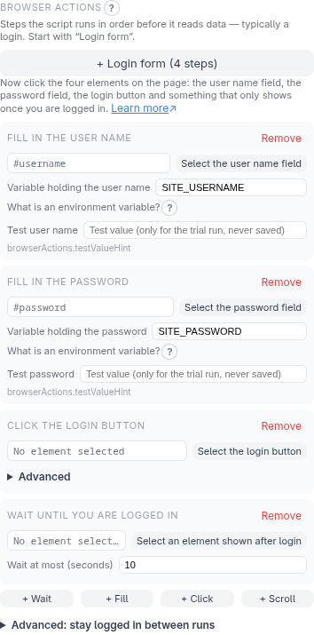
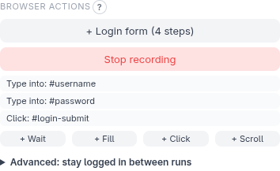

# Browser engine and actions

By default a script fetches the page with plain HTTP and reads the HTML it gets
back (the **Static** engine). That is fast and light, but it sees only what the
server sends. Pages that build their content with JavaScript, or that need a
login, a click or scrolling first, need the **Browser** engine: the script then
drives a real Chromium through Playwright.

## Switching engine

In the idle screen, the **Engine** row has **Static** and **Browser** (the **?**
next to it says which fits). When a trial run on **Static** finds no data, the
error suggests trying **Browser** — a very common cause is a page that builds its
content with JavaScript. Choosing
**Browser** reveals the **Browser actions** list.

The Browser engine needs extra software on the machine that runs the script
(and on the companion's machine, because of the trial run):

```bash
pip install playwright
playwright install chromium
```

The installer does this for you with `--browser-engine` (`-BrowserEngine` on
Windows).

## Browser actions

Actions run in order, before the data is extracted. There are four kinds:

| Action | What it does |
| --- | --- |
| **Wait** | Waits until an element appears (with a timeout) |
| **Fill** | Types a value into an input |
| **Click** | Clicks an element |
| **Scroll** | Scrolls to load more content |

Choose the element for an action with **Select element** and click it on the
page — you never write a selector by hand.

### A login flow

A login is four steps: fill in the user name, fill in the password, click the
sign-in button, then wait until the signed-in page appears. **Login form (4
steps)** adds all four in one click; the **?** next to **Browser actions** explains
the sequence.



Each step is named for what it does (**Fill in the user name**, **Click the login
button**, …). All that is left is to click the four elements on the page with
**Select the user name field**, **Select the password field**, **Select the login
button** and **Select an element shown after login** (something only visible once you
are signed in, such as a welcome line). The starter adds to your list — it never
replaces steps you already made — and waits up to 10 seconds for the signed-in page.

A **Fill** step never stores a secret in the script. You give it the *name of an
environment variable* (the starter suggests `SITE_USERNAME` and `SITE_PASSWORD`),
and the script reads the value when it runs:

```bash
export SITE_PASSWORD='…'
python scraper.py
```

To let the trial run get past the login, type a **Test user name** and **Test
password**. They are sent to the companion for that one run and are never saved,
logged or written into the script.

**Reuse session between runs** (under **Advanced: stay logged in between runs**) remembers the login, so later runs skip the login
steps. The saved session file holds live cookies — treat it like a password and never
share or commit it. If the session expires the run fails; there is no automatic
re-login (delete the file to log in again).

Times are in plain **seconds** (for example **Wait at most (seconds)**; `0.25` works).
Rarely needed options — which match a click uses, the scroll step, a scroll's container
and "Load more" button — are under a collapsed **Advanced** that remembers whether you
opened it.

### Record my steps

You know what *you* do on the page to get to the data, not which selectors to
enter. Click **Record my steps** and do it by hand:

1. The page reloads, so the recording starts from the state the script starts from.
2. Click, type and scroll as you normally would. The panel lists each step as it is
   recorded.
3. Click **Stop recording**. The steps become the actions above, each one still
   editable or removable. If the list already has actions, you choose **Add to the
   list**, **Replace the list** or **Discard**.



What is recorded, and what not:

- A **click** becomes **Click** (several clicks on the same element in a row become
  one). Clicking into a text field only focuses it and is no step.
- Typing becomes **Fill**, but **what you type is never recorded**: the action only
  names the field, and the editor asks for the name of the environment variable that
  will hold the value, as for any Fill. A password never reaches a script, a saved
  configuration or a log.
- A **scroll** becomes **Scroll** only if it made the page load more content; a plain
  reading scroll is ignored.
- An element that was not on the page right after loading (a menu that opens, a
  field that appears) gets a **Wait** in front of it.
- Not recorded: pressing Enter to submit (click the button instead), drop-down lists,
  dragging and keyboard shortcuts. Add those by hand. A CAPTCHA is never solved or
  recorded; if one appears the script fails honestly.
- If the page navigates while you record, the recording continues on the new page.
  It stops, and says so, when the tab is closed or the page cannot be recorded.

Choosing the data you want to extract works as always: pick the fields afterwards.

### Click: first, last or all

If a selector matches several elements (say, one "Show more" toggle per entry),
**Click which match** (under **Advanced**) chooses **First match**, **Last match** or
**All matches, in order**. For all, you can set how long to wait after each click, in
seconds.

### Scroll

**Scroll** repeats up to **Max. rounds** times (the **?** explains it), stopping when no
new content appears. Under **Advanced** you can name a **Container** (a scrollable box instead of the whole
page) and a **"Load more" button** to click each round. By default every round
jumps to the bottom. If a site only loads a section once you scroll *through*
it, set **Scroll step (pixels)** to scroll that many pixels at a time.

## Things to know

- A page that answers with an HTTP error (for example 403) fails the run with a
  clear message instead of silently scraping the error page.
- CAPTCHAs are not solved or bypassed, by design. If one blocks the flow, the
  script fails honestly.
- Selectors for things inside iframes are supported; the extension records
  which frame an element was in.
