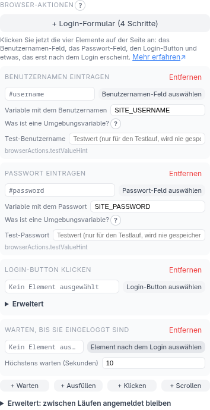

<!-- source: c35bfabaf422 -->
# Browser-Engine und Aktionen

Standardmäßig holt ein Skript die Seite mit einfachem HTTP und liest das HTML, das
zurückkommt (die **Statisch**-Engine). Das ist schnell und leicht, sieht aber nur,
was der Server sendet. Seiten, die ihren Inhalt mit JavaScript aufbauen oder die
vorher eine Anmeldung, einen Klick oder Scrollen brauchen, benötigen die
**Browser**-Engine: Das Skript steuert dann über Playwright einen echten Chromium.

## Die Engine wechseln

Auf dem Startbildschirm hat die Zeile **Engine** die Einträge **Statisch** und
**Browser** (das **?** daneben sagt, was passt). Findet ein Testlauf mit **Statisch**
keine Daten, schlägt die Fehlermeldung **Browser** vor — eine sehr häufige Ursache ist
eine Seite, die ihren Inhalt mit JavaScript aufbaut. Wenn du **Browser** wählst,
erscheint die Liste **Browser-Aktionen**.

Die Browser-Engine braucht zusätzliche Software auf dem Rechner, der das Skript
ausführt (und auf dem Rechner des Companions, wegen des Testlaufs):

```bash
pip install playwright
playwright install chromium
```

Das Installationsprogramm erledigt das für dich mit `--browser-engine`
(`-BrowserEngine` unter Windows).

## Browser-Aktionen

Aktionen laufen der Reihe nach, bevor die Daten extrahiert werden. Es gibt vier Arten:

| Aktion | Was sie tut |
| --- | --- |
| **Warten** | Wartet, bis ein Element erscheint (mit Zeitlimit) |
| **Ausfüllen** | Tippt einen Wert in ein Eingabefeld |
| **Klicken** | Klickt ein Element an |
| **Scrollen** | Scrollt, um mehr Inhalt zu laden |

Das Element für eine Aktion wählst du mit **Element auswählen** und klickst es auf
der Seite an — du schreibst nie von Hand einen Selektor.

### Ein Login-Ablauf

Ein Login besteht aus vier Schritten: den Benutzernamen eintragen, das Passwort
eintragen, die Anmelde-Schaltfläche klicken und dann warten, bis die angemeldete
Seite erscheint. **Login-Formular (4 Schritte)** fügt alle vier mit einem Klick
hinzu; das **?** neben **Browser-Aktionen** erklärt die Abfolge.



Jeder Schritt ist nach dem benannt, was er tut (**Benutzernamen eintragen**,
**Login-Button klicken**, …). Übrig bleibt, die vier Elemente auf der Seite
anzuklicken, mit **Benutzernamen-Feld auswählen**, **Passwort-Feld auswählen**,
**Login-Button auswählen** und **Element nach dem Login auswählen** (etwas, das nur
sichtbar ist, wenn du angemeldet bist, etwa eine Willkommenszeile). Der Starter
ergänzt deine Liste — er ersetzt nie Schritte, die du schon gemacht hast — und wartet
bis zu 10 Sekunden auf die angemeldete Seite.

Ein Schritt **Ausfüllen** speichert nie ein Geheimnis im Skript. Du gibst ihm den
*Namen einer Umgebungsvariable* (der Starter schlägt `SITE_USERNAME` und
`SITE_PASSWORD` vor), und das Skript liest den Wert, wenn es läuft:

```bash
export SITE_PASSWORD='…'
python scraper.py
```

Damit der Testlauf an der Anmeldung vorbeikommt, tippst du einen **Test-Benutzername**
und ein **Test-Passwort** ein. Sie werden nur für diesen einen Lauf an den Companion
gesendet und weder gespeichert noch protokolliert noch ins Skript geschrieben.

**Sitzung zwischen Läufen wiederverwenden** (unter **Erweitert: zwischen Läufen
angemeldet bleiben**) merkt sich die Anmeldung, sodass spätere Läufe die
Anmeldeschritte überspringen. Die gespeicherte Sitzungsdatei enthält aktive Cookies —
behandle sie wie ein Passwort und gib sie nie weiter und committe sie nie. Läuft die
Sitzung ab, schlägt der Lauf fehl; es gibt keine automatische erneute Anmeldung
(lösche die Datei, um dich neu anzumelden).

Zeiten werden in einfachen **Sekunden** angegeben (zum Beispiel **Höchstens warten
(Sekunden)**; `0.25` funktioniert). Selten gebrauchte Optionen — welcher Treffer
geklickt wird, der Scroll-Schritt, der Container eines Scrollens und sein
„Mehr laden“-Button — stehen unter einem zugeklappten **Erweitert**, das sich merkt,
ob du es geöffnet hast.

### Klicken: erster, letzter oder alle

Passt ein Selektor auf mehrere Elemente (etwa ein „Mehr anzeigen“-Schalter pro
Eintrag), wählt **Welcher Treffer wird geklickt** (unter **Erweitert**) zwischen
**Erster Treffer**, **Letzter Treffer** und **Alle Treffer, der Reihe nach**. Bei
„alle“ kannst du einstellen, wie lange nach jedem Klick gewartet wird, in Sekunden.

### Scrollen

**Scrollen** wiederholt sich bis zu **Max. Durchläufe** Mal (das **?** erklärt es)
und hört auf, wenn kein neuer Inhalt erscheint. Unter **Erweitert** kannst du einen
**Container** (eine scrollbare Box statt der ganzen Seite) und einen
**„Mehr laden“-Button** nennen, der in jedem Durchlauf geklickt wird. Standardmäßig
springt jeder Durchlauf ans Ende. Lädt eine Seite einen Abschnitt erst, wenn du
*hindurch*scrollst, stelle **Scroll-Schritt (Pixel)** ein, um jeweils so viele Pixel
auf einmal zu scrollen.

## Gut zu wissen

- Eine Seite, die mit einem HTTP-Fehler antwortet (zum Beispiel 403), lässt den Lauf
  mit einer klaren Meldung fehlschlagen, statt stillschweigend die Fehlerseite
  auszulesen.
- CAPTCHAs werden absichtlich weder gelöst noch umgangen. Blockiert eines den Ablauf,
  schlägt das Skript ehrlich fehl.
- Selektoren für Dinge in iframes werden unterstützt; die Erweiterung merkt sich,
  in welchem Frame ein Element war.
