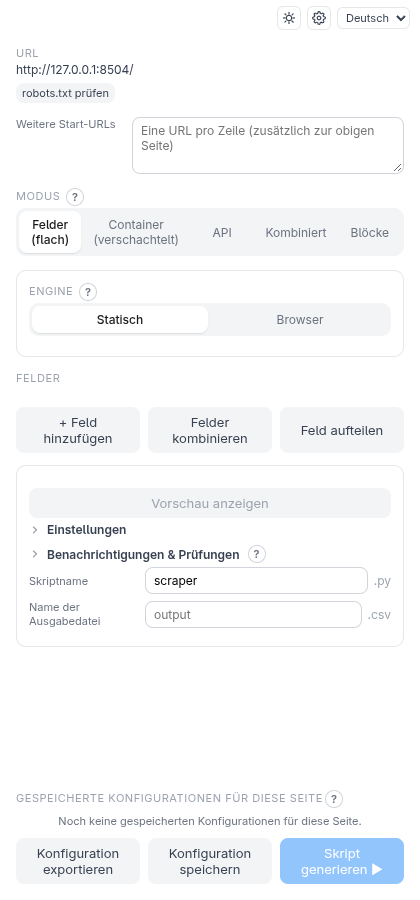
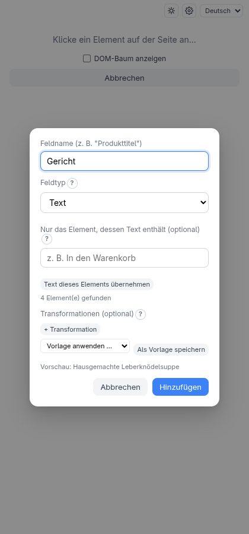
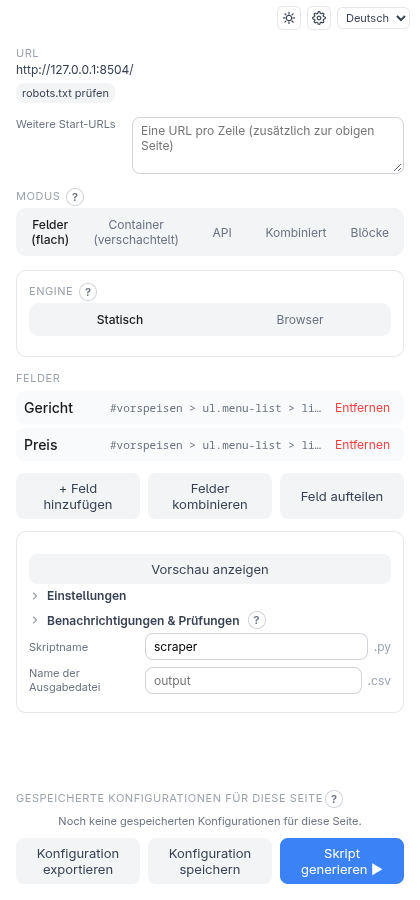
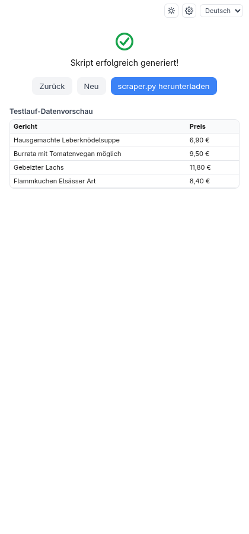

<!-- source: 2022b2f6b063 -->
# Erste Schritte

Diese Seite führt dich in etwa zehn Minuten von null zu einem funktionierenden Scraper.

## Was du brauchst

- Einen Chromium-basierten Browser: Chrome, Edge oder Opera.
- **Python 3.9 oder neuer** auf deinem Computer. Der Companion führt dein Skript
  einmal als Test aus, also muss Python vorhanden sein.
- Das **Release-Paket** von Scraping Factory für dein System (Linux, macOS oder
  Windows) von der GitHub-Seite *Releases* des Projekts.

## 1. Den Companion installieren

Entpacke das Paket und führe in diesem Ordner das Installationsprogramm aus.

**Linux / macOS**

```bash
./install.sh --autostart
```

**Windows** (PowerShell)

```powershell
powershell -ExecutionPolicy Bypass -File .\install.ps1 -Autostart
```

Das Installationsprogramm kopiert den Companion in deinen Benutzerordner, legt eine
eigene Python-Umgebung mit den Paketen an, die Skripte brauchen, startet den
Companion und — mit `--autostart` — startet ihn bei jeder Anmeldung. Wenn du es
erneut ausführst, aktualisiert es eine vorhandene Installation. Die `INSTALL.md`
im Paket listet jede Option (zum Beispiel `--browser-engine`, nötig für Seiten, die
in einem echten Browser laufen müssen; siehe
[Browser-Engine und Aktionen](browser-engine.md)).

Prüfe, ob er läuft: Öffne <http://localhost:5000/health> in deinem Browser. Du
solltest eine kurze JSON-Antwort sehen.

## 2. Die Erweiterung laden

Das Installationsprogramm nennt dir den Ordner, den du brauchst.

1. Öffne `chrome://extensions` (in Edge: `edge://extensions`).
2. Schalte den **Entwicklermodus** ein.
3. Klicke auf **Entpackte Erweiterung laden** und wähle den Ordner der Erweiterung.
4. Öffne das Seitenpanel der Erweiterung über das Symbol in der Symbolleiste.

Wenn das Panel **Companion-App nicht erreichbar** meldet, siehe
[Fehlersuche](troubleshooting.md#das-panel-meldet-companion-app-nicht-erreichbar).

## 3. Deinen ersten Scraper bauen

> **Probier es selbst aus.** Im Hauptordner des Repositorys:
> `python3 -m http.server 8504 --bind 127.0.0.1 --directory test-pages/speisekarte`
> und öffne <http://127.0.0.1:8504/>. Es ist eine Speisekarte — eine typische
> „Liste von Einträgen“. Auf einer echten Seite funktioniert jede Seite mit einer
> Liste genauso.

Öffne die Seite, die du auslesen willst, und dann das Seitenpanel. Es startet auf
dem Startbildschirm, ganz oben mit der Adresse der aktuellen Seite:



### Die gewünschten Daten auswählen

1. Klicke auf **+ Feld hinzufügen**. Das Panel wechselt zu „Klicke ein Element auf der Seite an…“.
2. Klicke auf der Seite den ersten Gerichtsnamen an. Die Erweiterung findet heraus,
   wie sich ein solches Element wiederfinden lässt, und bittet dich, das Feld zu benennen.
3. Tippe **Gericht** ein und bestätige.



Wiederhole das für den Preis: **+ Feld hinzufügen**, klicke auf den ersten Preis und
nenne das Feld **Preis**.



Du klickst nur das *erste* Beispiel an. Das Skript findet jedes Element, das genauso
aussieht, du bekommst also eine Zeile pro Gericht.

### Das Skript generieren

Klicke auf **Skript generieren ▶**. Der Companion baut das Skript und führt es einmal
gegen die echte Seite aus. Klappt das, landest du auf dem Fertig-Bildschirm und
kannst das Skript herunterladen.

Um zu sehen, was der Testlauf tatsächlich ausgelesen hat, schaltest du vor dem
Generieren auf dem Bildschirm **Einstellungen** (das Zahnrad) **Testlauf-Datenvorschau
anzeigen** ein:



### Das Skript ausführen

Lade das Skript herunter (es heißt wie das Feld **Skriptname**, standardmäßig
`scraper.py`) und führe es aus:

```bash
pip install requests beautifulsoup4
python scraper.py
```

Es schreibt `output.csv` neben sich, eine Zeile pro Gericht.

## Hilfe genau dort, wo du sie brauchst

Das Panel hat zu jeder Option einen kurzen Titel. Die Erklärung — was sie tut, ein
Beispiel, worauf du achten solltest — steht hinter dem kleinen **?** neben dem Titel:
Klicke darauf (oder drücke die Eingabetaste), um sie zu öffnen, und drücke Esc oder
klicke woanders hin, um sie zu schließen. Ihr Link **Mehr erfahren** öffnet die
passende Seite dieser Dokumentation in einem neuen Tab; die Seiten sind in die
Erweiterung gebündelt, das funktioniert also ohne Internetverbindung.

Auf dem Bildschirm **Einstellungen** (das Zahnrad) stehen die Listen — Ausgabe-Layouts,
Transformations-Vorlagen und gespeicherte Konfigurationen — und die
Verbindungseinstellungen in zugeklappten Bereichen; klicke auf einen Titel, um ihn
zu öffnen. Selten gebrauchte Optionen stehen unter **Erweitert** und öffnen sich von
selbst, wenn sie in Benutzung sind.

## Wie es weitergeht

- Einträge, die weitere Listen enthalten (Kategorien mit Gerichten)? Nutze den
  [Container-Modus](modes.md#container-verschachtelt).
- Die Seite lädt Daten mit JavaScript oder steht hinter einer Anmeldung?
  [Browser-Engine und Aktionen](browser-engine.md).
- Mehrere Ergebnisseiten? [Pagination](pagination.md).
- Werte wie `6,90 €`, die Zahlen sein sollen? [Transformationen](transforms.md).
