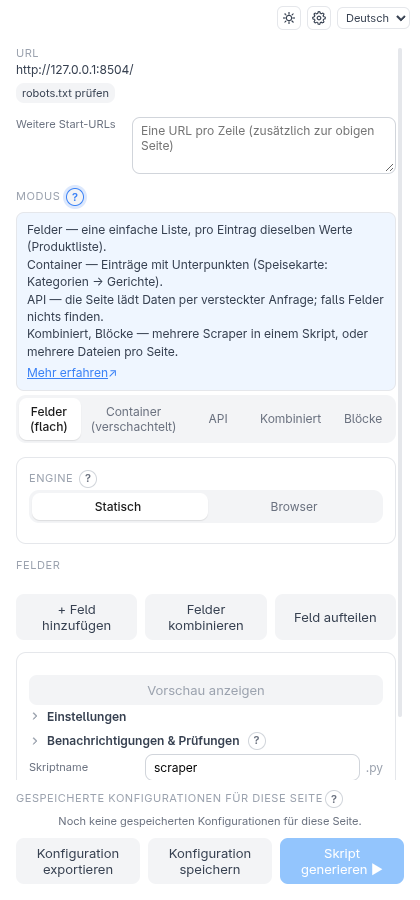
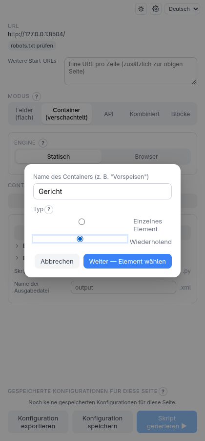
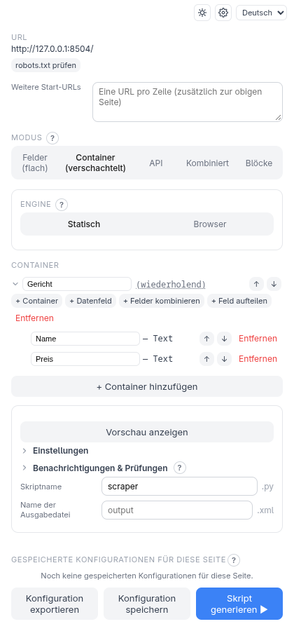
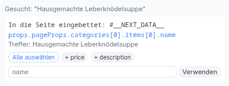
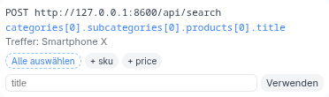
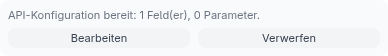
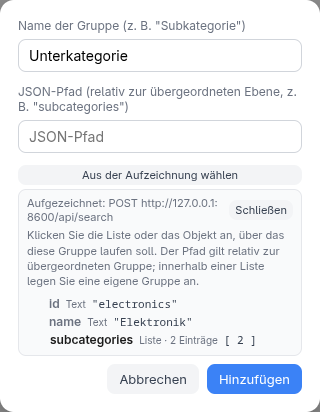

<!-- source: 5c11fad5f336 -->
# Scraping-Modi

Die Schaltflächen oben auf dem Startbildschirm legen fest, *wie* die Daten
beschrieben werden. Die Modi sind voneinander getrennt: Beim Wechseln wird die
Konfiguration der anderen gelöscht, wähle also einen pro Scraper.

| Modus | Wofür | Ausgabe |
| --- | --- | --- |
| **Felder (flach)** | Eine Zeile pro Eintrag, jeweils wenige Werte | CSV |
| **Container (verschachtelt)** | Wiederholte Gruppen, möglicherweise in anderen Gruppen | XML |
| **API** | Daten, die aus einer JSON-Anfrage der Seite stammen | CSV (XML bei verschachteltem JSON) |
| **Kombiniert** | Mehrere bereits gespeicherte Scraper zu einem Skript zusammenführen | JSON |
| **Blöcke** | Mehrere unterschiedlich geformte Ausgaben aus einer Seite | eine Datei pro Block |

Jeder Modus lässt sich auf JSON-, SQLite- oder Excel-Ausgabe umstellen; siehe
[Ausgabeformate](output.md).

Du bist unsicher, welcher passt? Klicke auf das **?** neben **Modus** — es nennt
für jeden Modus in einer Zeile „was passt?“ mit einem Beispiel. Dasselbe **?** steht
neben **Engine**, dem Container-**Typ** und dem **Feldtyp**, die Entscheidung wird
also dort erklärt, wo du sie triffst.

## Felder (flach)

Der einfachste Modus, Schritt für Schritt beschrieben in
[Erste Schritte](getting-started.md). Klicke auf **+ Feld hinzufügen**, klicke ein
Element an, benenne es. Jedes Feld wird zu einer Spalte.

Zwei Zusätze stehen neben **+ Feld hinzufügen**: **Felder kombinieren** (mehrere
Felder zu einem Wert verbinden) und **Feld aufteilen** (einen Teil eines Feldes
nehmen). Sie arbeiten mit Feldern, die du bereits hast, und brauchen keinen Klick
auf der Seite.

## Elemente, die gleich aussehen

Wenn sich mehrere ähnliche Elemente — Schaltflächen, Links — nur an ihrer
Beschriftung unterscheiden lassen, trage im Felddialog bei **Nur das Element,
dessen Text enthält** etwas ein oder klicke auf **Text dieses Elements übernehmen**.
Groß- und Kleinschreibung und zusätzliche Leerzeichen spielen keine Rolle; lass das
Feld leer, um die Auswahl unverändert zu lassen.

## Container (verschachtelt)

Nutze das, wenn die Seite ein *Baum* ist: Kategorien, die Gerichte enthalten,
Produkte, die Bewertungen enthalten. Du beschreibst sie als verschachtelte
**Container** und **Felder**.

> **Probier es selbst aus.** Dieselbe Beispielseite wie in Erste Schritte:
> `python3 -m http.server 8504 --bind 127.0.0.1 --directory test-pages/speisekarte`.

1. Wechsle zu **Container (verschachtelt)** und klicke auf **+ Container hinzufügen**.
2. Nenne ihn **Gericht**. Wähle **Wiederholend** — der Container kommt auf der Seite
   mehrfach vor (einmal pro Gericht). Wähle **Einzelnes Element** für etwas, das nur
   einmal existiert.
3. Klicke auf **Weiter — Element wählen** und klicke dann auf der Seite ein ganzes
   Gericht an. Klicke auf seinen *Rand oder Innenabstand*, nicht auf den Text darin,
   damit der Container das Gericht selbst ist und nicht eines seiner Teile.
4. Klicke in der Zeile des neuen Containers auf **+ Datenfeld**, klicke den
   Gerichtsnamen an und nenne es **Name**. Wiederhole das für den Preis.

Das Ergebnis ist ein Baum. Feldklicks innerhalb eines Containers sind auf diesen
Container beschränkt, und der Selektor funktioniert für jedes Gericht, in dem du
geklickt hast:

Du wählst **Einzelnes Element** oder **Wiederholend** vor dem Klicken, deshalb
gleicht die Erweiterung deine Wahl mit dem ab, was der Klick getroffen hat: Mehrere
Treffer bei einem *einzelnen* Container oder nur einer bei einem *wiederholenden*
zeigen direkt nach dem Auswählen einen Hinweis. Die Beschriftung „(einzeln)“ /
„(wiederholend)“ im Baum ist eine Schaltfläche — klicke darauf, um den Typ später
umzuschalten.

Jede Zeile lässt sich an Ort und Stelle umbenennen und mit den Pfeiltasten
umsortieren. Ein Feld hat einen Typ: **Text**, **Attribut** (zum Beispiel die
Adresse eines Links oder die Quelle eines Bildes), **Vorhanden?** (ist das Element
überhaupt da) oder **Nur eigener Text** (nur der eigene Text des Elements, ohne
darin verschachtelte Plaketten).

Container können über **+ Container** weitere Container enthalten, so tief, wie die
Seite geht.

## API

Viele Seiten laden ihre Daten über eine JSON-Anfrage, statt sie ins HTML zu
schreiben. Der API-Modus findet diese Anfrage für dich:

1. Lädt die Seite ihre Daten selbst nach, klicke auf **Netzwerk-Aufzeichnung starten**
   und benutze dann die Seite (scrollen, einen Tab öffnen), damit sie ihre Anfragen
   stellt. Überspringe den Schritt, wenn die Seite ihre Daten schon enthält (siehe unten).
2. Klicke auf **Datenpunkt suchen** und klicke dann einen Wert auf der Seite an. Die
   Erweiterung sucht ihn in den aufgezeichneten Antworten *und* im JSON der Seite selbst
   und listet jeden Treffer mit seiner Herkunft: **Aufgezeichnete Anfrage: …** oder
   **In die Seite eingebettet: …** (aufgezeichnete zuerst).

   

   Jeder Treffer ist eine Karte mit Namensfeld und **Verwenden**. Lässt du den Namen
   leer, übernimmt **Verwenden** ihn aus der Anfrage selbst — der letzte Schlüssel des
   Pfads, aus `products[0].title` wird also `title` (das Feld zeigt ihn grau an). Ein
   getippter Name hat Vorrang. Ist der Name schon vergeben, wird ein Zähler angehängt
   (`title_2`).

   

3. Entscheide auf dem API-Bildschirm für jeden Teil der Anfrage-Adresse, ob er fest
   oder **variabel** ist (eine Werteliste, ein zweiter Endpunkt, der die Werte
   liefert, oder ein Bereich wie ISO-Wochen), und benenne deine Felder.

Nach **Übernehmen** zeigt der Hauptbildschirm das API-Panel. **Bearbeiten** öffnet den
Bildschirm genau so, wie du ihn übernommen hast — ein Feld umbenennen, eine
Transformation ändern, ein Feld oder eine Gruppe aus der Aufzeichnung mit
**+ Datenfeld** / **+ Gruppe** ergänzen — und **Übernehmen** bestätigt erneut.
**Abbrechen** verwirft die Änderungen und behält die vorherige Konfiguration.
**Verwerfen** entfernt die Konfiguration komplett.

**Bearbeiten** gibt es nur für eine Konfiguration, die du in dieser Sitzung übernommen
hast. Eine aus **Gespeicherten Konfigurationen** geladene oder importierte
Konfiguration zeigt stattdessen einen Hinweis: verwirf sie und wähle neu, um sie zu
ändern.

Jedes **?** auf diesem Bildschirm erklärt das Konzept an Ort und Stelle: was ein
**variabler** URL-Teil ist, was jede Wertquelle tut (mit Beispiel), was **→ Variabel**
mit einem Wert im Anfrage-Body macht. Die gängigen Wertquellen — **Werteliste**,
**Liste aus anderer Anfrage** und **Bereich** — stehen zuerst; **Aus der Seite
sammeln (Browser)** und der **Token-Wert** stehen unter **Erweiterte Quellen**, und
der **Werttyp** eines Body-Wertes unter seinem eigenen **Erweitert**.

### Bereichswerte und `today`

Die Wertquelle **Bereich** zählt für einen Teil der Anfrage-Adresse durch Werte: ISO-Wochen
(`2026-W30`), einfache Zahlen oder Daten. Trage den Anfang in **Von** und das Ende in **Bis**
ein; die Formatzeile darunter zeigt, wie ein Wert aussehen muss.

Das Wort **`today`** funktioniert als Grenze und wird beim *Lauf* des Skripts aufgelöst, nicht
beim Erzeugen — eine gespeicherte Konfiguration zählt also immer bis zur aktuellen Woche
beziehungsweise zum aktuellen Tag:

| Typ | `today` in **Von** | `today` in **Bis** |
| --- | --- | --- |
| **IsoWeek** | ja: die aktuelle ISO-Woche | ja |
| **Date** | nein | ja: der Tag des Laufs |
| **Number** | nein | nein |

**Beispiel.** Eine Seite lädt ihre Wochenzahlen von `/api/weeks/{week}`. Wähle **Bereich**,
den Typ `IsoWeek`, **Von** `2026-W30` und **Bis** `today`: Jeder Lauf fragt alle Wochen von
Woche 30 bis zur aktuellen ab. Mit **Von** `today` und **Bis** `today` (IsoWeek) ergibt der
Bereich genau einen Wert, die aktuelle Woche — praktisch für „nur die neuesten Daten“. Bei
Daten ergibt **Bis** `today` jeden Tag bis zum Tag des Laufs, der Anfang muss aber ein echtes
Datum sein.

### JSON-Pfade auswählen

Du musst nie einen JSON-Pfad tippen. Überall, wo einer verlangt wird — der Pfad einer
Gruppe, die Pfade für Cursor und „weitere Seiten“, das Body-Feld, in das ein Cursor
kommt, der Pfad zu einem Anmelde-Token — zeigt **Aus der Aufzeichnung wählen** die
aufgezeichnete Antwort (oder den Anfrage-Body) als kleinen Baum. Klicke einen Wert an,
und sein Pfad wird eingetragen.

- Der Pfad einer Gruppe ist relativ zu ihrer übergeordneten Gruppe, der Baum beginnt
  also beim ersten Eintrag des Elternteils; Listen werden als Ganzes angeboten (was
  in einer Liste steckt, gehört in eine eigene Gruppe).
- Klicke bei einem Cursor, einem Flag oder einem Token den Wert selbst an. Eine
  Liste wird über ihren ersten Eintrag gezeigt.
- Für den Anfrage-Body werden nur Felder angeboten, die du erreichst, ohne durch eine
  Liste zu gehen.
- Eine sehr große Antwort wird nicht vollständig aufbewahrt und kann nicht angezeigt
  werden; dann sagt dir der Picker das, und du tippst den Pfad (**Aus Aufzeichnung
  erkennen** funktioniert für Cursor und Tokens weiter). Ist gar nichts
  aufgezeichnet, verweist er dich zurück auf **Netzwerk-Aufzeichnung starten**. Bei
  den eingebetteten JSON-Daten einer Seite wird der Baum aus der Seite selbst gelesen.

Die selten gebrauchten Optionen — ein **Auth-Bootstrap** (ein Token, das zuerst per
Anmelde-Anfrage geholt wird), **Cursor**-Pagination und **Link-Header**-Pagination —
stehen unter eigenen **Erweitert**-Zeilen, die jeweils in einem Satz sagen, wann sie
gelten. Sie öffnen sich von selbst, sobald sie eingeschaltet sind, und die
Link-Header-Option auch, wenn die Aufzeichnung einen Header `Link: rel="next"` zeigt.

Manche Seiten legen alle ihre Daten in die Seite selbst (Next.js und Ähnliches). Sie
brauchen keine Aufzeichnung: **Datenpunkt suchen** findet den Wert im JSON der Seite,
und das Skript lädt die Seite dann wie jede andere URL.

Der API-Modus erzeugt ein Skript, das nur `requests` braucht — keinen Browser. Siehe
[Netzwerk-Einstellungen](network-settings.md) für Header und Tokens.

## Kombiniert

Wähle zwei oder mehr deiner [gespeicherten Konfigurationen](saved-configurations.md)
— sie können für völlig verschiedene Seiten sein — und bringe sie in eine
Reihenfolge. Ein Skript führt jede aus und führt alle Ergebnisse in einer einzigen
`output.json` zusammen, geordnet nach dem Namen jeder Komponente (bearbeitbar).
Schlägt eine Komponente fehl oder findet nichts, schlägt der ganze Lauf fehl und
sagt, welche.

## Blöcke

Nutze das, wenn *eine Seite* mehrere Ausgaben speisen soll, zum Beispiel eine flache
Liste von Angeboten und eine verschachtelte Liste von Kategorien. Du baust jeden
Block gegen die geöffnete Seite (flache Felder oder Container), klickst auf
**+ Block hinzufügen** und wiederholst das. Es werden mindestens zwei Blöcke
gebraucht. Das Skript lädt die Seite einmal und schreibt eine Datei pro Block.
