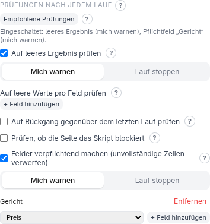

<!-- source: a355d866f900 -->
# Sicherheitsprüfungen und Benachrichtigungen

Ein Scraper, den du nach Zeitplan laufen lässt, kann unbemerkt kaputtgehen: Ein
Redesign der Seite ändert einen Klassennamen, und das Skript „gelingt“ weiter mit einer
leeren Datei. Der Bereich **Benachrichtigungen & Prüfungen** auf dem Startbildschirm
(standardmäßig zugeklappt) sorgt dafür, dass das *generierte Skript selbst* es merkt —
bei jedem Lauf, nicht nur im Test.

Das ist nur wichtig, wenn du das Skript **immer wieder** ausführst (zum Beispiel jede
Nacht): Es sagt dir Bescheid, wenn sich die Website geändert hat und dein Skript nicht
mehr funktioniert. Jede Prüfung hat ein **?** mit einem Zweck in einer Zeile und einem
Beispiel.

## Empfohlene Prüfungen

Du weißt nicht, wo du anfangen sollst? **Empfohlene Prüfungen** schaltet mit einem Klick
zwei Dinge ein: eine Warnung, wenn der Lauf **gar nichts** gefunden hat, und eine
Warnung für Zeilen, denen ihr **erstes Feld** fehlt (meist der Name oder die ID, die eine
Zeile erst sinnvoll macht — solche Zeilen werden dann aus der Datei ausgelassen).
Prüfungen, die du schon eingerichtet hast, bleiben unangetastet, und ein erneuter Klick
ändert nichts.

## Sicherheitsprüfungen

Jede Prüfung wird einzeln eingeschaltet, und du wählst, was passiert, wenn sie
fehlschlägt:

- **Mich warnen** — der Lauf endet normal, und eine Meldung wird ausgegeben.
- **Lauf stoppen** — der Lauf gilt als fehlgeschlagen, sodass ein Scheduler oder
  Überwachungswerkzeug es bemerkt: Das Skript beendet sich mit seinem eigenen Code, **2**
  (ein unerwarteter Absturz ist Code 1).

| Prüfung | Erkennt |
| --- | --- |
| **Auf leeres Ergebnis prüfen** | Der Lauf hat gar keine Zeilen erzeugt |
| **Auf leere Werte pro Feld prüfen** | Der Selektor eines Feldes trifft noch *etwas*, aber der Wert ist zu oft leer — „*Preis* ist leer in mehr als **50** % der Zeilen“ |
| **Auf Rückgang gegenüber dem letzten Lauf prüfen** | Die Anzahl der Ergebnisse ist gegenüber dem vorigen Lauf gefallen — „Auslösen bei **20** % weniger Zeilen als im letzten Lauf“ (z. B. ein defektes „Mehr laden“) |
| **Prüfen, ob die Seite das Skript blockiert** | Die Seite hat angefangen, dich zu blockieren, antwortet aber normal: eine Weiterleitung auf einen anderen Host oder — unter **Erweitert** — eine Seite, die kürzer ist als eine Anzahl Bytes (eine Sperrseite ist winzig: 1000 Bytes sind etwa ein Absatz) oder eine deiner Wendungen (`Access Denied`, …) |
| **Felder verpflichtend machen (unvollständige Zeilen verwerfen)** | Zeilen, denen ein Pflichtwert fehlt, werden aus der Ausgabe *entfernt*, z. B. damit ein Datenbank-Import nie auf einen leeren `NOT NULL`-Wert trifft |

Gut zu wissen:

- Die Rückgangsprüfung merkt sich die letzte Ergebnisanzahl in einer kleinen Datei neben
  der Ausgabe und aktualisiert sie nur nach einem Lauf, der nicht fehlgeschlagen ist.
- Die Prüfungen auf leere Werte und Pflichtfelder gleichen Felder über das ganze
  Ergebnis hinweg nach Namen ab; bei verschachtelter Ausgabe wird eine unvollständige
  Gruppeninstanz verworfen.
- Die Blockier-Erkennung *meldet* nur. Sie versucht nie, eine Sperre zu umgehen.
- Eine gespeicherte Ausgabe lässt sich im Bereich
  [Gespeicherte Konfigurationen](saved-configurations.md) mit den aktuellen
  Einstellungen erneut prüfen (**Sicherheitsprüfungen testen**).

## Änderungserkennung

**Änderungserkennung aktivieren (Benachrichtigung bei Änderungen)** vergleicht die
Ausgabedatei jedes Laufs mit der des vorigen und benachrichtigt dich nur, wenn sich etwas
geändert hat — per **E-Mail** oder **Webhook**. Der erste Lauf legt nur die Ausgangsbasis
fest.

Jede Adresse und jede Zugangsangabe ist der *Name einer Umgebungsvariable*, die du dort
setzt, wo das Skript läuft (bei E-Mail: SMTP-Host, Port, Benutzer, Passwort, Absender
und Empfänger; bei einem Webhook: seine URL). Nichts Geheimes wird im Skript gespeichert.
Eine fehlgeschlagene Benachrichtigung gibt nur eine Warnung aus; sie lässt den Lauf nicht
fehlschlagen.

## Überspringen, wenn die Seite unverändert ist

**Überspringen, wenn die Seite unverändert ist** lässt das Skript zuerst eine billige
Anfrage senden und `ETag` / `Last-Modified` der Seite mit dem letzten erfolgreichen Lauf
vergleichen. Ist sie unverändert, beendet es sich mit Code **4**, bevor es echte Arbeit
tut (und bei der Browser-Engine, bevor ein Browser gestartet wird). Ist die Seite nicht
erreichbar, beendet es sich mit Code **5**. Eine Seite, die keinen der beiden Header
sendet, wird einfach normal ausgelesen.

## Nach Zeitplan ausführen

Die Zeitplanung liegt bei dir: Nutze cron, die Aufgabenplanung oder launchd. Exit-Codes
sagen dem Scheduler, was passiert ist:

| Code | Bedeutung |
| --- | --- |
| 0 | Erfolg (möglicherweise mit Warnungen) |
| 2 | Eine Sicherheitsprüfung mit Schweregrad Fehler ist fehlgeschlagen |
| 4 | Überspringen, wenn die Seite unverändert ist: Seite unverändert, Lauf übersprungen |
| 5 | Überspringen, wenn die Seite unverändert ist: Seite nicht erreichbar |
| 78 | Eine erforderliche Umgebungsvariable war nicht gesetzt |
