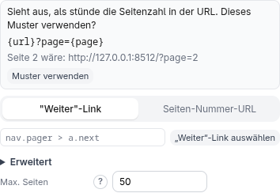
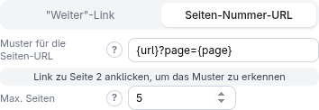

<!-- source: 09107f20c6e6 -->
# Pagination

Ergebnisse verteilen sich oft auf mehrere Seiten. **Pagination** (im Bereich
**Einstellungen** des Startbildschirms, im API-Modus ausgeblendet) sorgt dafür, dass
das Skript ab der Startseite weitermacht — Seite 1 ist immer die Start-URL genau so,
wie sie angegeben ist.

Schalte **Pagination aktivieren** ein und wähle, wie die nächste Seite gefunden wird.

## „Weiter“-Link

Klicke auf **„Weiter“-Link auswählen** und klicke dann auf der Seite den Link zur
nächsten Seite an. Das Skript folgt der Adresse dieses Links Seite für Seite, bis der
Link verschwindet, eine Seite keine Ergebnisse liefert oder **Max. Seiten**
erreicht ist. (Der CSS-Selektor, den der Klick erzeugt hat, ist ein bearbeitbares
Detail unter **Erweitert**.)

## Seiten-Nummer-URL

Stehen Seitenzahlen in der Adresse, kann das Skript die Adresse von Seite 2, 3, … aus
einem **Muster für die Seiten-URL** bauen. Du musst nicht wissen, wie die Seite sie
schreibt: Die Erweiterung **schlägt ein Muster vor**, wenn sie es erkennen kann an

- dem **„Weiter“-Link**, den du gewählt hast (sie sieht sich an, wohin dieser Link führt),
- einem Link zu **Seite 2**, den du mit **Link zu Seite 2 anklicken, um das Muster zu
  erkennen** anklickst, oder
- der Start-URL selbst, wenn sie schon Seite 1 sagt (`?page=1`, `/page/1/`).

**Muster verwenden** schaltet auf **Seiten-Nummer-URL** um und trägt das Muster ein;
nichts wird angewendet, bevor du darauf klickst. Beispiele, die erkannt werden:
`?page=2`, `&p=2`, `?seite=2`, `/page/2/`, `/seite/2`. Bei allem Unklaren (Seitenzahlen,
die bei 0 beginnen, Offsets, mehrere mögliche Parameter) gibt es lieber keinen
Vorschlag als eine Vermutung.

Du kannst das Muster auch selbst schreiben. Es hat bis zu zwei Platzhalter (das **?**
neben dem Feld erklärt sie):

- `{page}` — die Seitenzahl, beginnend bei **2** (Seite 1 ist immer die Startseite)
- `{url}` — die Start-URL, unverändert (optional)

Zum Beispiel `{url}?page={page}` oder, für eine Start-URL, die schon `?page=1` sagt,
`https://example.com/list?page={page}`. Bei **mehreren Startseiten** (weitere oder
automatisch ermittelte Start-URLs) ist `{url}` Pflicht, damit jede Startseite für sich
weitergeblättert wird; die Erweiterung schlägt dann nur Muster vor, die es enthalten.

> **Probier es selbst aus.** `python3 test-pages/paginated-listing/server.py` stellt
> zwei Listen mit je drei Seiten bereit (`http://127.0.0.1:8512/` mit `?page=N` und
> `/blog/` mit `/page/N/`), mit einem „Weiter »“-Link auf jeder Seite.

## Gut zu wissen

- **Max. Seiten** ist eine Sicherheitsgrenze, immer aktiv (Standard 50): Das Skript
  hört nach so vielen Seiten auf, auch wenn es mehr gibt, und früher, sobald eine Seite
  keine Ergebnisse hat oder der „Weiter“-Link fehlt. Sie schützt vor einer Liste, die
  nie endet.
- Es funktioniert mit beiden Engines und mit mehreren Start-URLs: Jede Start-URL wird
  für sich weitergeblättert.
- Es ist für klassische Seite-für-Seite-Navigation gedacht. Für endloses Scrollen oder
  „Mehr laden“-Schaltflächen auf einer einzelnen Seite nutze die Aktion **Scrollen**
  ([Browser-Engine](browser-engine.md#scrollen)). Für APIs nutze einen numerischen
  Bereichsparameter ([API-Modus](modes.md#api)).
- **Weitere Start-URLs** (ein Textfeld unter der Seitenadresse) lässt dich mehrere
  feste Seiten in einem Lauf auslesen. **Weitere Start-URLs automatisch ermitteln**
  (unter **Erweitert: Startseiten automatisch finden**) sammelt stattdessen Links von
  einer Navigationsseite für dich ein: Wähle einen Link im Menü, und jeder ähnliche Link
  wird zu einer Startseite.
