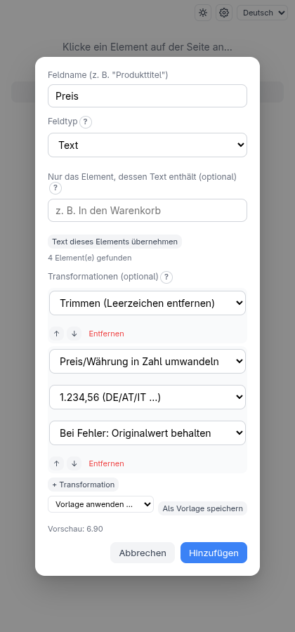
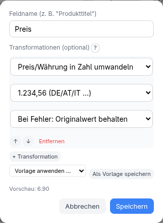
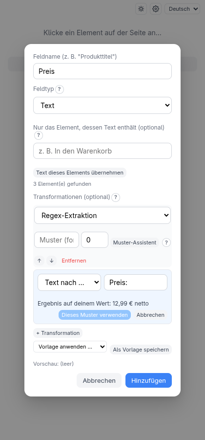
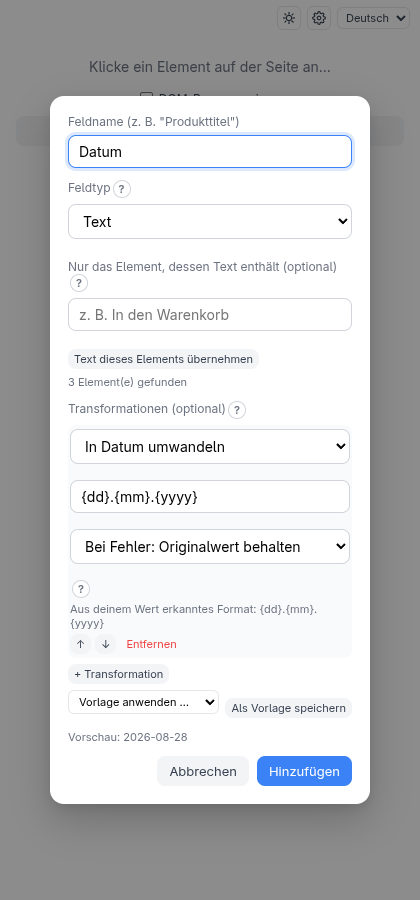

<!-- source: 2ad3a27ff097 -->
# Transformationen und Vorlagen

Ausgelesener Text ist selten sauber: `"  Preis: 12,99 €  "` ist keine Zahl. Eine
**Transformationskette** ist eine geordnete Liste kleiner Aufräumschritte, die auf den
Wert eines Feldes angewendet werden, bevor er geschrieben wird. Du fügst sie beim
Benennen eines Feldes hinzu, in der Liste **Transformationen (optional)**.

## Beispiel: ein Preis als Zahl

> **Probier es selbst aus.**
> `python3 -m http.server 8504 --bind 127.0.0.1 --directory test-pages/speisekarte`

Füge ein Feld hinzu, klicke den ersten Preis an (`6,90 €`) und nenne es **Preis**.
Klicke dann zweimal auf **+ Transformation** und wähle **Trimmen (Leerzeichen
entfernen)** und **Preis/Währung in Zahl umwandeln** mit dem Format
`1.234,56 (DE/AT/IT …)`.

Die Zeile **Vorschau: 6.90** zeigt live, während du bearbeitest, was die Kette für das
angeklickte Element ergibt. Das Ergebnis in der Ausgabe ist `6.90`.

## Ein Feld nachträglich ändern

Jede Feldzeile hat eine Schaltfläche **Bearbeiten** (im Container-Modus an der
Feldzeile im Baum). Sie öffnet den Dialog des Felds mit Name und Kette vorbelegt, sodass
du Schritte hinzufügen, entfernen, umsortieren oder ändern kannst, ohne das Element neu
anzuklicken. **Speichern** ändert das Feld an Ort und Stelle, **Abbrechen** lässt es
unverändert.

- Die **Vorschau** funktioniert wie beim Anlegen des Felds, weil die Erweiterung den Wert
  des angeklickten Elements behält. Eine aus **Gespeicherten Konfigurationen** geladene
  oder importierte Konfiguration hat diesen Wert nicht und zeigt keine Vorschau.
- Nur Name und Kette sind änderbar. Das Element, sein Typ (Text oder Attribut), Downloads
  und der Filter „enthält Text“ gehören zur Auswahl: Um sie zu ändern, entferne das Feld
  und klicke das Element neu an.
- Ein **kombiniertes** oder **aufgeteiltes** Feld öffnet seinen eigenen, vorbelegten
  Dialog. Es kann nur Felder lesen, die über ihm stehen, daher werden nur diese als Quellen
  angeboten.
- Ein Feld, das ein kombiniertes oder aufgeteiltes Feld liest, behält seinen Namen (der
  Dialog sagt es), weil eine Umbenennung dieses Feld kaputt machen würde.

## Die Schritte

| Schritt | Macht |
| --- | --- |
| **Trimmen (Leerzeichen entfernen)** | Entfernt Leerzeichen an beiden Enden |
| **Regex-Extraktion** | Behält den Teil, der zu einem Muster (und optionaler Gruppe) passt |
| **Suchen/Ersetzen** | Ersetzt Text |
| **In Zahl umwandeln** | Umwandlung nach bestem Bemühen, versteht `12,99` und `12.99` |
| **In Ganzzahl / Wahrheitswert / Datum umwandeln** | Strenge Umwandlungen |
| **Preis/Währung in Zahl umwandeln** | Zahl aus einem Betrag, mit ausdrücklichem Format |

Die strengen Umwandlungen lehnen Werte ab, die nicht wohlgeformt sind, statt zu raten.
Wähle für jede **Bei Fehler: Originalwert behalten** oder **Bei Fehler: Standardwert
verwenden**. **In Datum umwandeln** liest ein Format wie `{dd}.{mm}.{yyyy}` und schreibt
ISO `yyyy-mm-dd`.

**Preis/Währung in Zahl umwandeln** ist ausdrücklich, weil `1.234` mehrdeutig ist:
tausend in Deutschland, etwas mehr als eins in den USA. Die vier Formate (`1.234,56`,
`1,234.56`, `1 234,56`, `1'234.56`) nehmen das Raten weg. Erzeugt wird nur der Betrag;
das Währungssymbol wird nicht extrahiert.

### Muster-Assistent (Regex-Extraktion)

Die meisten Preise, Zahlen und IDs stehen in anderem Text. Die **Regex-Extraktion**
holt den gewünschten Teil mit einem *Muster* heraus — aber du musst keines schreiben.
Klicke neben dem Muster auf **Muster-Assistent**, wähle, was extrahiert werden soll,
und tippe nur den Text drumherum:

| Rezept | Ergibt | Beispiel |
| --- | --- | --- |
| Erste Zahl | die erste Zahl, mit Dezimalstellen und Vorzeichen | `Preis 12,99 EUR` → `12,99` |
| Erste Ziffernfolge | die erste Gruppe von Ziffern | `Art.-Nr. 4711-B` → `4711` |
| Text nach … | alles nach deinem Text | nach `Preis:` in `Preis: 12,99 €` → `12,99 €` |
| Text vor … | alles vor deinem Text | vor `€` in `12,99 € netto` → `12,99` |
| Text zwischen … und … | was zwischen zwei Texten steht | zwischen `(` und `)` in `Müller (Berlin)` → `Berlin` |
| Text in Klammern | was in `( )`, `[ ]`, `{ }` oder `< >` steht | `Preis (inkl. MwSt.)` → `inkl. MwSt.` |

Der Assistent zeigt beim Tippen das **Ergebnis auf deinem Wert**. **Dieses Muster
verwenden** schreibt das Muster dann in das (weiterhin bearbeitbare) Feld **Muster
(fortgeschritten)**. Dein Text wird wörtlich genommen — Zeichen wie `.`, `(` oder `$`
sind nichts Besonderes. **Zu behaltender Teil** sagt, welcher geklammerte Teil des
Musters zum Wert wird (0 = der ganze Treffer). Brauchst du zwei Schnitte? Füge einen
zweiten Schritt **Regex-Extraktion** hinzu, zum Beispiel „Text nach `Preis:`“ gefolgt
von „Text vor `€`“.

### Datumsformat erraten (In Datum umwandeln)

Wählst du **In Datum umwandeln**, wird das Format aus dem Wert ausgefüllt, den du
gewählt hast: `28.08.2026` → `{dd}.{mm}.{yyyy}`, `2026-08-28` → `{yyyy}-{mm}-{dd}`,
`08/28/2026` → `{mm}/{dd}/{yyyy}`. Ein Wert, der Tag zuerst oder Monat zuerst sein
könnte (`03/04/2026`), wird mit dem Tag zuerst gelesen, und der Hinweis nennt die
andere Lesart. Der Hinweis unter dem Format sagt, was erkannt wurde; bearbeite das
Format, wenn es falsch ist.

Nur rein numerische Datumsangaben funktionieren — Monatsnamen wie `28 Aug 2026` werden
nicht unterstützt, und ein Datum mit anderem Text drumherum (`Stand: 28.08.2026`) bekommt
keine Vermutung; schneide das Datum vorher mit einem Schritt **Regex-Extraktion** heraus.

Schritte laufen von oben nach unten; mit den Pfeilen sortierst du um. Transformationen
gibt es im flachen Modus, im Container-Modus und im API-Modus (die Schaltfläche
**Transformieren** neben einem Feld im API-Baum).

## Vorlagen

Hast du eine Kette gebaut, die du wieder brauchen wirst? Klicke auf **Als Vorlage
speichern**, gib ihr einen Namen und wähle sie später bei **Vorlage anwenden …** an
jedem Feld jedes Scrapers. Das Anwenden **fügt eine Kopie** der Schritte zur Kette
hinzu; es ersetzt nie, was da ist, und das Bearbeiten der Kopie ändert die Vorlage nicht.

Zwei eingebaute Vorlagen — **Preis bereinigen (1.234,56)** und **Preis bereinigen
(1,234.56)** — funktionieren ohne den Companion. Gespeicherte Vorlagen liegen im
Speicher des Companions und werden unter **Einstellungen → Transformations-Vorlagen**
umbenannt oder gelöscht. Schritte, die auf andere Felder verweisen (Kombinieren/
Aufteilen), lassen sich nicht in einer Vorlage speichern.

## Felder kombinieren und aufteilen

Um einen Wert aus anderen Feldern zu bauen — eine volle Adresse aus Straße und Ort oder
nur die Hausnummer aus einer Adresse — nutze **Felder kombinieren** und **Feld
aufteilen** neben **+ Feld hinzufügen**. Sie brauchen keinen Klick auf der Seite. Hake
**Ursprüngliche Felder aus der Ausgabe entfernen** an, um die Quellen aus der Datei
herauszuhalten und sie trotzdem zu benutzen.
