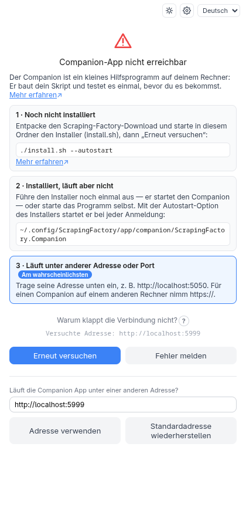
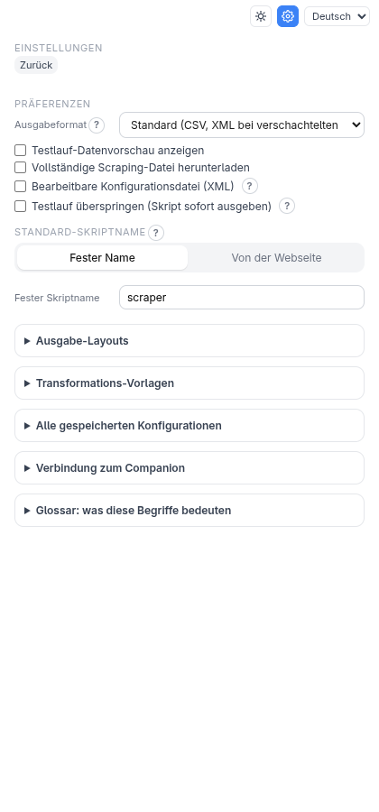

<!-- source: b8bd9f168d8f -->
# Fehlersuche und FAQ

## Das Panel meldet „Companion-App nicht erreichbar“

Die Erweiterung kann den Companion nicht erreichen. Solange noch kein Companion in
diesem Browser geantwortet hat, erklärt der Bildschirm, was er ist, und zeigt die drei
üblichen Situationen mit je ihrem nächsten Schritt (der Installationsbefehl und der
Programmpfad sind die für dein Betriebssystem); die Situation, die am besten zum Fehler
passt, ist mit **Am wahrscheinlichsten** markiert. Danach wird nur noch ein Hinweis in
einer Zeile gezeigt — das **?** neben **Warum klappt die Verbindung nicht?** listet in
beiden Fällen die üblichen Ursachen auf. Der Reihe nach:

1. Läuft der Companion? Öffne <http://localhost:5000/health> — du solltest JSON sehen.
   Wenn nicht, starte ihn (das `--autostart` des Installationsprogramms erledigt das bei
   der Anmeldung) oder, aus einem Checkout: `dotnet run --project companion/ScrapingFactory.Companion`.
2. Läuft er auf einem anderen Port oder Rechner? Gib seine Adresse unter **Läuft die
   Companion App unter einer anderen Adresse?** ein und klicke auf **Adresse
   verwenden**; **Standardadresse wiederherstellen** geht zurück zu `http://localhost:5000`.
3. Einfaches `http://` wird nur für diesen Rechner akzeptiert; eine Adresse auf einem
   anderen Rechner muss `https://` verwenden.

## „Dieser Companion verlangt einen Zugangsschlüssel“ / „Zugangsschlüssel ist ungültig“

Beim Companion ist die Authentifizierung eingeschaltet. Öffne **Einstellungen** und melde
dich an oder füge deinen Schlüssel unter **Zugangsschlüssel** ein und wähle **Speichern und
testen**. Siehe [Konten und Zugangsschlüssel](authentication.md).

## Das Generieren schlägt fehl

Der Companion führt dein Skript einmal aus, bevor er es dir gibt, ein Fehler stammt also
vom echten Skript. Das Panel zeigt einen verständlichen **Titel** und einen **Hinweis**,
was du versuchen kannst — und behält den Originaltext hinter **Details** (mit einer
Schaltfläche **Kopieren**). Die Meldung bleibt, bis du sie mit **×** schließt; **Fehler
melden** sendet den Originaltext. Die häufigsten:

| Das Panel sagt | Bedeutet meist | Versuche |
| --- | --- | --- |
| Es wurden keine Daten gefunden | Ein Selektor trifft auf der Seite, die das Skript holt, nichts | Nutze **Vorschau anzeigen**; bei Seiten, die ihren Inhalt mit JavaScript aufbauen, wechsle zur [Browser-Engine](browser-engine.md) |
| Die Seite weist das Skript ab (HTTP 401 / 403) | Die Seite braucht eine Anmeldung oder blockiert Skripte | Ein [Login-Ablauf](browser-engine.md#ein-login-ablauf) oder ein [eigener Header](network-settings.md#eigene-request-header) wie ein Cookie |
| Die Seite meldet: zu viele Anfragen (HTTP 429) | Ratenbegrenzung | [Pause zwischen Anfragen](network-settings.md#pause-zwischen-anfragen) und [Wiederholungen](network-settings.md#bei-vorübergehenden-fehlern-erneut-versuchen) |
| Die Seite wurde nicht gefunden (HTTP 404) | Falsche Start-URL | Prüfe die Adresse oben im Panel |
| Die Seite meldet einen Fehler (HTTP 5xx) | Meist vorübergehend | Versuche es erneut oder schalte [Wiederholungen](network-settings.md#bei-vorübergehenden-fehlern-erneut-versuchen) ein |
| Die Seite ist nicht erreichbar / Die Seite hat zu lange zum Laden gebraucht | Keine Verbindung, eine falsche Adresse oder eine langsame Seite | Prüfe die Adresse und deine Verbindung (und den Proxy) |
| Das Skript braucht die Variable … | Eine Aktion **Ausfüllen** oder ein Header liest eine Umgebungsvariable | Tippe einen **Testwert** für den Testlauf ein und setze die Variable dort, wo das Skript läuft |
| Der Testlauf hat zu lange gedauert | Zu viele Seiten oder Anfragen | Weniger Seiten/Anfragen oder **Testlauf überspringen** in den Einstellungen |
| Die robots.txt der Seite verbietet diese Anfrage | Die robots.txt-Prüfung zur Laufzeit ist an | Wähle in den Einstellungen **Überspringen und weitermachen** oder **Warnen** |
| Python wurde nicht gefunden / Ein Python-Paket fehlt | Auf dem Rechner des Companions fehlt Python 3.9+ oder ein Paket | Installiere es (oder führe das Installationsprogramm erneut aus); die Meldung nennt das Paket |
| Die Seitenadresse ist ungültig, Ein Feld hat keinen Namen, Zwei Felder heißen gleich, Ein Element hat keinen Selektor, … | Die Konfiguration hat einen Fehler, den das Panel benennt | Behebe, was der Hinweis sagt — ein Fehlerbericht ist nicht nötig |
| Die Companion-App ist nicht erreichbar | Sie läuft nicht mehr | Starte sie erneut, dann **Erneut versuchen** |

Ein Fehler, den das Panel nicht erkennt, wird als „Fehler: …“ mit dem Originaltext gezeigt,
und **Fehler melden** wird angeboten.

Ein **Warn-Toast**, dass die Prüfung übersprungen wurde, bedeutet, dass der geschätzte
Testlauf zu lang gewesen wäre (über zehn Minuten) oder du das Überspringen gewählt hast.
Das Skript wurde geprüft, aber nicht ausgeführt.

## Warum habe ich eine andere Seite bekommen als die, auf die ich geklickt habe?

Das Panel liest die oben angezeigte Adresse aus. Wenn du den Tab navigierst, während das
Panel offen ist, korrigiert es sich beim nächsten Auswählen eines Elements selbst und
sagt dir das.

## Der Selektor funktioniert in meinem Browser, aber nicht im Skript

Der HTML-Parser des Skripts führt kein JavaScript aus. Existiert das Element erst, nachdem
Skripte gelaufen sind, nutze die Browser-Engine. Um gleiche Schaltflächen oder Links an
ihrer Beschriftung zu unterscheiden, nutze im Felddialog **Nur das Element, dessen Text
enthält**.

## Die Datenvorschau oder Vorschau anzeigen zeigt nichts

**Vorschau anzeigen** hebt Treffer auf der echten Seite hervor; ein Element, das nur nach
einem Hover oder Klick vorhanden ist, wird nicht gefunden. Im Container-Modus sind
Feldauswahlen auf den Container beschränkt, in dem du geklickt hast.

## Was bedeuten diese Begriffe?

Das **Einstellungen → Glossar** des Panels erklärt die Begriffe der technischeren Optionen
in je einem Satz: **Ausgabe-Layout**, **Sicherheitsprüfungen**, **Überspringen, wenn die
Seite unverändert ist**, **Duplikate entfernen**, **Liste aus anderer Anfrage**, **Aus der
Seite sammeln (Browser)** und **Umgebungsvariable**. Selten gebrauchte Optionen sind unter
**Erweitert** verstaut und öffnen sich von selbst, wenn sie in Benutzung sind.

## Exit-Codes des Skripts

| Code | Bedeutung |
| --- | --- |
| 0 | Erfolg |
| 1 | Unbehandelter Fehler (ein Bug oder unerwartetes Scheitern) |
| 2 | Eine Sicherheitsprüfung mit Schweregrad Fehler ist fehlgeschlagen |
| 3 | Die bearbeitbare Konfigurationsdatei ist ungültig |
| 4 / 5 | „Überspringen, wenn die Seite unverändert ist“: Seite unverändert / nicht erreichbar |
| 6 | Die Auth-Bootstrap-Anfrage ist fehlgeschlagen (API-Modus) |
| 7 | Eine Seiten- oder API-Anfrage ist fehlgeschlagen (HTTP-Fehler, nicht erreichbar) |
| 8 | Ein benötigtes Python-Paket (z. B. `openpyxl`) fehlt |
| 9 | Die robots.txt hat eine Anfrage verboten und die Aktion ist **Lauf abbrechen** |
| 10 | An die vorhandene Ausgabedatei lässt sich nicht anhängen |
| 78 | Eine erforderliche Umgebungsvariable ist nicht gesetzt |

## Einen Fehler melden

Bei einem Fehler-Toast sammelt **Fehler melden** das Protokoll der Erweiterung und füllt ein
GitHub-Issue vor. **Konfiguration exportieren** gibt dir ein JSON deiner Einrichtung zum
Anhängen. Bitte entferne vor dem Posten jedes Geheimnis.
