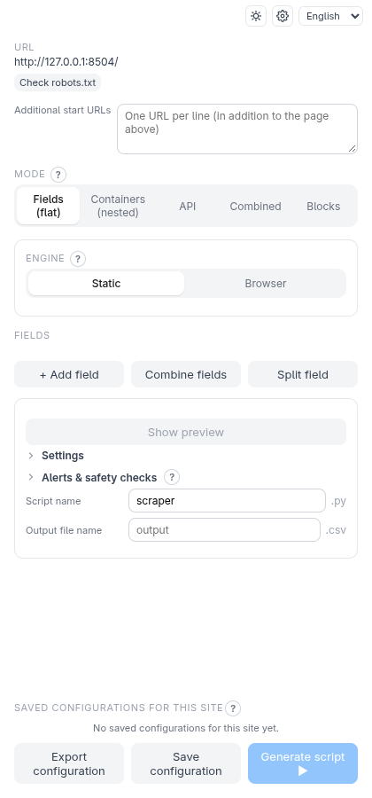
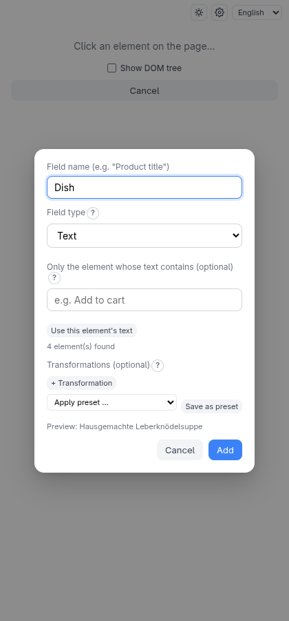
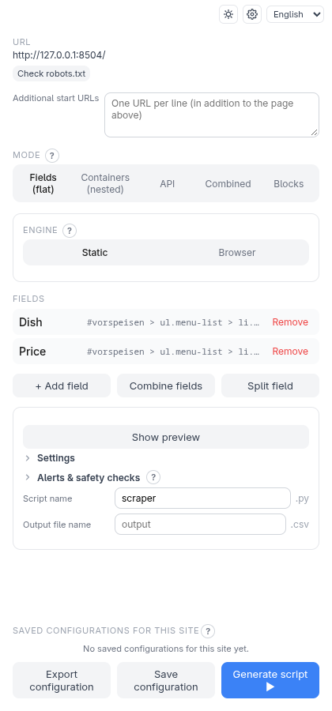
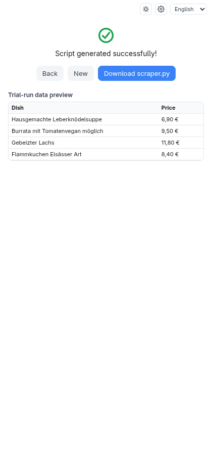

# Getting started

This page takes you from nothing to a working scraper in about ten minutes.

## What you need

- A Chromium-based browser: Chrome, Edge or Opera.
- **Python 3.9 or newer** on your computer. The companion runs your script once
  as a test, so Python has to be there.
- The Scraping Factory **release bundle** for your system (Linux, macOS or
  Windows), from the project's GitHub *Releases* page.

## 1. Install the companion

Unpack the bundle and, in that folder, run the installer.

**Linux / macOS**

```bash
./install.sh --autostart
```

**Windows** (PowerShell)

```powershell
powershell -ExecutionPolicy Bypass -File .\install.ps1 -Autostart
```

The installer copies the companion into your user folder, creates a private
Python environment with the packages scripts need, starts the companion and —
with `--autostart` — starts it every time you log in. Running it again updates
an existing installation. The bundle's own `INSTALL.md` lists every option
(for example `--browser-engine`, needed for pages that must run in a real
browser; see [Browser engine and actions](browser-engine.md)).

Check that it runs: open <http://localhost:5000/health> in your browser. You
should see a short JSON answer.

## 2. Load the extension

The installer prints the folder to use.

1. Open `chrome://extensions` (in Edge: `edge://extensions`).
2. Turn on **Developer mode**.
3. Click **Load unpacked** and choose the extension folder.
4. Open the extension's side panel from the toolbar icon.

If the panel says **Companion app unreachable**, see
[Troubleshooting](troubleshooting.md#the-panel-says-companion-app-unreachable).

## 3. Build your first scraper

> **Try it yourself.** From the repository root:
> `python3 -m http.server 8504 --bind 127.0.0.1 --directory test-pages/speisekarte`
> and open <http://127.0.0.1:8504/>. It is a restaurant menu — a typical
> "list of items" page. On a real site, any page with a list works the same way.

Open the page you want to scrape, then open the side panel. It starts on the
idle screen with the current page's address at the top:



### Pick the data you want

1. Click **+ Add field**. The panel switches to "Click an element on the page…".
2. Click the first dish name on the page. The extension works out how to find
   that kind of element and asks you to name the field.
3. Type **Dish** and confirm.



Repeat for the price: **+ Add field**, click the first price, name it **Price**.



You only click the *first* example. The script finds every element that looks
the same, so you get one row per dish.

### Generate the script

Click **Generate script ▶**. The companion builds the script and runs it once
against the live page. When that works you land on the done screen, and you can
download the script.

To see what the trial run actually scraped, turn on **Show trial-run data
preview** in the **Settings** screen (the gear icon) before generating:



### Run the script

Download the script (it is named after the **Script name** field, `scraper.py`
by default) and run it:

```bash
pip install requests beautifulsoup4
python scraper.py
```

It writes `output.csv` next to itself, one row per dish.

## Help right where you need it

The panel keeps one short title per option. The explanation — what it does, an
example, what to watch out for — is behind the small **?** next to the title: click
it (or press Enter on it) to open it, press Escape or click elsewhere to close it.
Its **Learn more** link opens the matching page of this documentation in a new tab;
the pages are bundled inside the extension, so this works without an internet
connection.

On the **Settings** screen (the gear icon) the lists — output layouts,
transformation presets and saved configurations — and the connection settings sit in
collapsed sections; click a title to open it. Rarely needed options are under
**Advanced** and open by themselves when they are in use.

## What next

- Items that contain further lists (categories with dishes)? Use
  [container mode](modes.md#containers-nested).
- The page loads data with JavaScript, or sits behind a login?
  [Browser engine and actions](browser-engine.md).
- Several pages of results? [Pagination](pagination.md).
- Values like `6,90 €` that should be numbers? [Transforms](transforms.md).
