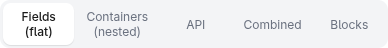
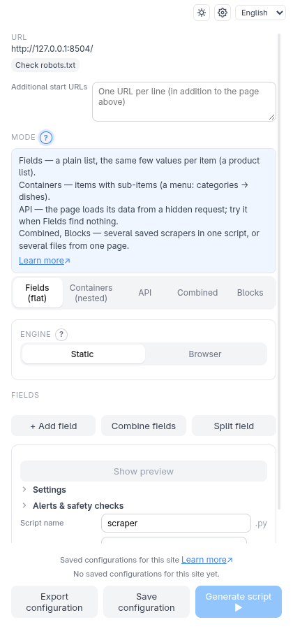
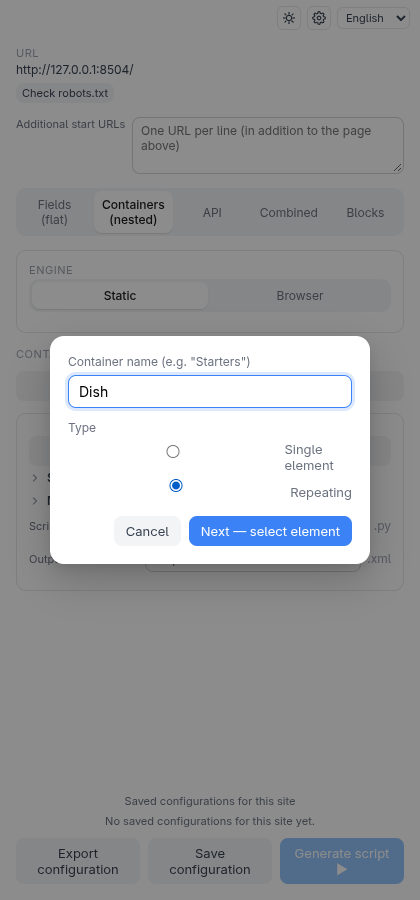
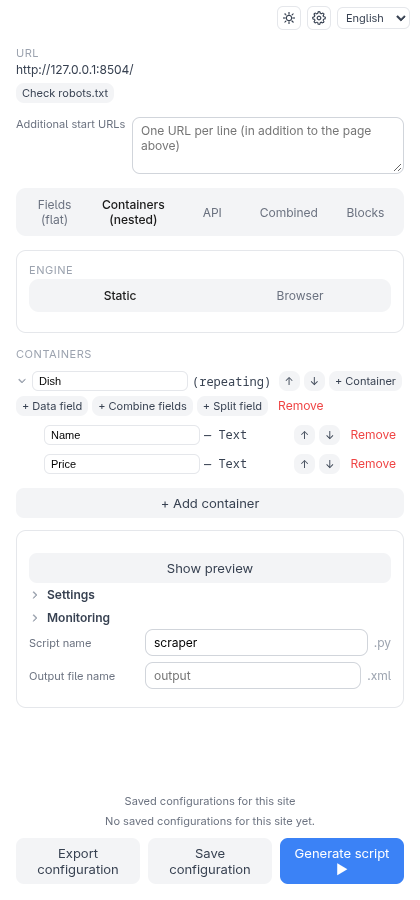
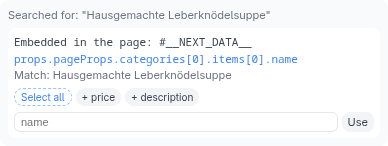
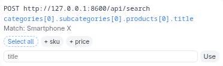
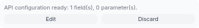
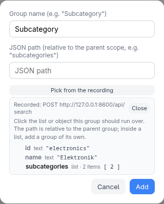

# Scraping modes

The row of buttons at the top of the idle screen chooses *how* the data is
described. The modes are separate: switching clears the configuration of the
others, so pick one per scraper.

| Mode | Use it for | Output |
| --- | --- | --- |
| **Fields (flat)** | One row per item, a few values each | CSV |
| **Containers (nested)** | Repeating groups, possibly inside other groups | XML |
| **API** | Data that comes from a JSON request the page makes | CSV (XML for nested JSON) |
| **Combined** | Merge several already-saved scrapers into one script | JSON |
| **Blocks** | Several differently-shaped outputs from one page | one file per block |

Any mode can be switched to JSON, SQLite or Excel output; see
[Output formats](output.md).

Not sure which one fits? Click the **?** next to **Mode** — it gives a one-line
"which fits?" with an example for each. The same kind of **?** sits next to
**Engine**, the container **Type** and the **Field type**, so the decision is
explained where you make it.

## Fields (flat)

The simplest mode, covered step by step in [Getting started](getting-started.md).
Click **+ Add field**, click an element, name it. Each field becomes a column.

Two extras sit next to **+ Add field**: **Combine fields** (join several fields
into one value) and **Split field** (take one part of a field). They work on
fields you already have, and have no page click.

## Elements that look alike

When several similar elements — buttons, links — can only be told apart by their
label, fill in **Only the element whose text contains** in the field dialog, or
click **Use this element's text**. Capitals and extra spaces don't matter; leave
it empty to keep the selection as it is.

## Containers (nested)

Use this when the page is a *tree*: categories that contain dishes, products
that contain reviews. You describe it as nested **containers** and **fields**.

> **Try it yourself.** Same fixture as in Getting started:
> `python3 -m http.server 8504 --bind 127.0.0.1 --directory test-pages/speisekarte`.

1. Switch to **Containers (nested)** and click **+ Add container**.
2. Name it **Dish**. Choose **Repeating** — the container appears many times on
   the page (once per dish). Choose **Single element** for something that exists
   once.
3. Click **Next — select element**, then click one whole dish on the page. Click its *edge or padding*, not the text
   inside it, so the container is the dish itself and not one of its pieces.
4. On the new container's row click **+ Data field**, click the dish name, name
   it **Name**. Repeat for the price.

The result is a tree. Field clicks inside a container are limited to that
container, and the selector works for whichever dish you clicked in:

You choose **Single element** or **Repeating** before clicking, so the extension
checks your choice against what the click matched: several matches for a *single*
container, or just one for a *repeating* one, show a notice right after the pick.
The "(single)" / "(repeating)" label in the tree is a button — click it to switch
the type later.

Every row can be renamed in place and reordered with the arrow buttons. A field
has a type: **Text**, **Attribute** (for example a link's address or an image's
source), **Exists?** (is the element there at all), or **Own text only** (only the
element's own text, leaving out badges nested inside it).

Containers can hold further containers via **+ Container**, as deep as the page
goes.

## API

Many pages load their data from a JSON request instead of putting it in the
HTML. API mode finds that request for you:

1. If the page loads its data by itself, click **Start network recording**, then use
   the page (scroll, open a tab) so it makes its requests. Skip this step when the
   page already contains its data (see below).
2. Click **Find data point**, then click a value on the page. The extension
   searches the recorded responses *and* the JSON inside the page itself for it,
   and lists every hit with where it was found: **Recorded request: …** or
   **Embedded in the page: …** (recorded ones first).

   

   Each match is a card with a name field and **Use**. Leave the name empty and
   **Use** takes it from the request itself — the last key of the path, so
   `products[0].title` becomes `title` (the field shows it in grey). A name you
   type wins. If the name is already taken, a counter is added (`title_2`).

   

3. On the API screen, decide for each part of the request address whether it is
   fixed or **variable** (a list of values, a second endpoint that supplies the
   values, or a range such as ISO weeks), and name your fields.

After **Apply** the main screen shows the API panel. **Edit** reopens the screen
exactly as you applied it — rename a field, change a transform, add a field or a
group from the recording with **+ Data field** / **+ Group** — and **Apply** confirms
again. **Cancel** drops the changes and keeps the previous configuration.
**Discard** removes the configuration completely.

**Edit** is only there for a configuration you applied in this session. A
configuration you loaded from **Saved configurations** or imported shows a note
instead: discard it and pick again to change it.

Each **?** on that screen explains the concept in place: what a **variable** URL
part is, what each value source does (with an example), what **→ Variable** does to
a request-body value. All value sources — **Value list**, **List from another
request**, **Range** and **Collect from the page (browser)** — are plain options of the
parameter's card (the **token value** joins them when a login token is set up), and
a body value's **value type** is under its own **Advanced**.

### Range values and `today`

The **Range** value source counts through values for one part of the request address: ISO
weeks (`2026-W30`), plain numbers or dates. Type the start into **From** and the end into
**To**; the format line below them shows how a value has to look.

The word **`today`** works as a boundary, and it is resolved when the script *runs*, not
when it is generated — so a saved configuration always counts up to the current week or
day:

| Type | `today` in **From** | `today` in **To** |
| --- | --- | --- |
| **IsoWeek** | yes: the current ISO week | yes |
| **Date** | no | yes: the day the script runs |
| **Number** | no | no |

**Example.** A page loads its weekly figures from `/api/weeks/{week}`. Choose **Range**,
type `IsoWeek`, **From** `2026-W30` and **To** `today`: every run requests all weeks from
week 30 up to the current one. With **From** `today` and **To** `today` (IsoWeek) the
range is exactly one value, the current week — a handy "just the latest data" setup. For
dates, **To** `today` gives every day up to the day of the run, but the start must be a
real date.

### Picking JSON paths

You never have to type a JSON path. Wherever one is asked — a group's path, the
cursor and "has more pages" paths, the request-body field a cursor goes into, the
path to a login token — **Pick from the recording** shows the recorded response (or
request body) as a small tree. Click a value and its path is filled in.

- A group's path is relative to its parent group, so the tree starts at the parent's
  first entry; lists are offered as a whole (what is inside a list belongs in a
  group of its own).
- For a cursor, a flag or a token, click the value itself. A list is shown through
  its first item.
- For the request body, only fields you can reach without going through a list are
  offered.
- A very large response is not kept in full and can't be shown; then the picker says
  so and you type the path (**Detect from recording** still works for cursors and
  tokens). With nothing recorded at all it points you back to **Start network
  recording**. For a page's own embedded JSON the tree is read from the page itself.

The rarely needed options — an **auth bootstrap** (a token fetched by a login
request first), **cursor** pagination and **Link-header** pagination — sit under
their own **Advanced** lines, each saying in one sentence when it applies. They open
by themselves once switched on, and the Link-header one when the recording shows a
`Link: rel="next"` header.

Some sites put all their data in the page itself (Next.js and similar). Those need no
recording: **Find data point** finds the value in the page's own JSON, and the script
then fetches the page like any other URL.

API mode produces a script that needs only `requests` — no browser. See
[Network settings](network-settings.md) for headers and tokens.

## Combined

Pick two or more of your [saved configurations](saved-configurations.md) —
they can be for entirely different sites — and put them in order. One script
runs each and merges all results into a single `output.json`, keyed by each
component's name (editable). If a component fails or finds nothing, the whole
run fails and says which one.

## Blocks

Use this when *one page* should feed several outputs, for example a flat list of
offers and a nested list of categories. You build each block against the open
page (flat fields or containers), click **+ Add block**, and repeat. At least
two blocks are needed. The script loads the page once and writes one file per
block.
