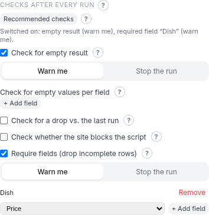

# Hardening and monitoring

A scraper you run on a schedule can break quietly: a site redesign changes a
class name, and the script keeps "succeeding" with an empty file. The
**Monitoring** section of the idle screen (collapsed by default) makes the
*generated script itself* notice — on every run, not just during the trial.

This only matters if you run the script **again and again** (for example every
night): it tells you when the website changed and your script stopped working.
Every check has a **?** with a one-line purpose and an example.

## Recommended checks

Not sure where to start? **Recommended checks** switches on two things in one click:
a warning when the run found **nothing at all**, and a warning for rows missing their
**first field** (usually the name or ID that makes a row meaningful — those rows are
then left out of the file). Checks you already set up are left alone, and clicking
again changes nothing.

## Hardening checks

Each check is switched on independently, and you choose what happens when it fails:

- **Warn me** — the run finishes normally and a message is printed.
- **Stop the run** — the run is marked as failed, so a scheduler or monitoring tool
  notices: the script exits with its own code, **2** (an unexpected crash is code 1).

| Check | Catches |
| --- | --- |
| **Check for empty result** | The run produced no rows at all |
| **Check for empty values per field** | A field's selector still matches *something*, but the value is empty too often — "*Price* is empty in more than **50** % of the rows" |
| **Check for a drop vs. the last run** | The result count fell compared with the previous run — "trigger if there are **20** % fewer rows than in the last run" (e.g. a broken "load more") |
| **Check whether the site blocks the script** | The site started blocking you but answers normally: a redirect to another host, or — under **Advanced** — a page shorter than a number of bytes (a block page is tiny: 1000 bytes is about a paragraph) or one of your phrases (`Access Denied`, …) |
| **Require fields (drop incomplete rows)** | Rows missing a required value are *removed* from the output, e.g. so a database import never meets an empty `NOT NULL` value |

Details worth knowing:

- The drop check remembers the last result count in a small file next to the
  output, and only updates it after a run that did not fail.
- The empty-value and required-field checks match fields by name across the whole
  result; in nested output, an incomplete group instance is dropped.
- Blocking detection only *reports*. It never tries to get around a block.
- A saved output can be re-checked with the current settings from the
  [saved configurations](saved-configurations.md) panel (**Test hardening**).

## Change detection

**Enable change detection (notify on changes)** compares each run's output file
with the previous run's and notifies you only when something changed — by
**Email** or **Webhook**. The first run only sets the baseline.

Every address and credential is the *name of an environment variable* that you
set where the script runs (for email: the SMTP host, port, user, password, from
and to; for a webhook: its URL). Nothing secret is stored in the script. A
failed notification only prints a warning; it doesn't fail the run.

## Check beforehand whether the page has changed

**Check beforehand whether the page has changed, and skip the run if not**
makes the script send one cheap request first and compare the page's `ETag` /
`Last-Modified` with the last successful run. If unchanged, it exits with code
**4** before doing any real work (and, for the Browser engine, before starting a
browser). If the page can't be reached it exits with code **5**. A page that
sends neither header is simply scraped normally.

## Running on a schedule

Scheduling is yours: use cron, Task Scheduler or launchd. Exit codes tell the
scheduler what happened:

| Code | Meaning |
| --- | --- |
| 0 | Success (possibly with warnings) |
| 2 | A hardening check with severity Error failed |
| 4 | Preflight: page unchanged, run skipped |
| 5 | Preflight: page not reachable |
| 78 | A required environment variable was not set |
