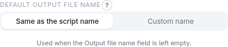

# Output formats and output layouts

## Output format

Choose the format in **Settings** (the gear icon) → **Output format**. It
applies to every scraper you build.

| Format | Written as |
| --- | --- |
| **Default (CSV, XML for nested results)** | `output.csv` for flat data, `output.xml` for nested |
| **JSON** | `output.json`: a list of records, or a nested object for nested data |
| **SQLite database** | `output.sqlite`, one table `data` |
| **Excel (.xlsx)** | `output.xlsx`, one sheet `Data` |

Notes:

- SQLite and Excel are tables. A nested result (containers, or nested API data)
  is *flattened* into one row per innermost item, with higher-level values
  repeated on every row; the extension tells you when that happens.
- Excel needs `pip install openpyxl` on the computer where the script runs — and
  on the one that runs the companion, since the trial run executes the script.
- SQLite and Excel are not available for Blocks or Combined mode and cannot be
  combined with change detection.
- The script and output file names come from **Script name** and **Output file
  name** at the bottom of the idle screen. In **Settings**, **Default script
  name** can be a fixed name or derived from the website's hostname.

Other output-related preferences in **Settings**: **Show trial-run data
preview**, **Download the full scraped data file** (the complete trial-run
output, from the done screen), **Editable config file (XML)** (see below), and **Skip the trial run** (see below).

## Default output file name

The data file a run writes is called `output` plus its extension (`output.csv`,
`output.xml`, …) unless you type an **Output file name** for the scraper. In
**Settings**, **Default output file name** sets what is used while that field is
left empty:

- **Same as the script name** — the data file is named after the script:
  `shop-example-com.py` writes `shop-example-com.csv`.
- **Custom name** — that name is used for every scraper (for example `daily-data`);
  left empty it stays `output`, as before.

A name you type for a scraper always wins. The default is a preference of this
browser: it is not saved into a configuration or its export, and it applies when the
script is generated. Both kinds of name are cleaned up the same way (letters,
digits, `-` and `_`), so `Mein Skript!` becomes `Mein_Skript`. In
[Blocks mode](modes.md#blocks) every block names its own file, so the default does
not apply there.

## Skip the trial run

Normally the companion runs the generated script once against the live page
before handing it out. That proves it works, but takes time. With **Skip the
trial run (return the script immediately)** the script is returned right away,
without being run. It is still checked for structural problems (a broken URL,
duplicate or empty field names), but a wrong selector or a blocked request only
shows up when you run the script yourself. A data preview or a full output file
is not available while this is on.

## Editable config file

**Editable config file (XML)** lets you change a few
things *after* generating, without touching the `.py` file or reopening the
extension: the start URL(s), the output file name, a field's output name (flat
mode), and the values of a fixed-value-list API parameter. The file doesn't exist
yet when you download the script — the script creates it next to itself the first
time it runs, and reads it on every run after that. An invalid file stops the run
with a clear message (exit code 3).

## Append instead of replace

**Append to the existing output file instead of replacing it** makes every run
add to the file the earlier runs left, for any format — useful for a price
history. If the existing file has different columns, it keeps its own, adds new
ones, and leaves gaps empty. A file it can't read stops the run (exit code
**10**) without touching it.

## Remove duplicates

**Remove duplicates** drops a later row whose key (one or
several fields) already appeared. With **Only write new items since the last
run** the script remembers the keys it has seen in a small file and writes only
new items — either just the new ones, or appended to the growing file. Pick the
field(s) that identify an item (together they form its key); items whose key
fields are all empty are never removed. This also helps with overlapping pages
and items reachable from several start URLs.

The remembered keys live in a small file next to the output (the output file name
plus `.dedup-seen.json`); delete it to start over. How long items are remembered
(by number or by days) is under **Advanced**; the default fits almost every
scraper. The file is only updated after a run that did not fail a safety check.

## Output layouts

An **output layout** is a saved list of target field names in a fixed order — the
column set your downstream import expects. With a layout selected (**Output
layout** in the idle screen's Settings), you map each target field to one of
your scraper's fields, and the output always has exactly those names in exactly
that order, whichever scraper produced it.

Create and edit layouts under **Settings → Output layouts**. You can type
the fields, or **paste or upload a sample** (a JSON object, a CSV header row or a
list of names) and **Parse & fill fields**.

A layout can be **Flat** or **Tree** (nested target structure). Nested
scraper output can be mapped onto a flat layout — it is flattened into rows —
or onto a tree layout, where each target group draws from its own source
group.

Output layouts are not available for Combined and Blocks mode.
