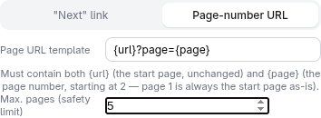

# Pagination

Results often span several pages. **Pagination** (in the **Settings** section of
the idle screen, hidden in API mode) makes the script keep going from the start
page — page 1 is always the start URL exactly as given.

Turn on **Enable pagination** and choose how the next page is found.

## "Next" link

Pick the "next page" link by clicking it, or type a CSS selector such as
`a.next`. The script follows that link's address page after page, until the
link is gone, a page yields no results, or **Max. pages (safety limit)** is
reached.

## Page-number URL

If page numbers appear in the address, give a **Page URL template** with two
placeholders:

- `{url}` — the start URL, unchanged
- `{page}` — the page number, starting at **2**

For example `{url}?page={page}`:

> **Try it yourself.** The fixture used here is a static page, so it only shows
> the settings; point it at a real paginated list to see several pages scraped.
> `python3 -m http.server 8504 --bind 127.0.0.1 --directory test-pages/speisekarte`

## Good to know

- **Max. pages** is always active (default 50). It protects against a link that
  never runs out.
- It works with both engines and with several start URLs: each start URL is
  paginated on its own.
- It is for classic page-by-page navigation. For infinite scroll or "load more"
  buttons on a single page, use the **Scroll** action
  ([Browser engine](browser-engine.md#scroll)). For APIs, use a numeric range
  parameter ([API mode](modes.md#api)).
- **Additional start URLs** (a text box under the page address) lets you scrape
  several fixed pages in one run. **Discover additional start URLs
  automatically** harvests links from a navigation page for you instead.
