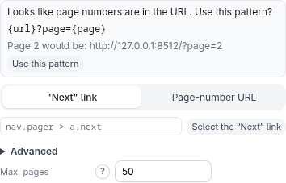

# Pagination

Results often span several pages. **Pagination** (in the **Settings** section of
the idle screen, hidden in API mode) makes the script keep going from the start
page — page 1 is always the start URL exactly as given.

Turn on **Enable pagination** and choose how the next page is found.

## "Next" link

Click **Select the "Next" link**, then click the "next page" link on the page. The
script follows that link's address page after page, until the link is gone, a page
yields no results, or **Max. pages** is reached. (The CSS selector the click produced
is an editable detail under **Advanced**.)

## Page-number URL

If page numbers appear in the address, the script can build the address of page 2, 3, …
from a **Page URL pattern**. You don't have to know how the site writes it: the
extension **proposes a pattern** when it can learn it from

- the **"Next" link** you picked (it looks at where that link goes),
- a link to **page 2** you click with **Click a link to page 2 to learn the pattern**, or
- the start URL itself, when it already says page 1 (`?page=1`, `/page/1/`).

**Use this pattern** switches to **Page-number URL** and fills the pattern in; nothing is
applied until you click it. Examples it recognises: `?page=2`, `&p=2`, `?seite=2`,
`/page/2/`, `/seite/2`. Anything unclear (page numbers that start at 0, offsets, several
candidate parameters) gets no proposal rather than a guess.

You can also write the pattern yourself. It has up to two placeholders (the **?** next to
the field explains them):

- `{page}` — the page number, starting at **2** (page 1 is always the start page)
- `{url}` — the start URL, unchanged (optional)

For example `{url}?page={page}`, or, for a start URL that already says `?page=1`,
`https://example.com/list?page={page}`. With **several start pages** (additional or
discovered start URLs) `{url}` is required, so each start page is paginated on its own;
the extension then only proposes patterns that contain it.

> **Try it yourself.** `python3 test-pages/paginated-listing/server.py` serves two lists
> of three pages (`http://127.0.0.1:8512/` with `?page=N` and `/blog/` with `/page/N/`)
> with a "Next »" link on each page.

## Good to know

- **Max. pages** is a safety limit, always active (default 50): the script stops after
  that many pages even if there are more, and earlier as soon as a page has no results
  or the "Next" link is gone. It protects against a list that never runs out.
- It works with both engines and with several start URLs: each start URL is
  paginated on its own.
- It is for classic page-by-page navigation. For infinite scroll or "load more"
  buttons on a single page, use the **Scroll** action
  ([Browser engine](browser-engine.md#scroll)). For APIs, use a numeric range
  parameter ([API mode](modes.md#api)).
- **Additional start URLs** (a text box under the page address) lets you scrape
  several fixed pages in one run. **Discover additional start URLs
  automatically** (under **Advanced: find start pages automatically**) harvests links
  from a navigation page for you instead: pick one link in the menu and every similar
  link becomes a start page.
