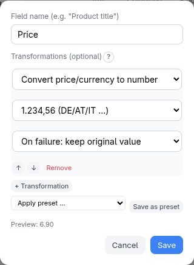
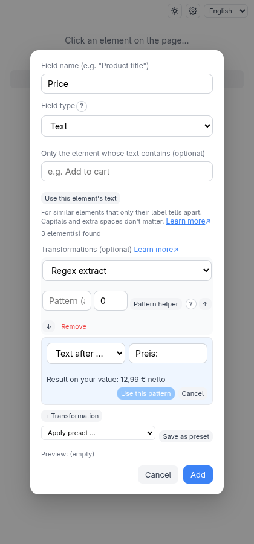
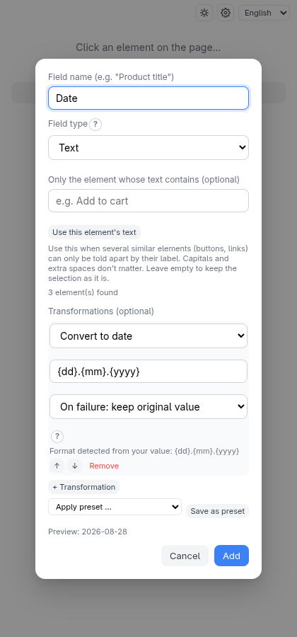

# Transforms and presets

Scraped text is rarely clean: `"  Preis: 12,99 €  "` is not a number. A
**transform chain** is an ordered list of small clean-up steps applied to a
field's value before it is written. You add them when naming a field, in the
**Transformations (optional)** list.

## Example: a price as a number

> **Try it yourself.**
> `python3 -m http.server 8504 --bind 127.0.0.1 --directory test-pages/speisekarte`

Add a field, click the first price (`6,90 €`) and name it **Price**. Then click
**+ Transformation** twice and choose **Trim (remove whitespace)** and
**Convert price/currency to number** with the format `1.234,56 (DE/AT/IT …)`.

The line **Preview: 6.90** shows what the chain produces for the element you
clicked, live, as you edit. The result in the output is `6.90`.

## Changing a field later

Every field row has an **Edit** button (in container mode, on the field's row in the
tree). It reopens the field's dialog with its name and chain filled in, so you can
add, remove, reorder or change steps without picking the element again. **Save**
changes the field in place; **Cancel** leaves it as it was.

- The **Preview** works as when the field was created, because the extension keeps
  the value of the element you picked. A configuration you loaded from **Saved
  configurations** or imported has no such value, so it shows no preview.
- Only the name and the chain are editable. The element, its type (text or
  attribute), downloads and the "contains text" filter belong to the pick: to change
  them, remove the field and pick the element again.
- A **combined** or **split** field opens its own dialog, prefilled. It can only
  read fields listed above it, so only those are offered as sources.
- A field that a combined or split field reads from keeps its name (the dialog says
  so), because renaming it would break that field.

## The steps

| Step | Does |
| --- | --- |
| **Trim (remove whitespace)** | Removes spaces at both ends |
| **Regex extract** | Keeps the part matching a pattern (and optional group) |
| **Find/replace** | Replaces text |
| **Convert to number** | Best-effort conversion, handles `12,99` and `12.99` |
| **Convert to integer / boolean / date** | Strict conversions |
| **Convert price/currency to number** | Number from an amount, with an explicit format |

The strict conversions refuse values that aren't well formed instead of
guessing. For each, choose **On failure: keep original value** or **On failure:
use default value**. **Convert to date** reads a format like
`{dd}.{mm}.{yyyy}` and writes ISO `yyyy-mm-dd`.

**Convert price/currency to number** is explicit because `1.234` is ambiguous:
a thousand in Germany, a little over one in the US. The four formats
(`1.234,56`, `1,234.56`, `1 234,56`, `1'234.56`) remove the guesswork. Only the
amount is produced; the currency symbol is not extracted.

### Pattern helper (Regex extract)

Most prices, numbers and IDs sit inside other text. **Regex extract** pulls out the
part you want with a *pattern* — but you don't have to write one. Click **Pattern
helper** next to the pattern, choose what to extract, and type only the text around
it:

| Recipe | Gives you | Example |
| --- | --- | --- |
| First number | the first number, with decimals and a sign | `Preis 12,99 EUR` → `12,99` |
| First run of digits | the first group of digits | `Art.-Nr. 4711-B` → `4711` |
| Text after … | everything after your text | after `Preis:` in `Preis: 12,99 €` → `12,99 €` |
| Text before … | everything before your text | before `€` in `12,99 € netto` → `12,99` |
| Text between … and … | what sits between two texts | between `(` and `)` in `Müller (Berlin)` → `Berlin` |
| Text inside brackets | what is inside `( )`, `[ ]`, `{ }` or `< >` | `Preis (inkl. MwSt.)` → `inkl. MwSt.` |

The helper shows **the result on your real value** as you type. **Use this pattern**
then writes the pattern into the (still editable) **Pattern (advanced)** field. Your
text is taken literally — symbols like `.`, `(` or `$` are not special. **Part to
keep** says which bracketed part of the pattern becomes the value (0 = the whole
match). Need two cuts? Add a second **Regex extract** step, for example "Text after
`Preis:`" followed by "Text before `€`".

### Date format guess (Convert to date)

When you choose **Convert to date**, the format is filled in from the value you
picked: `28.08.2026` → `{dd}.{mm}.{yyyy}`, `2026-08-28` → `{yyyy}-{mm}-{dd}`,
`08/28/2026` → `{mm}/{dd}/{yyyy}`. A value that could be day-first or month-first
(`03/04/2026`) is read day-first, and the hint names the other reading. The hint
below the format says what was detected; edit the format if it's wrong.

Only all-numeric dates work — month names such as `28 Aug 2026` are not supported,
and a date with other text around it (`Stand: 28.08.2026`) gets no guess; cut the date
out first with a **Regex extract** step.

Steps run top to bottom; use the arrows to reorder. Transforms are available in
flat mode, container mode and API mode (the **Transform** button next to a field
in the API tree).

## Presets

Built a chain you will want again? Click **Save as preset**, name it, and
later pick it from **Apply preset …** on any field of any scraper. Applying
**adds a copy** of the steps to the chain; it never replaces what is there, and
editing the copy doesn't change the preset.

Two built-in presets — **Clean up price (1.234,56)** and **Clean up price
(1,234.56)** — work without the companion. Saved presets live in the
companion's store, and are renamed or deleted in **Settings → Transformation
presets**. Steps that reference other fields (combine/split) can't be saved in a
preset.

## Combine and split fields

To build a value from other fields — a full address from street and city, or
just the house number from an address — use **Combine fields** and **Split
field** next to **+ Add field**. They take no page click. Tick **Remove the
original fields from the output** to keep the sources out of the file while
still using them.
