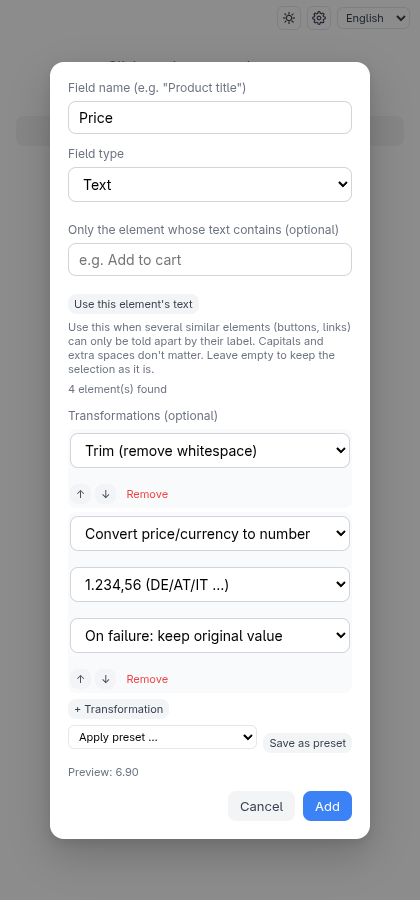

# Transforms and presets

Scraped text is rarely clean: `"  Preis: 12,99 €  "` is not a number. A
**transform chain** is an ordered list of small clean-up steps applied to a
field's value before it is written. You add them when naming a field, in the
**Transformations (optional)** list.

## Example: a price as a number

> **Try it yourself.**
> `python3 -m http.server 8504 --bind 127.0.0.1 --directory test-pages/speisekarte`

Add a field, click the first price (`6,90 €`) and name it **Price**. Then click
**+ Transformation** twice and choose **Trim (remove whitespace)** and
**Convert price/currency to number** with the format `1.234,56 (DE/AT/IT …)`.

The line **Preview: 6.90** shows what the chain produces for the element you
clicked, live, as you edit. The result in the output is `6.90`.

## The steps

| Step | Does |
| --- | --- |
| **Trim (remove whitespace)** | Removes spaces at both ends |
| **Regex extract** | Keeps the part matching a pattern (and optional group) |
| **Find/replace** | Replaces text |
| **Convert to number** | Best-effort conversion, handles `12,99` and `12.99` |
| **Convert to integer / boolean / date** | Strict conversions |
| **Convert price/currency to number** | Number from an amount, with an explicit format |

The strict conversions refuse values that aren't well formed instead of
guessing. For each, choose **On failure: keep original value** or **On failure:
use default value**. **Convert to date** reads a format like
`{dd}.{mm}.{yyyy}` and writes ISO `yyyy-mm-dd`.

**Convert price/currency to number** is explicit because `1.234` is ambiguous:
a thousand in Germany, a little over one in the US. The four formats
(`1.234,56`, `1,234.56`, `1 234,56`, `1'234.56`) remove the guesswork. Only the
amount is produced; the currency symbol is not extracted.

Steps run top to bottom; use the arrows to reorder. Transforms are available in
flat mode, container mode and API mode (the **Transform** button next to a field
in the API tree).

## Presets

Built a chain you will want again? Click **Save as preset**, name it, and
later pick it from **Apply preset …** on any field of any scraper. Applying
**adds a copy** of the steps to the chain; it never replaces what is there, and
editing the copy doesn't change the preset.

Two built-in presets — **Clean up price (1.234,56)** and **Clean up price
(1,234.56)** — work without the companion. Saved presets live in the
companion's store, and are renamed or deleted in **Settings → Transformation
presets**. Steps that reference other fields (combine/split) can't be saved in a
preset.

## Combine and split fields

To build a value from other fields — a full address from street and city, or
just the house number from an address — use **Combine fields** and **Split
field** next to **+ Add field**. They take no page click. Tick **Remove the
original fields from the output** to keep the sources out of the file while
still using them.
