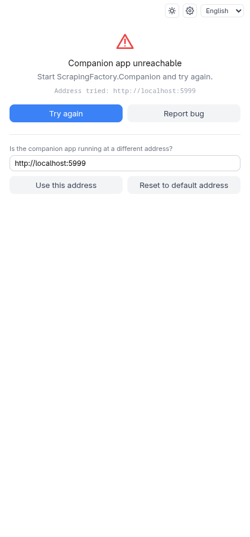
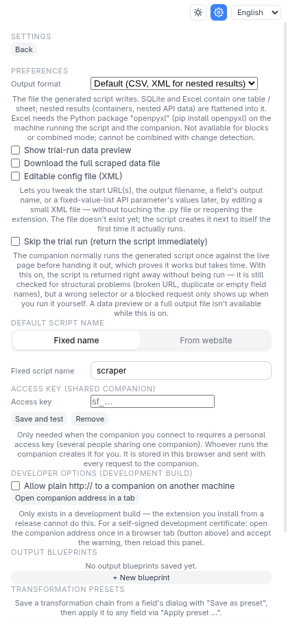

# Troubleshooting and FAQ

## The panel says "Companion app unreachable"

The extension can't reach the companion. In order:

1. Is the companion running? Open <http://localhost:5000/health> — you should
   see JSON. If not, start it (the installer's `--autostart` does this at login),
   or from a checkout: `dotnet run --project companion/ScrapingFactory.Companion`.
2. Is it on another port or machine? Enter its address under **Is the companion
   app running at a different address?** and click **Use this address**; **Reset
   to default address** goes back to `http://localhost:5000`.
3. Plain `http://` is only accepted for this machine; an address on another
   machine must use `https://`.

## "This companion requires an access key" / "access key is not valid"

The companion has authentication turned on. Open **Settings** and sign in, or
paste your key under **Access key** and **Save and test**. See
[Accounts and access keys](authentication.md).

## Generate fails

The companion runs your script once before giving it to you, so a failure message
is the real script's. Common ones:

| Message says | Usually means | Try |
| --- | --- | --- |
| The script produced no data | A selector matches nothing on the page the script fetches | Use **Show preview** and the *N element(s) found* hint; for JavaScript pages switch to the [Browser engine](browser-engine.md) |
| Request … failed: HTTP 401 / 403 | The site needs a login or blocks scripts | A [login flow](browser-engine.md#a-login-flow), or a [custom header](network-settings.md#custom-request-headers) such as a cookie |
| … HTTP 429 | Rate limited | [Pause between requests](network-settings.md#pause-between-requests) and [retries](network-settings.md#retry-on-transient-errors) |
| … HTTP 404 | Wrong start URL | Check the address at the top of the panel |
| required environment variable … is not set | A **Fill** action, header or other option reads a variable | Set it where the script runs; type a **Test value** for the trial run |
| exceeded the timeout | The trial run took too long | Fewer pages/requests, or **Skip the trial run** in Settings |

A **warning toast** that verification was skipped means the estimated trial run
was too long (over ten minutes) or you chose to skip it. The script was
validated but not run.

## Why did I get a different page than the one I clicked on?

The panel scrapes the address shown at the top. If you navigate the tab while
the panel is open, it corrects itself the next time you pick an element and
tells you so.

## The selector works in my browser but not in the script

The script's HTML parser doesn't run JavaScript. If the element only exists
after scripts run, use the Browser engine. To tell identical buttons or links
apart by their label, use **Only the element whose text contains** in the field
dialog.

## The data preview or Show preview shows nothing

**Show preview** highlights matches on the live page; an element only present
after a hover or a click won't be found. For container mode, field picks are
limited to the container you clicked in.

## Script exit codes

| Code | Meaning |
| --- | --- |
| 0 | Success |
| 1 | Unhandled error (a bug or unexpected failure) |
| 2 | A hardening check with severity Error failed |
| 3 | The editable config file is invalid |
| 4 / 5 | Preflight: page unchanged / not reachable |
| 6 | Auth bootstrap request failed (API mode) |
| 7 | A page or API request failed (HTTP error, unreachable) |
| 8 | A needed Python package (e.g. `openpyxl`) is missing |
| 9 | robots.txt disallowed a request and the action is **Stop the run** |
| 10 | The existing output file can't be appended to |
| 78 | A required environment variable is not set |

## Reporting a bug

On an error toast, **Report bug** collects the extension's log and pre-fills a
GitHub issue. **Export configuration** gives you a JSON of your setup to attach.
Please remove any secret before posting.
